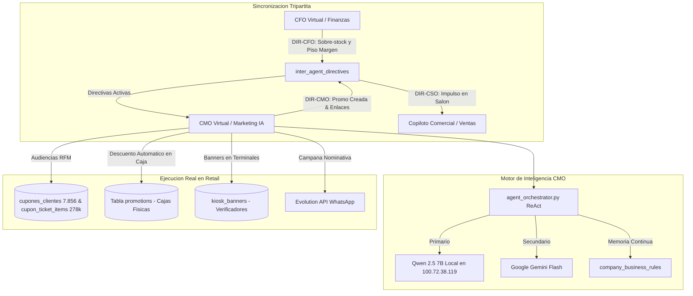

# Rediseño Integral del Gerente de Marketing IA (CMO) e Interconexión Tripartita - Implementation Plan

> **For agentic workers:** REQUIRED SUB-SKILL: Use superpowers:subagent-driven-development to implement this plan task-by-task. Steps use checkbox (`- [ ]`) syntax for tracking.

**Goal:** Transformar al Gerente de Marketing IA (CMO Virtual) en un operador estratégico autónomo de retail que explota los 7.856 clientes y 278.020 tickets de fidelización reales de Extra Supermercado, conectado al CFO Virtual y al Copiloto Comercial mediante un bus vivo de directivas, memoria corporativa continua y un motor híbrido ReAct (Qwen 2.5 7B Local + Gemini).

**Architecture:**
El módulo se estructura sobre un Orquestador ReAct (`agent_orchestrator.py`) que invoca a Qwen 2.5 7B en Ollama local (`100.72.38.119:11434`) con fallback a Gemini y a PostgreSQL. Consume las directivas de sobre-stock y piso de margen de `inter_agent_directives` y `finance_agent`, cruza los productos a liquidar con los hábitos de compra de `cupones_clientes` y `cupon_ticket_items`, genera promociones reales en la tabla `promotions` del POS, publica creativos en los Kioscos verificadores de precios y graba reglas aprendidas en `company_business_rules`. La interfaz se rediseña como una Sala de Comando Ejecutivo con sincronización tripartita en tiempo real.

**Architecture Diagram:**

**Tech Stack:**
- Backend: FastAPI, SQLAlchemy Async, PostgreSQL, Qwen 2.5 7B (Ollama API), Google Gemini (google-genai / HTTP), Evolution API.
- Frontend: React 18, TypeScript, Tailwind CSS, Lucide React, Glassmorphism design tokens.
- Servidor: Linux VM (`intellihouse@100.83.91.76` / `192.168.0.10`).

**Spec:** [docs/superpowers/specs/2026-10-11-cmo-virtual-redesign-spec.md](file:///Users/gustaquevedo/Library/CloudStorage/OneDrive-Personal/Dev/Intelimarket/docs/superpowers/specs/2026-10-11-cmo-virtual-redesign-spec.md)

---

## Global Constraints
- **Regla 1 (Estricta):** PROHIBIDO modificar o tocar archivos de `POS` (`ui-web/src/pages/pos/`) o `Electron` (`electron/`).
- **Regla 4 (Estricta):** Rama activa es `vertical/supermercado`.
- **Regla 5:** Zona horaria inmutable `America/Asuncion` (UTC-4 / UTC-3).
- **Regla 7:** Despliegues Zero-Downtime mediante `bash deploy-api.sh` y `bash deploy-ui.sh`.
- **Regla 10:** Guaraníes enteros sin decimales (`formatPYG()`).

---

## Tareas de Implementación

### Tarea 1: Backend — Esquemas y Servicio de Segmentación RFM Real con Fidelización
**Archivos:**
- `api/src/marketing_agent/schemas.py`
- `api/src/marketing_agent/service.py`

- [ ] **Paso 1.1:** Definir esquemas para Segmentos RFM Reales (`CustomerRFMSummary`, `CustomerProfileDetail`), Directivas Tripartitas (`DirectiveSummary`, `ActionProposal`) y Memoria de Negocio (`LearnedRuleItem`).
- [ ] **Paso 1.2:** Implementar en `service.py` la función `get_real_rfm_segments()` consultando `cupones_clientes`, `cupon_tickets` y `cupon_ticket_items`, agrupando por Recencia (días sin comprar), Frecuencia (cantidad de tickets) y Monto (gasto acumulado en Guaraníes).
- [ ] **Paso 1.3:** Implementar en `service.py` la búsqueda de clientes afines a un producto o categoría específica (ej: clientes con compras previas de carnicería o cervezas) para cruzar con sobre-stock del CFO.
- [ ] **Paso 1.4:** Verificar la consulta en la VM de producción asegurando que devuelva métricas reales sobre los 7.856 clientes y 278k líneas en menos de 1 segundo.

---

### Tarea 2: Backend — Orquestador de Inteligencia Híbrida ReAct y Memoria Continua
**Archivos:**
- `api/src/marketing_agent/agent_orchestrator.py`
- `api/src/marketing_agent/router.py`

- [ ] **Paso 2.1:** Crear `api/src/marketing_agent/agent_orchestrator.py` implementando el ciclo ReAct con herramientas:
  - `get_cfo_directives`: Lee directivas vivas de `inter_agent_directives` y sobre-stock de `finance_agent`.
  - `get_rfm_customer_segments`: Recupera segmentos reales.
  - `create_pos_promotion`: Inserta/activa la regla en la tabla `promotions` de PostgreSQL para que los POS descuenten en caja.
  - `publish_kiosk_banner`: Publica banners en verificadores de precios.
  - `send_whatsapp_campaign`: Despacho por Evolution API.
  - `record_learned_rule`: Inserta reglas de negocio en `company_business_rules` con categoría `marketing` para memoria permanente.
- [ ] **Paso 2.2:** Configurar la llamada a Ollama Qwen 2.5 7B en `http://100.72.38.119:11434/api/chat` con inyección de memoria histórica de `company_business_rules`.
- [ ] **Paso 2.3:** Implementar fallback transparente a Gemini y fallback determinístico SQL si no hay conectividad a Ollama.
- [ ] **Paso 2.4:** Agregar endpoints en `router.py`:
  - `POST /api/marketing-agent/chat`: Chat con el agente ReAct.
  - `GET /api/marketing-agent/tripartite-sync`: Estado vivo de la tríada (CFO - CMO - CSO).
  - `POST /api/marketing-agent/approve-directive`: Aprobación y ejecución 1-clic de propuesta inter-agente.
  - `GET /api/marketing-agent/learned-rules`: Historial de memoria continua y buenas prácticas aprendidas.

---

### Tarea 3: Backend — Motor de Monitoreo Continuo e Interconexión con CFO y Copiloto
**Archivos:**
- `api/src/marketing_agent/service.py`
- `api/src/finance_agent/service.py`

- [ ] **Paso 3.1:** Crear la función `evaluate_marketing_opportunities()` que cruce automáticamente el sobre-stock del CFO con las audiencias de cupones y determine si hay oportunidades de combo con margen protegido.
- [ ] **Paso 3.2:** Integrar el registro bidireccional en `inter_agent_directives`: cuando el CMO lanza una promo, emitir directiva `DIR-CMO-xxx` para el Copiloto Comercial informando a las cajas y al salón.
- [ ] **Paso 3.3:** Validar consistencia y ejecutar pruebas con script python en la VM.

---

### Tarea 4: Frontend — Rediseño de la Sala de Comando Ejecutivo Tripartita
**Archivos:**
- `ui-web/src/pages/marketing-agent/MarketingAgentPage.tsx`
- `ui-web/src/api/index.ts`

- [ ] **Paso 4.1:** Actualizar cliente API en `ui-web/src/api/index.ts` con los nuevos tipos y métodos del orquestador de marketing.
- [ ] **Paso 4.2:** Diseñar la barra superior de Sincronización Tripartita (CFO: Margen y Liquidez | CMO: Promos y WhatsApp | CSO: Venta y Metas) con semáforo de alineación.
- [ ] **Paso 4.3:** Rediseñar las 5 pestañas de operación:
  - 🎯 **Comando & Directivas:** Tarjetas de acuerdos inter-agente con botón de ejecución 1-clic.
  - 👥 **Audiencias RFM Reales:** Visualización y filtrado de los 7.856 clientes reales con sus consumos y barrios en Pedro Juan Caballero.
  - 🏷️ **Promociones en POS:** Listado de promociones reales en la base de datos con toggle de activación y estadísticas de redención.
  - 🖥️ **Banners de Salón:** Gestión interactiva de banners de Kioscos.
  - 💬 **Sala de Negociación:** Chat ReAct con Qwen 2.5 + Gemini y badges de acciones ejecutadas.
- [ ] **Paso 4.4:** Eliminar el 100% de datos hardcodeados y mocks estáticos.

---

### Tarea 5: Verificación, Build y Despliegue Zero-Downtime
**Archivos:**
- Servidor de producción (`100.83.91.76`)

- [ ] **Paso 5.1:** Ejecutar `npm run build` en local para validar tipado TypeScript sin errores.
- [ ] **Paso 5.2:** Desplegar backend con `bash deploy-api.sh` en la VM (rolling reload puertos 8000 y 8010 sin cortes).
- [ ] **Paso 5.3:** Desplegar frontend con `bash deploy-ui.sh` en la VM (conmutación atómica de symlink en `/var/www/intelimarket-ui/current`).
- [ ] **Paso 5.4:** Probar el chat y la generación de promociones con datos reales y certificar que la tríada responde con coherencia comercial.
