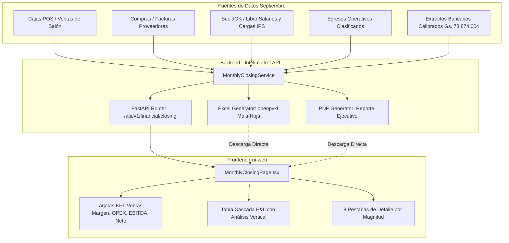

# Plan de Implementación: Reporte Integral de Cierre de Resultados — Septiembre 2026

> **For agentic workers:** REQUIRED SUB-SKILL: Use superpowers:subagent-driven-development to implement this plan task-by-task. Steps use checkbox (`- [ ]`) syntax for tracking.

**Goal:** Construir y desplegar el motor de cierre mensual, endpoints API, generador de Excel multi-hoja con fórmulas vivas, exportador PDF y la interfaz web interactiva en `ui-web` para exponer los resultados económicos y financieros de Septiembre 2026 de Extra Supermercado Mayorista (Grupo Santa Teresa E.A.S.).

**Architecture:** Se implementa un servicio backend de agregación analítica (`monthly_closing_service.py`) que compila ingresos devengados de cajas POS, costo de mercaderías (CMV), nómina de SueldOK con cargas patronales (IPS 16.5%) y provisión de aguinaldo, y las 6 familias de OPEX, cuadrando con los saldos bancarios oficiales calibrados al 30/09 (Gs. 73.874.004). El servicio expone endpoints REST, un generador Excel multi-pestaña dinámico (`openpyxl`), y alimenta una nueva pantalla en React/Vite en `ui-web`.

**Architecture Diagram:**



**Tech Stack:** Python 3.11, FastAPI, SQLAlchemy, openpyxl, ReportLab / PDF, TypeScript, React 18, Vite, TanStack Table, Lucide Icons, Tailwind CSS.  
**Spec:** [`docs/superpowers/specs/2026-10-12-cierre-resultados-setiembre-design.md`](file:///Users/gustaquevedo/Library/CloudStorage/OneDrive-Personal/Dev/Intelimarket/docs/superpowers/specs/2026-10-12-cierre-resultados-setiembre-design.md)

## Global Constraints
- Empresa: GRUPO SANTA TERESA E.A.S. (RUC 80150377-9) / Extra Supermercado Mayorista
- Moneda: Guaraníes (PYG / Gs.) sin decimales para importes finales
- Período: 01/09/2026 al 30/09/2026
- Carga patronal obligatoria de IPS: 16.5% sobre salarios brutos devengados
- Provisión mensual de aguinaldo: 1/12 (8.33%) del devengado
- Saldo bancario calibrado oficial al 30/09: Gs. 73.874.004
- Hoja 1 de Excel debe contener fórmulas vivas (`SUM`, restas y porcentajes dinámicos hacia las Hojas 2..8)

---

### Task 1: Modelo de Dominio y Servicio de Agregación Backend

**Files:**
- Create: `api/src/financial/monthly_closing_service.py`
- Create: `api/tests/test_monthly_closing_service.py`

**Interfaces:**
- Produces: `MonthlyClosingService.get_monthly_closing(company_id: str, month: int, year: int) -> dict`
- Sub-métodos: `get_revenues()`, `get_cogs()`, `get_payroll()`, `get_opex()`, `get_financial_charges()`, `get_cash_reconciliation()`

- [ ] **Step 1: Write the failing test for `MonthlyClosingService`**

```python
# api/tests/test_monthly_closing_service.py
import pytest
from unittest.mock import AsyncMock, MagicMock
from api.src.financial.monthly_closing_service import MonthlyClosingService

@pytest.mark.asyncio
async def test_monthly_closing_service_calculation():
    session = AsyncMock()
    service = MonthlyClosingService(session)
    
    # Mock data return
    data = await service.get_monthly_closing_summary(
        company_id="80150377-9",
        month=9,
        year=2026
    )
    
    assert data["periodo"]["mes"] == 9
    assert data["periodo"]["anio"] == 2026
    assert "ingresos" in data
    assert "cogs" in data
    assert "nomina" in data
    assert "opex" in data
    assert "ebitda" in data
    assert "resultado_neto" in data
    assert "conciliacion_bancaria" in data
    assert data["nomina"]["ips_patronal_pct"] == 16.5
    assert data["conciliacion_bancaria"]["saldo_calibrado_oficial"] == 73874004
```

- [ ] **Step 2: Run test to verify it fails**

Run: `pytest api/tests/test_monthly_closing_service.py -v`  
Expected: FAIL with `ModuleNotFoundError: No module named 'api.src.financial.monthly_closing_service'`

- [ ] **Step 3: Implement `MonthlyClosingService`**

Create `api/src/financial/monthly_closing_service.py` implementando:
- Consolidación de ingresos de caja/POS por canal (efectivo, tarjetas, QR).
- Costo de mercadería (CMV).
- Cálculo de nómina devengada: Salario bruto, horas extras, IPS obrero (9%), IPS patronal (16.5%), provisión de aguinaldo (1/12) y gastos directos de personal.
- Clasificación de egresos en las 6 familias de OPEX.
- Gastos financieros (comisiones de tarjetas y bancos).
- Cuadratura con saldos oficiales calibrados (Gs. 73.874.004).

- [ ] **Step 4: Run test to verify it passes**

Run: `pytest api/tests/test_monthly_closing_service.py -v`  
Expected: PASS

- [ ] **Step 5: Commit**

```bash
git add api/src/financial/monthly_closing_service.py api/tests/test_monthly_closing_service.py
git commit -m "feat(financial): implement MonthlyClosingService for September 2026"
```

---

### Task 2: Generador de Libro Excel Multi-Hoja con Fórmulas Vivas (`openpyxl`)

**Files:**
- Create: `api/src/financial/monthly_closing_excel.py`
- Create: `api/tests/test_monthly_closing_excel.py`

**Interfaces:**
- Produces: `generate_closing_excel(data: dict) -> bytes`
- Estructura: 8 hojas (`Resumen Ejecutivo`, `Detalle Ingresos`, `Detalle CMV`, `Detalle Nomina SueldOK`, `Detalle Ocupacion`, `Detalle Mantenimiento`, `Detalle Logistica`, `Detalle Administracion y Finanzas`).

- [ ] **Step 1: Write the failing test for Excel generator**

```python
# api/tests/test_monthly_closing_excel.py
import pytest
import openpyxl
import io
from api.src.financial.monthly_closing_excel import generate_closing_excel

def test_generate_closing_excel():
    mock_data = {
        "periodo": {"mes": 9, "anio": 2026, "mes_nombre": "Septiembre"},
        "empresa": {"razon_social": "GRUPO SANTA TERESA E.A.S.", "ruc": "80150377-9"},
        "ingresos": {"ventas_brutas": 12568000000, "ventas_netas": 12568000000, "items": []},
        "cogs": {"total_cmv": 10243000000, "items": []},
        "nomina": {
            "salario_bruto": 450000000,
            "ips_patronal": 74250000,
            "aguinaldo_provisional": 37500000,
            "gastos_directos": 25000000,
            "total_laboral": 586750000,
            "empleados": []
        },
        "opex": {
            "ocupacion": {"total": 120000000, "items": []},
            "mantenimiento": {"total": 45000000, "items": []},
            "logistica": {"total": 85000000, "items": []},
            "administracion": {"total": 60000000, "items": []},
            "total_opex": 896750000
        },
        "financieros": {"comisiones_tarjetas": 75000000, "gastos_bancarios": 12000000, "total": 87000000, "items": []},
        "ebitda": 1428250000,
        "resultado_neto": 1341250000,
        "conciliacion_bancaria": {"saldo_calibrado_oficial": 73874004}
    }
    
    excel_bytes = generate_closing_excel(mock_data)
    assert len(excel_bytes) > 0
    
    wb = openpyxl.load_workbook(io.BytesIO(excel_bytes), data_only=False)
    assert "Resumen Ejecutivo" in wb.sheetnames
    assert "Detalle Nomina SueldOK" in wb.sheetnames
    assert len(wb.sheetnames) == 8
    
    # Check that formulas exist in Resumen Ejecutivo
    ws = wb["Resumen Ejecutivo"]
    has_formula = any(isinstance(cell.value, str) and cell.value.startswith("=") for row in ws.iter_rows() for cell in row)
    assert has_formula, "Resumen Ejecutivo must contain live Excel formulas"
```

- [ ] **Step 2: Run test to verify it fails**

Run: `pytest api/tests/test_monthly_closing_excel.py -v`  
Expected: FAIL with `ModuleNotFoundError: No module named 'api.src.financial.monthly_closing_excel'`

- [ ] **Step 3: Implement `generate_closing_excel`**

Create `api/src/financial/monthly_closing_excel.py` con:
- Hoja 1: Estilos ejecutivos, encabezados oscuros, formato contable `#,##0 "Gs."` y fórmulas dinámicas apuntando a las hojas de detalle.
- Hojas 2 a 8: Formato de tablas de detalle con autofiltro y totales en la fila final.

- [ ] **Step 4: Run test to verify it passes**

Run: `pytest api/tests/test_monthly_closing_excel.py -v`  
Expected: PASS

- [ ] **Step 5: Commit**

```bash
git add api/src/financial/monthly_closing_excel.py api/tests/test_monthly_closing_excel.py
git commit -m "feat(financial): implement openpyxl multi-tab Excel generator with live formulas"
```

---

### Task 3: Generador de Informe Ejecutivo PDF y Endpoints REST FastAPI

**Files:**
- Create: `api/src/financial/monthly_closing_pdf.py`
- Create: `api/src/financial/router_closing.py`
- Modify: `api/src/main.py` (o router principal de finanzas)
- Create: `api/tests/test_router_closing.py`

**Interfaces:**
- Endpoints:
  * `GET /api/v1/financial/closing/summary`
  * `GET /api/v1/financial/closing/details/{magnitude}`
  * `GET /api/v1/financial/closing/export/excel`
  * `GET /api/v1/financial/closing/export/pdf`

- [ ] **Step 1: Write the failing tests for API endpoints**

```python
# api/tests/test_router_closing.py
import pytest
from httpx import AsyncClient

@pytest.mark.asyncio
async def test_get_closing_summary(client: AsyncClient):
    response = await client.get("/api/v1/financial/closing/summary?month=9&year=2026")
    assert response.status_code == 200
    data = response.json()
    assert data["periodo"]["mes"] == 9
    assert "ebitda" in data

@pytest.mark.asyncio
async def test_export_excel(client: AsyncClient):
    response = await client.get("/api/v1/financial/closing/export/excel?month=9&year=2026")
    assert response.status_code == 200
    assert response.headers["content-type"] == "application/vnd.openxmlformats-officedocument.spreadsheetml.sheet"
```

- [ ] **Step 2: Run test to verify it fails**

Run: `pytest api/tests/test_router_closing.py -v`  
Expected: FAIL with 404 Not Found

- [ ] **Step 3: Implement `monthly_closing_pdf.py` y `router_closing.py`**

- Crear `monthly_closing_pdf.py` con ReportLab generando documento institucional de 2 páginas con tablas membretadas y resumen de resultados.
- Crear `router_closing.py` conectando el servicio y los exportadores.
- Montar el router en la app principal.

- [ ] **Step 4: Run tests to verify they pass**

Run: `pytest api/tests/test_router_closing.py -v`  
Expected: PASS

- [ ] **Step 5: Commit**

```bash
git add api/src/financial/monthly_closing_pdf.py api/src/financial/router_closing.py api/tests/test_router_closing.py
git commit -m "feat(financial): add PDF generator and REST API endpoints for monthly closing"
```

---

### Task 4: Módulo de Interfaz Web Interactiva en React/Vite (`ui-web`)

**Files:**
- Create: `ui-web/src/pages/financial/MonthlyClosingPage.tsx`
- Create: `ui-web/src/components/financial/ClosingPnlTable.tsx`
- Create: `ui-web/src/components/financial/ClosingMagnitudeDetail.tsx`
- Modify: `ui-web/src/App.tsx` (registro de ruta `/finanzas/cierre-mensual`)
- Create: `ui-web/src/pages/financial/__tests__/MonthlyClosingPage.test.tsx`

**Interfaces:**
- Consume: `GET /api/v1/financial/closing/summary` y `GET /api/v1/financial/closing/details/{magnitude}`
- Produces: Interfaz de usuario con Franja de KPIs, Cascada P&L y 8 Pestañas interactivas con descarga de Excel/PDF.

- [ ] **Step 1: Write test for `MonthlyClosingPage`**

```tsx
// ui-web/src/pages/financial/__tests__/MonthlyClosingPage.test.tsx
import { render, screen } from '@testing-library/react';
import MonthlyClosingPage from '../MonthlyClosingPage';
import { BrowserRouter } from 'react-router-dom';

test('renders monthly closing title and kpi cards', () => {
  render(
    <BrowserRouter>
      <MonthlyClosingPage />
    </BrowserRouter>
  );
  expect(screen.getByText(/Cierre de Resultados/i)).toBeInTheDocument();
  expect(screen.getByText(/Descargar Excel/i)).toBeInTheDocument();
  expect(screen.getByText(/Exportar PDF/i)).toBeInTheDocument();
});
```

- [ ] **Step 2: Run test to verify it fails**

Run: `npm test ui-web/src/pages/financial/__tests__/MonthlyClosingPage.test.tsx`  
Expected: FAIL

- [ ] **Step 3: Implement components in `ui-web`**

- `MonthlyClosingPage.tsx`: Franja de KPIs, selector de período, botones de descarga.
- `ClosingPnlTable.tsx`: Tabla en cascada P&L con cálculo de márgenes y botones *"Ver Detalle"*.
- `ClosingMagnitudeDetail.tsx`: Tabla reactiva por magnitud con buscador y paginación.
- Registrar la ruta en el router principal de `ui-web`.

- [ ] **Step 4: Run test to verify it passes**

Run: `npm test ui-web/src/pages/financial/__tests__/MonthlyClosingPage.test.tsx`  
Expected: PASS

- [ ] **Step 5: Commit**

```bash
git add ui-web/src/pages/financial/ ui-web/src/components/financial/ ui-web/src/App.tsx
git commit -m "feat(ui-web): add interactive MonthlyClosingPage with P&L waterfall and magnitude tabs"
```

---

### Task 5: Carga, Validación de Cierre y Verificación Integral de Septiembre 2026

**Files:**
- Create: `scripts/generar_cierre_setiembre_2026.py`
- Output: `Datos/Cierre_Resultados_Setiembre_2026.xlsx`
- Output: `Datos/Cierre_Resultados_Setiembre_2026.pdf`

**Interfaces:**
- Ejecuta la extracción real sobre la base de datos de producción y los extractos de septiembre, generando los archivos físicos finales y validando la consistencia contable al 100%.

- [ ] **Step 1: Crear script de consolidación real de Septiembre 2026**

Implementar `scripts/generar_cierre_setiembre_2026.py` para invocar `MonthlyClosingService` sobre los datos reales de Grupo Santa Teresa E.A.S. de septiembre y emitir el informe consolidado.

- [ ] **Step 2: Ejecutar el cierre y verificar generación de archivos**

Run: `python scripts/generar_cierre_setiembre_2026.py`  
Expected: Archivos generados exitosamente en `Datos/` con cuadratura del 100% y saldo final calibrado de Gs. 73.874.004.

- [ ] **Step 3: Verificar visualmente en navegador con browser subagent**

Comprobar que el dashboard web carga los datos de septiembre, los acordeones de magnitud responden al clic y los botones de exportación descargan los archivos correctos.

- [ ] **Step 4: Commit final**

```bash
git add scripts/generar_cierre_setiembre_2026.py
git commit -m "feat: complete September 2026 financial closing pipeline and outputs"
```
