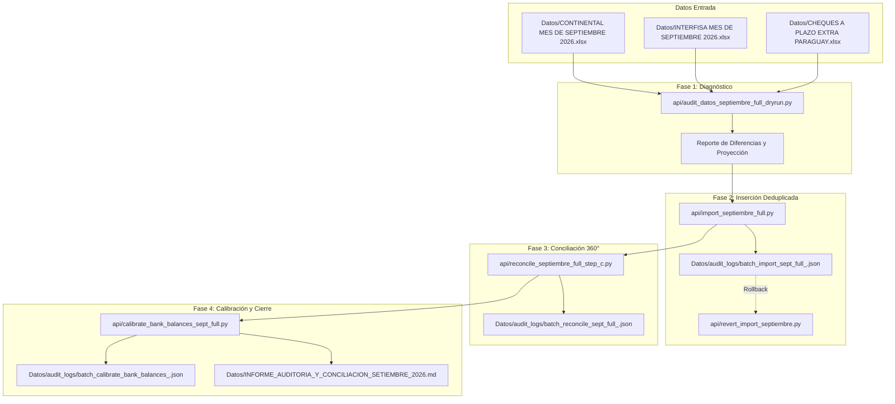

# Plan de Implementación: Auditoría y Conciliación Bancaria Integral — Septiembre 2026

> **For agentic workers:** REQUIRED SUB-SKILL: Use superpowers:subagent-driven-development to implement this plan task-by-task. Steps use checkbox (`- [ ]`) syntax for tracking.

**Goal:** Reconciliar al 100% los extractos bancarios del mes completo de Septiembre 2026 (Banco Continental y Banco Interfisa) contra la base de datos de Extra Supermercado Mayorista, cruzando cheques a plazo, acreditaciones de tarjetas/bóveda y calibrando los saldos finales oficiales al 30/09/2026 sin pisar ni duplicar datos, con reversibilidad atómica.

**Architecture:** Pipeline modular en 4 etapas ejecutables secuencialmente: Diagnóstico Dry-Run (Solo Lectura) -> Inserción quirúrgica deduplicada por firma compuesta -> Cruce y conciliación 360° (cheques, tarjetas, bóveda) -> Calibración de saldos oficiales al 30/09 con manifiestos JSON UUID y scripts de rollback.

**Architecture Diagram:**

**Tech Stack:** Python 3, SQLAlchemy (Async), PostgreSQL (`bank_accounts`, `bank_transactions`, `cheques`), openpyxl, pypdf.

**Spec:** [docs/superpowers/specs/2026-10-12-conciliacion-setiembre-design.md](file:///Users/gustaquevedo/Library/CloudStorage/OneDrive-Personal/Dev/Intelimarket/docs/superpowers/specs/2026-10-12-conciliacion-setiembre-design.md)

## Global Constraints
- Zona horaria de negocio: `America/Asuncion` (UTC-4 / UTC-3).
- Cero cortes en producción ni reinicios no controlados (`deploy-api.sh` / `deploy-ui.sh`).
- Cero sobreescritura de datos existentes: deduplicación estricta por firma compuesta `(bank_account_id, fecha, tipo, monto, referencia, hash(descripcion))`.
- Inversión obligatoria de columnas Débito/Crédito para Banco Interfisa según regla canónica de `statement_import.py`.
- Todo cambio en BD debe generar su manifiesto JSON con UUID en `Datos/audit_logs/` y contar con script de reversión reversible con `--commit`.

---

### Task 1: Diagnóstico Dry-Run 100% Solo Lectura

**Files:**
- Create: `api/audit_datos_septiembre_full_dryrun.py`
- Test: Ejecución en consola sobre la VM/BD local

**Interfaces:**
- Consumes: `Datos/CONTINENTAL MES DE SEPTIEMBRE 2026.xlsx`, `Datos/INTERFISA MES DE SEPTIEMBRE 2026.xlsx`, `Datos/CHEQUES A PLAZO EXTRA PARAGUAY.xlsx`, tablas `bank_accounts`, `bank_transactions`, `cheques`.
- Produces: Diagnóstico impreso en consola con:
  * Total de transacciones por cuenta en Excel vs existentes en BD.
  * Transacciones nuevas del 24 al 30 de septiembre identificadas para inserción.
  * Cheques debitados en banco con match exacto en libro maestro y BD.
  * Saldos en BD vs balances al 30/09 y discrepancias.

- [ ] **Step 1: Crear script de diagnóstico dry-run**
Implementar `api/audit_datos_septiembre_full_dryrun.py` importando `statement_import` y contrastando contra la base de datos sin ejecutar escrituras.

- [ ] **Step 2: Probar el script en modo dry-run**
Ejecutar el script contra la base de datos conectada en la VM para validar las 5 cuentas y el libro de cheques.

- [ ] **Step 3: Documentar y presentar los hallazgos del Dry-Run**
Confirmar los números exactos de transacciones nuevas y saldos proyectados.

---

### Task 2: Inserción Atómica Deduplicada de Transacciones Nuevas

**Files:**
- Create: `api/import_septiembre_full.py`
- Create: `api/revert_import_septiembre.py`

**Interfaces:**
- Consumes: Lista de `MOVIMIENTO_NUEVO` identificados en la Task 1.
- Produces: `Datos/audit_logs/batch_import_sept_full_<UUID>.json` y registros creados en `bank_transactions`.

- [ ] **Step 1: Escribir el script de reversión `api/revert_import_septiembre.py`**
Dado un archivo JSON de manifiesto con los UUIDs insertados, elimina de forma atómica dichos registros si se pasa `--commit`.

- [ ] **Step 2: Implementar el script de inserción `api/import_septiembre_full.py`**
Aplica la firma unívoca para insertar únicamente los movimientos nuevos del 24 al 30 de septiembre, generando el manifiesto JSON con UUID.

- [ ] **Step 3: Ejecutar la inserción y verificar no-duplicación**
Correr la importación, comprobar que se generó el log JSON y re-ejecutar el dry-run para verificar que las transacciones pendientes bajaron a 0.

---

### Task 3: Conciliación Cruzada 360° (Cheques, Tarjetas y Bóveda)

**Files:**
- Create: `api/reconcile_septiembre_full_step_c.py`
- Create: `api/revert_reconcile_septiembre_full_step_c.py`

**Interfaces:**
- Consumes: Registros de `bank_transactions` de septiembre, tabla `cheques`, hoja `26` de `CHEQUES A PLAZO EXTRA PARAGUAY.xlsx`.
- Produces: `Datos/audit_logs/batch_reconcile_sept_full_<UUID>.json`, cheques en estado `COBRADO`, vínculos `bank_transaction.cheque_id`.

- [ ] **Step 1: Escribir script de reversión `api/revert_reconcile_septiembre_full_step_c.py`**
Permite retrotraer el estado de los cheques a `PENDIENTE` y desvincular las transacciones.

- [ ] **Step 2: Implementar el motor de matching en `api/reconcile_septiembre_full_step_c.py`**
Emparejar por banco, número de cheque y monto. Cruzar también lotes de POS de Interfisa Ahorro.

- [ ] **Step 3: Ejecutar la conciliación y verificar resultados**
Aplicar los matches, generar el manifiesto y reportar la tasa de efectividad de conciliación.

---

### Task 4: Calibración Oficial de Saldos al 30/09/2026

**Files:**
- Create: `api/calibrate_bank_balances_sept_full.py`
- Create: `api/revert_calibrate_bank_balances_sept_full.py`

**Interfaces:**
- Consumes: Saldos finales certificados de los 5 extractos al 30/09/2026.
- Produces: Actualización de `bank_accounts.saldo_actual`, manifiesto `Datos/audit_logs/batch_calibrate_bank_balances_<UUID>.json`.

- [ ] **Step 1: Escribir script de reversión `api/revert_calibrate_bank_balances_sept_full.py`**
Restaura los saldos previos exactos almacenados en el manifiesto JSON.

- [ ] **Step 2: Implementar la calibración en `api/calibrate_bank_balances_sept_full.py`**
Actualiza los saldos de las 5 cuentas al valor oficial del extracto al 30/09 y sella `saldo_verificado_at`.

- [ ] **Step 3: Ejecutar la calibración y comprobar balances**
Validar que `SELECT banco, saldo_actual FROM bank_accounts` coincide 100% con los extractos bancarios.

---

### Task 5: Actualización del Informe Oficial de Auditoría

**Files:**
- Modify: `Datos/INFORME_AUDITORIA_Y_CONCILIACION_SETIEMBRE_2026.md`

**Interfaces:**
- Consumes: Métricas y manifiestos de las Tasks 1 a 4.
- Produces: Informe consolidado definitivo con tablas de cuentas, cheques compensados y circulantes, cuadratura de tarjetas y flujo de efectivo.

- [ ] **Step 1: Redactar cifras y tablas consolidadas del mes completo**
Actualizar el informe con las cifras auditadas del 1 al 30 de septiembre.

- [ ] **Step 2: Validar enlaces a los manifiestos JSON generados y comandos de reversión**
Asegurar que cada UUID y comando de reversión quede documentado en el informe.
