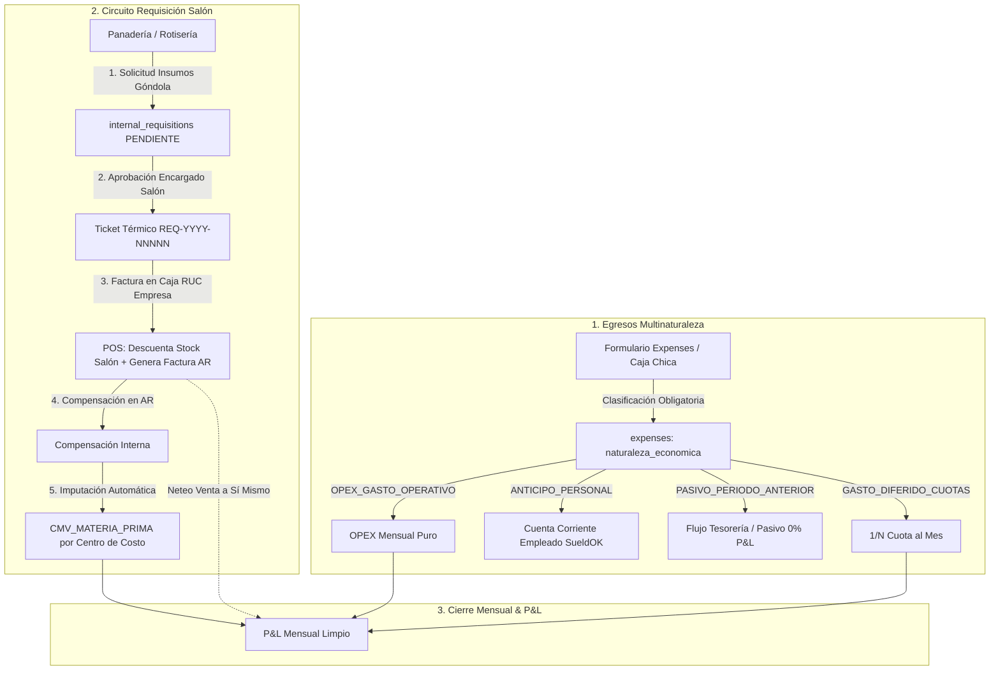

# Plan de Implementación: Segregación Estructural de Egresos, Criterio Contable y Requisiciones de Consumo Interno

> **For agentic workers:** REQUIRED SUB-SKILL: Use superpowers:subagent-driven-development to implement this plan task-by-task. Steps use checkbox (`- [ ]`) syntax for tracking.

**Goal:** Implementar la segregación multinaturaleza de egresos (`expenses`), el circuito de requisición y consumo interno de salón a producción con aprobación de encargado y ticket térmico, la compensación contable en cuentas por cobrar y el cálculo limpio del P&L en el cierre mensual.

**Architecture:** Se enriquece el modelo `Expense` con el enum `naturaleza_economica` y metadatos de imputación (cuotas, empleado, período, centro de producción). Se crea la entidad de requisiciones de salón (`internal_requisitions` e `internal_requisition_items`) con aprobación obligatoria, emisión de ticket y trazabilidad al facturarse en caja a nombre de la empresa. En cuentas por cobrar, la compensación asigna automáticamente el costo a `CMV_MATERIA_PRIMA`. El servicio de cierre mensual netea la venta interna y genera un P&L exacto sin distorsiones ni duplicaciones.

**Architecture Diagram:**



**Tech Stack:** Python 3.11, FastAPI, SQLAlchemy 2.0 (async), PostgreSQL, Pydantic v2, React 18, TypeScript, TailwindCSS, Lucide Icons.

**Spec:** [docs/superpowers/specs/2026-10-13-clasificacion-egresos-criterio-contable-design.md](file:///Users/gustaquevedo/Library/CloudStorage/OneDrive-Personal/Dev/Intelimarket/docs/superpowers/specs/2026-10-13-clasificacion-egresos-criterio-contable-design.md)

## Global Constraints

- Backend: Migraciones SQLAlchemy/Alembic idempotentes compatibles con PostgreSQL 15+.
- Frontend: Cumplimiento estricto de [docs/CANONICAL_UI_UX_DESIGN_SYSTEM.md](file:///Users/gustaquevedo/Library/CloudStorage/OneDrive-Personal/Dev/Intelimarket/docs/CANONICAL_UI_UX_DESIGN_SYSTEM.md) (Luxury Command Deck Headers, Glassmorphism Tab Pill Bars, inputs con `<CurrencyInput />`, visualización con `formatPYG()`).
- Contabilidad: Cero inventos de datos. Trazabilidad respaldada en comprobantes físicos o registros de BD.
- Despliegue: Compatible con scripts zero-downtime `deploy-api.sh` y `deploy-ui.sh`.

---

### Task 1: Modelo de Base de Datos y Enums de Egresos Multinaturaleza

**Files:**
- Modify: `api/src/petty_cash/models.py`
- Modify: `api/src/petty_cash/schemas.py`
- Test: `tests/test_petty_cash_multinaturaleza.py`

**Interfaces:**
- Consumes: `Base` de `api/src/db.py`.
- Produces: Enum `NaturalezaEconomica`, `ProductionArea` y columnas nuevas en `Expense` (`naturaleza_economica`, `production_area`, `employee_id`, `periodo_devengado`, `cuota_actual`, `total_cuotas`, `requisicion_id`).

- [x] **Step 1: Escribir el test fallido para el esquema y modelo de egresos**

Crear `tests/test_petty_cash_multinaturaleza.py`:
```python
import pytest
from pydantic import ValidationError
from api.src.petty_cash.schemas import ExpenseCreate, NaturalezaEconomica, ProductionArea

def test_expense_create_validations():
    # 1. Requiere production_area si es CMV_MATERIA_PRIMA
    with pytest.raises(ValidationError):
        ExpenseCreate(
            monto=50000,
            descripcion="Harina para panadería",
            naturaleza_economica=NaturalezaEconomica.CMV_MATERIA_PRIMA,
            production_area=None
        )

    # 2. Válido con production_area
    valid_exp = ExpenseCreate(
        monto=50000,
        descripcion="Harina para panadería",
        naturaleza_economica=NaturalezaEconomica.CMV_MATERIA_PRIMA,
        production_area=ProductionArea.PANADERIA
    )
    assert valid_exp.production_area == ProductionArea.PANADERIA

    # 3. Requiere cuotas si es GASTO_DIFERIDO_CUOTAS
    with pytest.raises(ValidationError):
        ExpenseCreate(
            monto=20000000,
            descripcion="Póliza de Seguro Río Seguros",
            naturaleza_economica=NaturalezaEconomica.GASTO_DIFERIDO_CUOTAS,
            cuota_actual=None,
            total_cuotas=None
        )
```

- [x] **Step 2: Ejecutar test para verificar que falla**

Run: `pytest tests/test_petty_cash_multinaturaleza.py -v`  
Expected: FAIL con `ImportError: cannot import name 'NaturalezaEconomica'`

- [x] **Step 3: Implementar Enums y Columnas en Models y Schemas**

Modificar `api/src/petty_cash/schemas.py`:
```python
from enum import Enum
from pydantic import BaseModel, ConfigDict, model_validator
from typing import Optional
from datetime import date, datetime
from decimal import Decimal

class NaturalezaEconomica(str, Enum):
    OPEX_GASTO_OPERATIVO = "OPEX_GASTO_OPERATIVO"
    CMV_REVENTA = "CMV_REVENTA"
    CMV_MATERIA_PRIMA = "CMV_MATERIA_PRIMA"
    ANTICIPO_PERSONAL = "ANTICIPO_PERSONAL"
    PASIVO_PERIODO_ANTERIOR = "PASIVO_PERIODO_ANTERIOR"
    GASTO_DIFERIDO_CUOTAS = "GASTO_DIFERIDO_CUOTAS"

class ProductionArea(str, Enum):
    PANADERIA = "panaderia"
    ROTISERIA = "rotiseria"
    CARNICERIA = "carniceria"
    VERDULERIA = "verduleria"
    SALON_GENERAL = "salon_general"

class ExpenseCreate(BaseModel):
    branch_id: Optional[str] = None
    category_id: Optional[str] = None
    monto: Decimal
    descripcion: str
    proveedor: Optional[str] = None
    comprobante_url: Optional[str] = None
    tipo_pago: str = "efectivo"
    fecha_gasto: Optional[date] = None
    naturaleza_economica: NaturalezaEconomica = NaturalezaEconomica.OPEX_GASTO_OPERATIVO
    production_area: Optional[ProductionArea] = None
    employee_id: Optional[str] = None
    periodo_devengado: Optional[str] = None
    cuota_actual: Optional[int] = None
    total_cuotas: Optional[int] = None
    requisicion_id: Optional[str] = None

    @model_validator(mode="after")
    def validate_conditional_fields(self):
        if self.naturaleza_economica == NaturalezaEconomica.CMV_MATERIA_PRIMA and not self.production_area:
            raise ValueError("production_area es obligatorio para CMV_MATERIA_PRIMA")
        if self.naturaleza_economica == NaturalezaEconomica.GASTO_DIFERIDO_CUOTAS:
            if not self.cuota_actual or not self.total_cuotas:
                raise ValueError("cuota_actual y total_cuotas son obligatorios para GASTO_DIFERIDO_CUOTAS")
        if self.naturaleza_economica == NaturalezaEconomica.PASIVO_PERIODO_ANTERIOR and not self.periodo_devengado:
            raise ValueError("periodo_devengado es obligatorio para PASIVO_PERIODO_ANTERIOR (ej. 2026-08)")
        if self.naturaleza_economica == NaturalezaEconomica.ANTICIPO_PERSONAL and not self.employee_id:
            raise ValueError("employee_id es obligatorio para ANTICIPO_PERSONAL")
        return self
```

Modificar `api/src/petty_cash/models.py` agregando las columnas a `Expense`:
```python
    naturaleza_economica = Column(String(50), nullable=False, server_default="OPEX_GASTO_OPERATIVO")
    production_area = Column(String(50))
    employee_id = Column(String(100))
    periodo_devengado = Column(String(7))
    cuota_actual = Column(Numeric(5, 0))
    total_cuotas = Column(Numeric(5, 0))
    requisicion_id = Column(UUID(as_uuid=True))
```

- [x] **Step 4: Ejecutar test para verificar que pasa**

Run: `pytest tests/test_petty_cash_multinaturaleza.py -v`  
Expected: PASS

- [x] **Step 5: Commit**

```bash
git add api/src/petty_cash/models.py api/src/petty_cash/schemas.py tests/test_petty_cash_multinaturaleza.py
git commit -m "feat(financial): add naturaleza_economica and conditional fields to Expense model and schemas"
```

---

### Task 2: Módulo y Servicio de Requisiciones Internas de Salón

**Files:**
- Create: `api/src/supermer/requisitions_service.py`
- Modify: `api/src/supermer/models.py`
- Modify: `api/src/supermer/schemas.py`
- Modify: `api/src/supermer/router.py`
- Test: `tests/test_internal_requisitions.py`

**Interfaces:**
- Consumes: `db` de `api/src/db.py`.
- Produces: Endpoints `/api/v1/supermer/requisitions` (crear, listar, aprobar, ticket).

- [x] **Step 1: Escribir el test fallido para el ciclo de requisiciones**

Crear `tests/test_internal_requisitions.py`:
```python
import pytest
from uuid import uuid4
from api.src.supermer.schemas import RequisitionCreate, RequisitionItemCreate

def test_requisition_creation_schema():
    req = RequisitionCreate(
        solicitado_por="Panadero Juan",
        area_destino="panaderia",
        items=[
            RequisitionItemCreate(
                barcode="7840001001",
                product_name="Leche Trébol 1L",
                cantidad=5,
                costo_unitario_estimado=4500,
                precio_venta_salon=6000
            )
        ]
    )
    assert req.area_destino == "panaderia"
    assert len(req.items) == 1
    assert req.items[0].cantidad == 5
```

- [x] **Step 2: Ejecutar test para verificar que falla**

Run: `pytest tests/test_internal_requisitions.py -v`  
Expected: FAIL con `ImportError: cannot import name 'RequisitionCreate'`

- [x] **Step 3: Implementar Modelos, Schemas y Servicio de Requisiciones**

1. Definir `InternalRequisition` e `InternalRequisitionItem` en `api/src/supermer/models.py`.
2. Definir schemas `RequisitionCreate`, `RequisitionResponse` en `api/src/supermer/schemas.py`.
3. Crear `api/src/supermer/requisitions_service.py` con métodos:
   - `create_requisition(company_id, branch_id, data)`: genera correlativo `REQ-YYYY-NNNNN`, guarda items en estado `PENDIENTE`.
   - `approve_requisition(requisition_id, user_id, user_name)`: cambia a `APROBADA`, guarda timestamp, devuelve layout para ticket térmico ESC/POS.
   - `link_pos_sale(requisition_id, sale_id, numero_factura)`: asocia la factura emitida en caja y pasa a `FACTURADA_EN_CAJA`.

- [x] **Step 4: Ejecutar test para verificar que pasa**

Run: `pytest tests/test_internal_requisitions.py -v`  
Expected: PASS

- [x] **Step 5: Commit**

```bash
git add api/src/supermer/ models.py schemas.py requisitions_service.py router.py tests/test_internal_requisitions.py
git commit -m "feat(supermer): implement internal requisitions workflow and ESC/POS ticket generation"
```

---

### Task 3: Integración de Compensación Interna en Cuentas por Cobrar

**Files:**
- Modify: `api/src/accounts_receivable/service.py:1260-1345`
- Test: `tests/test_ar_compensacion_materia_prima.py`

**Interfaces:**
- Consumes: `InternalRequisition` y `data.requisicion_id`.
- Produces: Registro en `expenses` con `naturaleza_economica = 'CMV_MATERIA_PRIMA'` y `production_area`.

- [x] **Step 1: Escribir test fallido para la compensación que asigna materia prima**

Crear `tests/test_ar_compensacion_materia_prima.py` verificando que cuando se envía `requisicion_id`, el egreso generado tenga `naturaleza_economica == 'CMV_MATERIA_PRIMA'` y la requisición pase a `COMPENSADA`.

- [x] **Step 2: Ejecutar test para verificar que falla**

Run: `pytest tests/test_ar_compensacion_materia_prima.py -v`  
Expected: FAIL

- [x] **Step 3: Modificar `accounts_receivable/service.py`**

Actualizar el bloque de inserción de `expenses` en la compensación interna:
```python
# Detectar si proviene de requisición de producción
nat_econ = "CMV_MATERIA_PRIMA" if req_destino in ("panaderia", "rotiseria", "carniceria", "verduleria") else "OPEX_GASTO_OPERATIVO"
await db.execute(
    text("""
        INSERT INTO expenses (
            ..., naturaleza_economica, production_area, requisicion_id
        ) VALUES (
            ..., :nat_econ, :production_area, :req_id
        )
    """),
    {
        ...,
        "nat_econ": nat_econ,
        "production_area": req_destino,
        "req_id": req_id
    }
)
```

- [x] **Step 4: Ejecutar test para verificar que pasa**

Run: `pytest tests/test_ar_compensacion_materia_prima.py -v`  
Expected: PASS

- [x] **Step 5: Commit**

```bash
git add api/src/accounts_receivable/service.py tests/test_ar_compensacion_materia_prima.py
git commit -m "feat(ar): integrate internal compensation with CMV_MATERIA_PRIMA and requisition tracking"
```

---

### Task 4: Reestructuración del Motor de Cierre Mensual (P&L Puro)

**Files:**
- Modify: `api/src/financial/monthly_closing_service.py`
- Modify: `api/src/financial/monthly_closing_excel.py`
- Test: `tests/test_monthly_closing_pl_clean.py`

**Interfaces:**
- Consumes: `expenses` clasificados, nómina devengada de SueldOK y ventas comerciales netas de autoconsumo.
- Produces: Dict de P&L con CMV Reventa, CMV Materia Prima Panadería/Rotisería, OPEX puro sin harinas ni duplicaciones laborales.

- [x] **Step 1: Escribir test unitario con datos de Septiembre 2026**

Crear `tests/test_monthly_closing_pl_clean.py`:
- Verificar que las compras de Hilagro, Gonzalito y Bio X (14.873.000 Gs.) salgan del OPEX de Logística y se computen en `cmv_materia_prima_panaderia`.
- Verificar que el OPEX no laboral baje exactamente a Gs. 94.750.811.
- Verificar que la póliza de Río Seguros devengue solo Gs. 2.000.000 (cuota 1/10).

- [x] **Step 2: Ejecutar test para verificar que falla con la lógica anterior**

Run: `pytest tests/test_monthly_closing_pl_clean.py -v`  
Expected: FAIL

- [x] **Step 3: Actualizar `monthly_closing_service.py` y `monthly_closing_excel.py`**

Reestructurar:
- `_get_cogs`: sumar `cmv_materia_prima_panaderia` y `cmv_materia_prima_rotiseria`.
- `_get_opex`: filtrar estrictamente `naturaleza_economica == 'OPEX_GASTO_OPERATIVO'` o cuota de `GASTO_DIFERIDO_CUOTAS`. Excluir `CMV_MATERIA_PRIMA`, `CMV_REVENTA`, `ANTICIPO_PERSONAL` y `PASIVO_PERIODO_ANTERIOR`.
- Reflejar las nuevas filas en la exportación Excel analítica de 6 solapas.

- [x] **Step 4: Ejecutar test para verificar que pasa**

Run: `pytest tests/test_monthly_closing_pl_clean.py -v`  
Expected: PASS

- [x] **Step 5: Commit**

```bash
git add api/src/financial/monthly_closing_service.py api/src/financial/monthly_closing_excel.py tests/test_monthly_closing_pl_clean.py
git commit -m "feat(financial): update monthly closing P&L engine with segregated CMV and clean OPEX"
```

---

### Task 5: UI - Formulario de Gastos Asistido con Selector Multinaturaleza

**Files:**
- Modify: `ui-web/src/pages/expenses/ExpensesPage.tsx`
- Modify: `ui-web/src/api.ts`

**Interfaces:**
- Consumes: API endpoints `/api/v1/petty-cash/expenses`.
- Produces: Modal y tabla con selector de `naturaleza_economica`, badges canónicos y campos condicionales obligatorios.

- [x] **Step 1: Actualizar tipos en `ui-web/src/api.ts`**

Agregar los nuevos campos a `Expense` y `ExpenseCreate`.

- [x] **Step 2: Implementar los campos condicionales en `ExpensesPage.tsx`**

Siguiendo el diseño canónico:
- Pestañas/Pills para elegir la Naturaleza Económica:
  * 🏢 Gasto Operativo (OPEX)
  * 🥖 Materia Prima Producción (despliega selector: Panadería, Rotisería, Carnicería)
  * 🛒 Mercadería Reventa Góndola
  * 👤 Anticipo al Personal (despliega buscador de empleados de SueldOK)
  * ⏳ Pasivo Período Anterior (despliega selector de mes devengado YYYY-MM)
  * 📑 Gasto Plurimensual en Cuotas (despliega inputs Cuota Actual / Total Cuotas)
- Badges de colores semánticos en la tabla de listado para auditoría visual inmediata.

- [x] **Step 3: Compilar y validar TypeScript**

Run: `npm run build` en `ui-web/`  
Expected: Exit code 0 sin errores de tipos.

- [x] **Step 4: Commit**

```bash
git add ui-web/src/api.ts ui-web/src/pages/expenses/ExpensesPage.tsx
git commit -m "feat(ui): add multi-nature expense selector and canonical audit badges"
```

---

### Task 6: UI - Módulo de Requisiciones de Salón y Vales Térmicos

**Files:**
- Create: `ui-web/src/pages/supermer/RequisitionsSubTab.tsx`
- Modify: `ui-web/src/pages/supermer/RotiseriaTab.tsx`
- Modify: `ui-web/src/pages/accounts-receivable/AccountsReceivablePage.tsx`

**Interfaces:**
- Consumes: API `/api/v1/supermer/requisitions`.
- Produces: Panel de requisiciones en producción, modal de aprobación con impresión térmica, y selector en Cuentas por Cobrar.

- [x] **Step 1: Crear `RequisitionsSubTab.tsx` en `ui-web/src/pages/supermer/`**

Componente con:
- Botón "Nueva Requisición de Salón".
- Buscador con autocompletado de productos de góndola (código de barra, descripción, stock actual, costo estimado).
- Bandeja de Requisiciones: filtros `Todas`, `Pendientes`, `Aprobadas`, `Facturadas`.
- Acción de Aprobación por Encargado de Salón:
  - Genera vista previa de Ticket Térmico de 80mm listo para imprimir en ticketera de salón.

- [x] **Step 2: Integrar en `RotiseriaTab.tsx`**

Agregar el subtab `"requisitions"` con icono `ClipboardList` y contador de pendientes.

- [x] **Step 3: Vincular en `AccountsReceivablePage.tsx`**

En el modal de Compensación Interna, agregar selector opcional: *"Vincular Requisición de Salón"* que autocompleta el centro de costo y marca la naturaleza como `CMV_MATERIA_PRIMA`.

- [x] **Step 4: Compilar y validar frontend**

Run: `npm run build` en `ui-web/`  
Expected: Exit code 0.

- [x] **Step 5: Commit**

```bash
git add ui-web/src/pages/supermer/RequisitionsSubTab.tsx ui-web/src/pages/supermer/RotiseriaTab.tsx ui-web/src/pages/accounts-receivable/AccountsReceivablePage.tsx
git commit -m "feat(ui): implement salon requisition workflow, thermal ticket print and AR compensation linking"
```

---

### Task 7: Migración de Base de Datos, Backfill Histórico y Despliegue en Producción

**Files:**
- Create: `api/alembic/versions/xxxx_add_naturaleza_economica_and_requisitions.py`
- Create: `scripts/backfill_septiembre_2026_expenses.py`
- Modify: `api/src/financial/monthly_closing_service.py`

**Interfaces:**
- Consumes: Base de datos Postgres en producción.
- Produces: Tabla `internal_requisitions`, columnas en `expenses` y datos históricos clasificados.

- [x] **Step 1: Generar y verificar migración Alembic**

Generar migración para crear `internal_requisitions`, `internal_requisition_items` y alterar `expenses`.

- [x] **Step 2: Escribir script de backfill histórico idempotente**

Crear `scripts/backfill_septiembre_2026_expenses.py`:
- Reclasifica facturas de Hilagro, Casa Gonzalito y Bio X de Septiembre 2026 a `CMV_MATERIA_PRIMA` (`production_area = 'panaderia'`).
- Reclasifica Río Seguros a `GASTO_DIFERIDO_CUOTAS` (`cuota_actual = 1, total_cuotas = 10`).
- Reclasifica pago de nómina de agosto a `PASIVO_PERIODO_ANTERIOR` (`periodo_devengado = '2026-08'`).

- [x] **Step 3: Ejecutar migración y backfill en VM de Producción (`100.83.91.76`)**

Ejecutar mediante SSH en `/home/intellihouse/intelimarket`:
- `alembic upgrade head`
- `python scripts/backfill_septiembre_2026_expenses.py`

- [x] **Step 4: Despliegue Zero-Downtime y Verificación**

- Correr `./deploy-api.sh` y `./deploy-ui.sh`.
- Verificar en la interfaz web de producción (`/financial/monthly-closing` y `/expenses`) que:
  * El P&L de Septiembre 2026 refleje el OPEX limpio (Gs. 94.750.811) y el CMV de Materia Prima de Panadería separado.
  * Los nuevos módulos y formularios funcionen de forma fluida.

- [x] **Step 5: Commit y Push Final**

```bash
git add .
git commit -m "chore(release): complete expense segregation and internal requisition system"
git push origin vertical/supermercado
```
