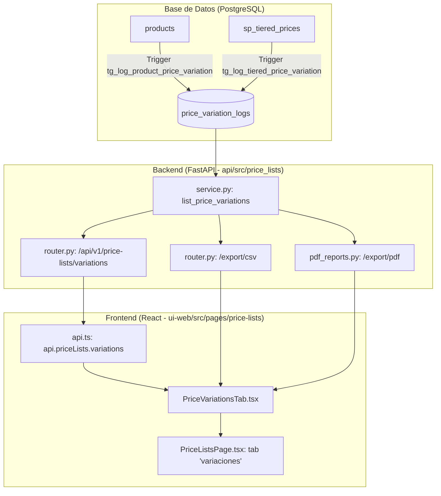

# Variaciones de Precios en Listas de Precios - Implementation Plan

> **For agentic workers:** REQUIRED SUB-SKILL: Use superpowers:subagent-driven-development to implement this plan task-by-task. Steps use checkbox (`- [ ]`) syntax for tracking.

**Goal:** Implementar una nueva pestaña "Variaciones de Precios" en el módulo Listas de Precios (`/price-lists`), con captura automática de cambios de precios regulares (unitarios y escalas) vía triggers PostgreSQL, endpoints de consulta y exportación (Excel y PDF oficial de Extra Supermercado), e interfaz interactiva con filtros y KPIs.

**Architecture:** Se despliega una tabla `price_variation_logs` en PostgreSQL alimentada de forma atómica por triggers ante cualquier actualización en `products.precio_venta` o `sp_tiered_prices`. FastAPI expone endpoints con filtros por fechas (`America/Asuncion`), tipo y orden, además de generadores de Excel y PDF con ReportLab. El frontend React integra la pestaña con KPIs, controles de orden y rango de fechas, tabla estilizada y botones de descarga directa.

**Architecture Diagram:**

**Tech Stack:**
- PostgreSQL 15+ / Alembic / SQLAlchemy Async
- FastAPI / Pydantic v2
- ReportLab (PDFs oficiales con membrete corporativo y fuentes Lato)
- React 18 / TypeScript / Tailwind CSS / Lucide Icons
- Zona Horaria: `America/Asuncion`
- Moneda: Guaraníes (`formatPYG`)

**Spec:** [`docs/superpowers/specs/2026-10-13-variaciones-de-precios-design.md`](file:///Users/gustaquevedo/Library/CloudStorage/OneDrive-Personal/Dev/Intelimarket/docs/superpowers/specs/2026-10-13-variaciones-de-precios-design.md)

## Global Constraints
- Prohibición estricta: NO TOCAR POS NI ELECTRON (`ui-web/src/pages/pos/`, `electron/`).
- Zona horaria inmutable: `America/Asuncion` para todo cálculo y filtro de fechas.
- Formato monetario: PYG enteros con separador de miles por punto vía `formatPYG()`.
- Exclusión total de promociones: Solo monitorear precios regulares (unitarios y escalas).
- Despliegue: `bash deploy-api.sh` y `bash deploy-ui.sh`.

---

### Task 1: Migración de Base de Datos y Triggers PostgreSQL (`price_variation_logs`)

**Files:**
- Create: `api/alembic/versions/20261013170000_add_price_variation_logs_and_triggers.py`
- Test: `tests/test_price_variation_triggers.py`

**Interfaces:**
- Produces: Tabla `price_variation_logs` y triggers `tg_log_product_price_variation` y `tg_log_tiered_price_variation`.

- [ ] **Step 1: Escribir test para validar funcionamiento del trigger y la tabla**
- [ ] **Step 2: Crear archivo de migración de Alembic con tabla, índices, triggers y backfill de historial previo**
- [ ] **Step 3: Ejecutar migración de Alembic en entorno local/test**
- [ ] **Step 4: Ejecutar test y verificar inserciones automáticas ante updates de `precio_venta` y `sp_tiered_prices`**
- [ ] **Step 5: Commit del cambio de base de datos**

---

### Task 2: Modelo SQLAlchemy, Schemas Pydantic y Servicio Backend

**Files:**
- Modify: `api/src/price_lists/models.py`
- Modify: `api/src/price_lists/schemas.py`
- Modify: `api/src/price_lists/service.py`
- Test: `tests/test_price_variations_service.py`

**Interfaces:**
- Produces: `PriceVariationLog` (Model), `PriceVariationItemResponse`, `PriceVariationsResponse` (Schemas), `list_price_variations` (Service).

- [ ] **Step 1: Escribir test unitario de servicio con filtros de fechas en `America/Asuncion`, orden y tipos**
- [ ] **Step 2: Agregar modelo `PriceVariationLog` en `api/src/price_lists/models.py`**
- [ ] **Step 3: Definir schemas de respuesta y filtros en `api/src/price_lists/schemas.py`**
- [ ] **Step 4: Implementar `list_price_variations(...)` en `api/src/price_lists/service.py` con métricas de resumen**
- [ ] **Step 5: Ejecutar test y verificar que pase**
- [ ] **Step 6: Commit de modelos y servicio**

---

### Task 3: Generador de Reporte PDF Oficial y Exportación Excel/CSV

**Files:**
- Create: `api/src/price_lists/pdf_reports.py`
- Modify: `api/src/price_lists/service.py`
- Test: `tests/test_price_variations_pdf.py`

**Interfaces:**
- Produces: `generate_price_variations_pdf(...)` y `generate_price_variations_csv(...)`.

- [ ] **Step 1: Escribir test para generación de bytes de PDF y CSV**
- [ ] **Step 2: Implementar `generate_price_variations_pdf` usando helpers corporativos de `integrated_finance.pdf_reports` con membrete de Extra Supermercado**
- [ ] **Step 3: Implementar generador de CSV UTF-8 BOM con columnas tabuladas**
- [ ] **Step 4: Ejecutar tests y validar contenido del PDF y CSV**
- [ ] **Step 5: Commit de reportes**

---

### Task 4: Endpoints REST en `api/src/price_lists/router.py` y Cliente `api.ts`

**Files:**
- Modify: `api/src/price_lists/router.py`
- Modify: `ui-web/src/api.ts`
- Test: `tests/test_price_variations_endpoints.py`

**Interfaces:**
- Produces: `GET /api/v1/price-lists/variations`, `GET /api/v1/price-lists/variations/export/csv`, `GET /api/v1/price-lists/variations/export/pdf`, métodos en `api.priceLists`.

- [ ] **Step 1: Escribir test para los endpoints REST con usuario autenticado**
- [ ] **Step 2: Agregar rutas en `api/src/price_lists/router.py`**
- [ ] **Step 3: Actualizar `ui-web/src/api.ts` con tipados y llamadas para variaciones y descargas**
- [ ] **Step 4: Ejecutar test de endpoints y verificar respuestas 200 OK**
- [ ] **Step 5: Commit de endpoints y cliente API**

---

### Task 5: Componente `PriceVariationsTab.tsx` e Integración en `PriceListsPage.tsx`

**Files:**
- Create: `ui-web/src/pages/price-lists/PriceVariationsTab.tsx`
- Modify: `ui-web/src/pages/price-lists/PriceListsPage.tsx`

**Interfaces:**
- Consumes: `api.priceLists.variations`, `api.priceLists.exportVariationsCsv`, `api.priceLists.exportVariationsPdf`.
- Produces: Nueva pestaña "Variaciones de Precios" activa en la interfaz.

- [ ] **Step 1: Crear `PriceVariationsTab.tsx` con filtros rápidos, selector de orden, KPIs, tabla con badges y acciones de descarga**
- [ ] **Step 2: Modificar `PriceListsPage.tsx` para agregar `"variaciones"` a `TABS` y renderizar `<PriceVariationsTab />`**
- [ ] **Step 3: Ejecutar build de frontend (`npm run build`) para certificar cero errores de tipos o sintaxis**
- [ ] **Step 4: Commit de la interfaz de usuario**

---

### Task 6: Despliegue y Verificación Integral

**Files:**
- System scripts: `bash deploy-api.sh`, `bash deploy-ui.sh`

- [ ] **Step 1: Aplicar migración de Alembic en producción / sandbox según corresponda**
- [ ] **Step 2: Ejecutar `bash deploy-api.sh` para reinicio secuencial (rolling reload) sin downtime**
- [ ] **Step 3: Ejecutar `bash deploy-ui.sh` para build atómico y conmutación de symlink**
- [ ] **Step 4: Realizar prueba funcional en vivo (verificar pestaña, modificar un precio de prueba o consultar historial, probar exportación PDF/Excel)**
- [ ] **Step 5: Concluir tarea con evidencia auditada**
