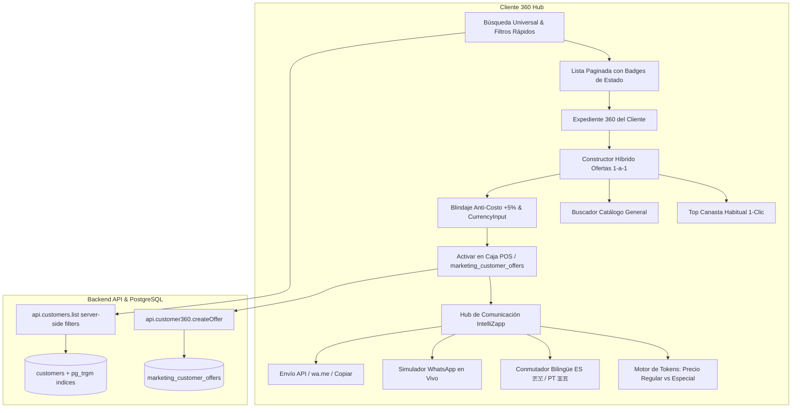

# Overhaul Cliente 360 & Hub de Comunicación Inteligente Implementation Plan

> **For agentic workers:** REQUIRED SUB-SKILL: Use superpowers:subagent-driven-development to implement this plan task-by-task. Steps use checkbox (`- [ ]`) syntax for tracking.

**Goal:** Implementar el rediseño integral de Cliente 360 en Extra Supermercado: búsqueda universal y filtros multidimensionales sobre toda la base de clientes, constructor híbrido de ofertas 1-a-1 con blindaje de costo (+5% mín.) e input `<CurrencyInput />`, y Hub de Comunicación bilingüe (ES/PT) con tokens de precios (regular vs especial) y simulador interactivo de WhatsApp en vivo.

**Architecture:** Se extienden los filtros server-side en el backend (`api/src/customers/`) para soportar búsquedas universales rápidas sin truncar clientes. En el frontend (`ui-web/src/pages/customer360/Customer360Page.tsx`), se reemplaza el filtrado local por consultas reactivas con fallback, se implementa un modal de ofertas con selector dual (canasta vs catálogo) y blindaje anti-costo, y se reconstruye el Hub de Comunicación con previsualización en vivo tipo smartphone y reemplazo dinámico de tokens de precio y ahorro.

**Architecture Diagram:**



**Tech Stack:** React, TypeScript, Tailwind CSS, Lucide React, FastAPI, SQLAlchemy (Async), PostgreSQL.

**Spec:** [docs/superpowers/specs/2026-10-14-cliente360-overhaul-design.md](file:///Users/gustaquevedo/Library/CloudStorage/OneDrive-Personal/Dev/Intelimarket/docs/superpowers/specs/2026-10-14-cliente360-overhaul-design.md)

## Global Constraints

- **Vertical Única:** Extra Supermercado (Retail & Frontera). RUC `80150377-9`, Razón Social `GRUPO SANTA TERESA E.A.S.`.
- **Prohibición Estricta:** No modificar `ui-web/src/pages/pos/` ni `electron/`.
- **Zona Horaria:** `America/Asuncion` (UTC-4 / UTC-3).
- **Formato Monetario (Regla #10):** Prohibido `<input type="number">` para dinero. Usar exclusivamente `<CurrencyInput />` (`src/components/CurrencyInput.tsx`). Guaraníes enteros sin decimales (`formatPYG()`).
- **Zero Downtime:** Validar build sin errores de tipos TypeScript (`npm run build` en `ui-web`).

---

### Task 1: Filtros Server-Side y Búsqueda Universal en Backend

**Files:**
- Modify: `api/src/customers/service.py:132-200`
- Modify: `api/src/customers/router.py:31-44`
- Test: `tests/test_customer_search_filters.py`

**Interfaces:**
- Consumes: Parámetros de query `country`, `extra_club`, `has_offers`, `archetype`.
- Produces: Query SQL filtrada en `customers` que devuelve los clientes de la empresa cumpliendo las condiciones de forma eficiente.

- [ ] **Step 1: Escribir test para los nuevos filtros de búsqueda de clientes**

Crear `tests/test_customer_search_filters.py`:
```python
import pytest
from httpx import AsyncClient

@pytest.mark.asyncio
async def test_list_customers_filters(client: AsyncClient, auth_headers: dict):
    # Probar filtro por país brasil
    res = await client.get("/api/v1/companies/00000000-0000-0000-0000-000000000010/customers?country=brasil&limit=10", headers=auth_headers)
    assert res.status_code == 200
    data = res.json()
    assert isinstance(data, list)
```

- [ ] **Step 2: Ejecutar el test para comprobar la interfaz**

Run: `pytest tests/test_customer_search_filters.py -v`

- [ ] **Step 3: Implementar parámetros y condiciones de filtrado en service y router**

En `api/src/customers/router.py`:
```python
@router.get("/companies/{company_id}/customers", response_model=list[CustomerResponse])
async def list_customers(
    company_id: str,
    search: str | None = Query(None),
    activo: bool | None = Query(None),
    tipo: str | None = Query(None),
    country: str | None = Query(None), # "brasil" | "paraguay"
    extra_club_only: bool = Query(False),
    has_offers_only: bool = Query(False),
    archetype: str | None = Query(None),
    exclude_proveedores: bool = Query(False),
    updated_since: datetime | None = Query(None),
    limit: int = Query(50000, le=100000),
    offset: int = Query(0, ge=0),
    db: AsyncSession = Depends(get_db),
):
    return await service.list_customers(
        db, company_id, search, activo, tipo, exclude_proveedores, limit, offset,
        updated_since=updated_since, country=country, extra_club_only=extra_club_only,
        has_offers_only=has_offers_only, archetype=archetype,
    )
```

En `api/src/customers/service.py`:
Agregar a `list_customers`:
```python
    if country == "brasil":
        query = query.where(or_(Customer.idioma == "pt", Customer.telefono.like("+55%")))
    elif country == "paraguay":
        query = query.where(and_(Customer.idioma != "pt", not_(Customer.telefono.like("+55%"))))
    if extra_club_only:
        query = query.where(and_(Customer.extra_club_numero.isnot(None), Customer.extra_club_numero != ""))
    if archetype:
        query = query.where(Customer.arquetipo == archetype)
    if has_offers_only:
        from api.src.marketing.models import CustomerOffer
        now_utc = datetime.now(timezone.utc)
        offers_subq = select(CustomerOffer.customer_id).where(
            CustomerOffer.usado.is_(False),
            or_(CustomerOffer.valido_hasta.is_(None), CustomerOffer.valido_hasta >= now_utc)
        ).distinct()
        query = query.where(Customer.id.in_(offers_subq))
```

- [ ] **Step 4: Ejecutar tests y verificar respuesta correcta**

Run: `pytest tests/test_customer_search_filters.py -v`
Expected: PASS

- [ ] **Step 5: Commit de backend**

```bash
git add api/src/customers/router.py api/src/customers/service.py tests/test_customer_search_filters.py
git commit -m "feat(customer360): add server-side customer filters for country, extra_club, archetype and offers"
```

---

### Task 2: Buscador Universal y Panel de Filtros Multidimensionales en Frontend

**Files:**
- Modify: `ui-web/src/pages/customer360/Customer360Page.tsx`
- Modify: `ui-web/src/api/index.ts` (si es necesario tipar los nuevos query params)

**Interfaces:**
- Consumes: `api.customers.list` con `search`, `country`, `extra_club_only`, `has_offers_only`, `archetype`.
- Produces: Barra de búsqueda unificada, chips de filtrado rápido Nivel 1 y panel desplegable de filtros Nivel 2 con contador de resultados exacto y soporte de fallback.

- [ ] **Step 1: Actualizar tipos en cliente API si aplica**

En `ui-web/src/api/index.ts`, verificar que `customers.list` admita los nuevos filtros opcionales.

- [ ] **Step 2: Implementar el nuevo estado y controlador de búsqueda en Customer360Page**

En `Customer360Page.tsx`:
- Estado para:
  * `searchTerm` con debounce de 300ms.
  * `quickFilter`: `"todos" | "brasil" | "paraguay" | "vip" | "ofertas_activas" | "riesgo_fuga"`.
  * `advancedArchetype`: string vacío o arquetipo seleccionado.
  * `showAdvancedFilters`: boolean para expandir drawer de filtros.
  * `sortBy`: `"reciente" | "gasto" | "compras" | "inactividad"`.
- Función de carga `loadCustomers`:
  * Enviar `country`, `extra_club_only`, `has_offers_only`, `archetype` al backend.
  * Mantener buffer local para fallback inmediato ante pérdida temporal de conectividad.

- [ ] **Step 3: Renderizar la barra de búsqueda y los chips de filtros**

En `Customer360Page.tsx`:
- Renderizar los chips con badges de conteo y colores distintivos (ej. 🇧🇷 Brasil, 🇵🇾 Paraguay, ⭐ ExtraClub, ⚠️ Riesgo de Fuga, 🎁 Con Ofertas).
- Botón "Filtros Avanzados" con icono `Filter` que despliega el panel de Arquetipos y Criterios de Ordenamiento.
- Mostrar contador en vivo: `Mostrando X clientes coincidentes`.
- En cada fila de cliente de la lista:
  * Badge de país (`🇧🇷 PT` o `🇵🇾 ES`).
  * Indicador de Arquetipo o Riesgo.
  * Badge verde si tiene oferta activa en caja.
  * Días desde la última compra.

- [ ] **Step 4: Validar build de frontend**

Run: `cd ui-web && npm run build`
Expected: Exitoso sin errores de TypeScript.

- [ ] **Step 5: Commit de filtros de frontend**

```bash
git add ui-web/src/pages/customer360/Customer360Page.tsx
git commit -m "feat(customer360): overhaul search bar with universal server-side filters and badges"
```

---

### Task 3: Constructor Híbrido de Ofertas 1-a-1 con Blindaje de Costo y CurrencyInput

**Files:**
- Modify: `ui-web/src/pages/customer360/Customer360Page.tsx`
- Test: Build y verificación de `<CurrencyInput />`

**Interfaces:**
- Consumes: `profile.frequent_basket`, `api.products.list(search)`, `api.customer360.createOffer`.
- Produces: Modal de creación de ofertas con pestaña A (Canasta Frecuente en 1 clic) y pestaña B (Buscador Catálogo General), visualización analítica de precios (Góndola, Costo, Piso +5%), input canónico `<CurrencyInput />`, cálculo de ahorro (Gs. y %) y botón directo "Activar y Preparar WhatsApp".

- [ ] **Step 1: Importar CurrencyInput y preparar estados del modal**

En `Customer360Page.tsx`:
```typescript
import CurrencyInput from "../../components/CurrencyInput"
```
Estados:
- `offerTab`: `"frecuentes" | "catalogo"`.
- `catalogSearch`: string para autocompletado de productos.
- `catalogResults`: Array de productos del inventario (`api.products.list`).
- `loadingCatalog`: boolean.

- [ ] **Step 2: Implementar la búsqueda en catálogo general**

Agregar handler con debounce para consultar `api.products.list({ search: catalogSearch, limit: 10, activo: true })` cuando el operador usa la pestaña de catálogo.

- [ ] **Step 3: Construir el cuerpo del modal con desglose analítico de precios**

- Reemplazar el selector simple por las dos pestañas:
  * **Pestaña Canasta Habitual:** Lista de productos comprados con frecuencia, veces comprado y último precio. Clic en cualquiera selecciona el producto y sugiere 15% OFF respetando el piso seguro.
  * **Pestaña Catálogo General:** Input con autocompletado en vivo de cualquier producto de la base.
- **Cuadro Financiero de Blindaje:**
  * Precio Regular: `formatPYG(normal)`.
  * Costo Base: `formatPYG(costo)`.
  * Piso Inviolable (+5%): `formatPYG(safetyFloor)`.
  * Input de Precio Especial: `<CurrencyInput value={offerPriceInput} onChange={val => setOfferPriceInput(val)} />` (cumpliendo Regla #10).
  * Ahorro Calculado: `Ahorro: Gs. X (Y% OFF)`.
  * Alerta visual roja en caso de perforar el costo base + 5%.
- Selector de vigencia: 3, 7, 15, 30 días.

- [ ] **Step 4: Conectar la confirmación con el salto directo al Hub de Comunicación**

En `handleConfirmCreateOffer`:
- Guardar la oferta en base de datos (`api.customer360.createOffer`).
- Refrescar las ofertas del cliente (`loadOffers`).
- Construir inmediatamente el mensaje con el precio regular y el precio especial.
- Cambiar a la pestaña `campanias_retencion` (Hub de Comunicación) con el mensaje cargado y notificar con Toast de éxito.

- [ ] **Step 5: Validar build de frontend**

Run: `cd ui-web && npm run build`
Expected: Build exitoso sin advertencias de tipos.

- [ ] **Step 6: Commit del modal de ofertas**

```bash
git add ui-web/src/pages/customer360/Customer360Page.tsx
git commit -m "feat(customer360): hybrid 1-to-1 offer builder with cost shield, CurrencyInput and direct Hub transition"
```

---

### Task 4: Hub de Comunicación IntelliZapp & Simulador de WhatsApp en Vivo

**Files:**
- Modify: `ui-web/src/pages/customer360/Customer360Page.tsx`

**Interfaces:**
- Consumes: `profile.customer`, ofertas activas de `customerOffers`, tokens `{primer_nombre}`, `{producto}`, `{precio_regular}`, `{precio_especial}`, `{ahorro_monto}`, `{ahorro_pct}`, `{validez_fecha}`.
- Produces: Simulador interactivo en pantalla tipo smartphone, conmutador bilingüe ES 🇵🇾 / PT 🇧🇷, catálogo de plantillas especializadas y botones de envío rápido (IntelliZapp API, `wa.me`, Copiar al Portapapeles).

- [ ] **Step 1: Definir la estructura de plantillas y generador de tokens**

En `Customer360Page.tsx`:
- Estado para `msgLanguage`: `"es" | "pt"` (autodetección inicial basada en `idioma === 'pt'` o teléfono `+55`).
- Estado para `selectedOfferForMsg`: Oferta activa seleccionada para inyectar datos de precios.
- Función constructora de mensajes con tokens:
  * Genera el texto con saltos de línea y formato WhatsApp (`*negrita*`, `~tachado~`).
  * Inyecta el Precio Regular formateado con `formatPYG()`.
  * Inyecta el Precio Especial de la oferta formateado con `formatPYG()`.
  * Inyecta el Ahorro en Gs. y porcentaje.
  * Incluye la vigencia con fecha paraguaya (`America/Asuncion`).

- [ ] **Step 2: Implementar el Simulador Interactivo de WhatsApp en Pantalla**

Crear el componente visual de smartphone dentro de la pestaña `campanias_retencion`:
- Marco de teléfono con bordes redondeados y sombra profunda.
- Barra superior de WhatsApp en color verde (`#075E54` / `#128C7E`) con:
  * Botón flecha atrás y avatar del cliente.
  * Nombre del cliente y estado *"en línea"*.
  * Iconos de llamada, videollamada y menú.
- Fondo de chat con trama sutil y fecha paraguaya en el centro.
- Burbuja verde de mensaje saliente (`#E7FFDB` en light, `#005C4B` en dark):
  * Texto renderizado letra por letra a medida que se tipea en el editor.
  * Soporte de formato visual para asteriscos `*negrita*`.
  * Hora paraguaya y doble check azul de entrega.

- [ ] **Step 3: Agregar Selector de Plantillas, Botones de Tokens y Acciones de Envío**

- Selector de Plantillas:
  1. *Oferta Exclusiva 1-a-1 en Favorito* (con precios regular vs especial).
  2. *Reactivación "Te Extrañamos"* (cliente en riesgo).
  3. *Alerta de Puntos ExtraClub & Vales de Compra*.
  4. *Feria de Frescos & Fin de Semana*.
  5. *Mensaje Libre*.
- Barra de Chips de Tokens: botones para insertar `{primer_nombre}`, `{producto}`, `{precio_especial}`, etc. directamente en el cursor del textarea.
- Toggle Bilingüe: `[ 🇵🇾 Español ]` | `[ 🇧🇷 Português ]`.
- Botones de acción:
  * "Enviar vía IntelliZapp API" (con spinner y confirmación).
  * "Abrir en WhatsApp Web / App" (`wa.me`).
  * "Copiar Mensaje" con tooltip "¡Copiado!".

- [ ] **Step 4: Validar build integral de frontend**

Run: `cd ui-web && npm run build`
Expected: Build atómico exitoso.

- [ ] **Step 5: Commit del Hub de Comunicación**

```bash
git add ui-web/src/pages/customer360/Customer360Page.tsx
git commit -m "feat(customer360): WhatsApp communication hub with live phone simulator, bilingual engine and price tokens"
```

---

### Task 5: Verificación Integral de Experiencia y Reglas de la Vertical

**Files:**
- Test: Navegador / Playwright o verificación en Sandbox (`100.83.91.76:8001` / `ui-web`)
- Documentación: Resumen de cambios y walkthrough

- [ ] **Step 1: Validar reglas del proyecto**
  * Verificar que no se haya modificado ningún archivo de POS (`ui-web/src/pages/pos/`) o Electron.
  * Verificar que todo monto en Guaraníes utilice `formatPYG()` sin decimales y `<CurrencyInput />`.
  * Verificar que las fechas mostradas cumplan con la zona horaria `America/Asuncion`.

- [ ] **Step 2: Ejecutar build de producción de UI**

Run: `cd ui-web && npm run build`
Expected: Build de Vite exitoso sin errores en dist/.

- [ ] **Step 3: Documentar y presentar evidencia de cumplimiento al usuario**

Actualizar `task.md` a completado y resumir las capacidades listas para su uso.
