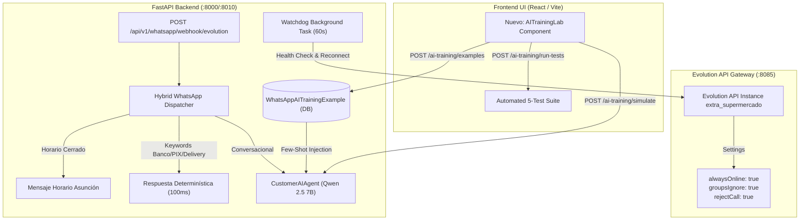

# Plan de Implementación: Overhaul de WhatsApp & Laboratorio de Entrenamiento IA

> **For agentic workers:** REQUIRED SUB-SKILL: Use superpowers:subagent-driven-development to implement this plan task-by-task. Steps use checkbox (`- [ ]`) syntax for tracking.

**Goal:** Blindar la estabilidad de conexión del gateway WhatsApp (Evolution API), unificar el enrutador híbrido determinístico + IA, y construir el Laboratorio y Simulador de Entrenamiento IA para Extra Supermercado.

**Architecture:** 
Implementa una arquitectura de tres capas: 
1) **Capa de Conexión & Resiliencia:** Watchdog en segundo plano con reconexión automática periódica (60s), forzado de `alwaysOnline` y `groupsIgnore` en Evolution API, y conmutación de webhook hacia NGINX (`:5173`).
2) **Capa de Orquestación Híbrida:** Enrutador determinístico para respuestas bancarias, fiscales y de horario comercial paraguayo (`America/Asuncion`) en 100ms + Agente IA (Qwen 2.5 7B en Ollama) con inyección dinámica de ejemplos Few-Shot y Tool Calling a PostgreSQL.
3) **Capa de Entrenamiento & Simulación:** Pestaña de Laboratorio en React con selector de perfil simulado (Paraguayo, Brasileño 🇧🇷, ExtraClub, Reclamante), inspector X-Ray de razonamiento/herramientas, botón "Corregir / Adiestrar" (1 clic) y batería de 5 pruebas de regresión automáticas.

**Architecture Diagram:**



**Tech Stack:** Python 3.11+, FastAPI, SQLAlchemy (Async), PostgreSQL, Ollama (Qwen 2.5 7B), Evolution API v2, React 18, TypeScript, Tailwind CSS, Lucide Icons.

**Spec:** [docs/superpowers/specs/2026-10-15-whatsapp-overhaul-and-simulator-design.md](file:///Users/gustaquevedo/Library/CloudStorage/OneDrive-Personal/Dev/Intelimarket/docs/superpowers/specs/2026-10-15-whatsapp-overhaul-and-simulator-design.md)

## Global Constraints
- **PROHIBIDO TOCAR POS NI ELECTRON:** Cero modificaciones a `ui-web/src/pages/pos/`, `electron/`, o scripts de punto de venta.
- **ZONA HORARIA INMUTABLE:** Todo cálculo horario y fecha debe evaluarse sobre `America/Asuncion` (Paraguay).
- **DATOS FISCALES EXACTOS:** Toda plantilla o mención empresarial debe reflejar: Razón Social `GRUPO SANTA TERESA E.A.S.` y RUC `80150377-9`.
- **REGLA DE FORMATO DE MONTOS:** `<CurrencyInput />` y `formatPYG()` para importes de dinero.
- **DESPLIEGUE ZERO-DOWNTIME:** Producción se actualiza exclusivamente con `bash deploy-api.sh` y `bash deploy-ui.sh`.

---

## Tareas de Implementación

### Tarea 1: Modelo de Datos para Adiestramiento y Feedback del Agente IA
**Archivos:**
- `api/src/whatsapp/models.py`
- `api/src/db.py` (registro de modelo si aplica)

- [ ] **Paso 1.1:** Definir la tabla `whatsapp_ai_training_examples` en `api/src/whatsapp/models.py`:
  - `id`: UUID (Primary Key, default uuid4).
  - `tenant_id`: UUID (Foreign Key a tenants).
  - `company_id`: UUID (Foreign Key a companies, nullable).
  - `categoria`: String(50) (ej: `carniceria`, `formas_pago`, `delivery`, `extraclub`, `reclamaciones`, `general`).
  - `mensaje_usuario`: Text (pregunta o caso planteado).
  - `respuesta_ideal`: Text (respuesta modélica esperada con tono Extra Supermercado).
  - `directiva_asociada`: Text (pauta o regla que debe recordar el LLM).
  - `activo`: Boolean (default True).
  - `origen`: String(50) (default `manual_admin`, `correccion_simulador`, `correccion_livechat`).
  - `created_at`: DateTime(timezone=True).
  - `updated_at`: DateTime(timezone=True).
- [ ] **Paso 1.2:** Crear o verificar migración de Alembic para la tabla `whatsapp_ai_training_examples`.
- [ ] **Paso 1.3:** Crear funciones de servicio en `api/src/whatsapp/service.py`:
  - `list_ai_training_examples(db, tenant_id, categoria=None, activo_only=True)`.
  - `create_ai_training_example(db, tenant_id, data)`.
  - `update_ai_training_example(db, example_id, data)`.
  - `delete_ai_training_example(db, example_id)`.
- [ ] **Paso 1.4:** Commit: `feat(whatsapp): modelo y servicios de ejemplos de adiestramiento IA`.

---

### Tarea 2: Blindaje de Conexión, Watchdog de Reconexión y Configuración de Evolution API
**Archivos:**
- `api/src/whatsapp/evolution_client.py`
- `api/src/whatsapp/watchdog.py`
- `api/src/main.py` (arranque del watchdog)

- [ ] **Paso 2.1:** Extender `EvolutionClient` en `evolution_client.py`:
  - `update_instance_settings(instance_name, always_online=True, groups_ignore=True, reject_call=True)`: actualiza `/settings/set/{instance}`.
  - `update_webhook_url(instance_name, webhook_url)`: asegura que el webhook apunte a `http://100.83.91.76:5173/api/v1/whatsapp/webhook/evolution`.
  - `reconnect_if_needed(instance_name)`: consulta `/connectionState` y si está en `close`, dispara `/connect`.
- [ ] **Paso 2.2:** Crear `api/src/whatsapp/watchdog.py`:
  - Background task asíncrona que corre cada 60s.
  - Monitorea la instancia de WhatsApp de Extra Supermercado.
  - Si el estado cae a `close` y no es por desvinculación explícita, intenta reestablecer el socket silenciosamente.
  - Almacena el último estado de salud y timestamp en memoria/cache.
- [ ] **Paso 2.3:** Integrar el watchdog en el ciclo de vida de la aplicación (`lifespan` en `api/src/main.py`).
- [ ] **Paso 2.4:** Commit: `feat(whatsapp): watchdog de auto-reconexion y blindaje de settings evolution`.

---

### Tarea 3: Orquestador Híbrido en el Webhook y Enriquecimiento con Few-Shots
**Archivos:**
- `api/src/whatsapp/router.py`
- `api/src/whatsapp/ai_agent.py`

- [ ] **Paso 3.1:** Actualizar `CustomerAIAgent` en `ai_agent.py`:
  - En `process_message`, cargar ejemplos activos de `whatsapp_ai_training_examples`.
  - Formatear e inyectar los ejemplos en el System Prompt de Qwen 2.5 como sección:
    ```text
    EJEMPLOS DE RESPUESTAS MODÉLICAS (APRENDIDAS POR EL SUPERMERCADO):
    [Usuario]: {mensaje_usuario}
    [Asistente]: {respuesta_ideal}
    ```
  - Instrumentar métricas de trazabilidad: capturar tiempo de respuesta (`latency_ms`), lista de herramientas ejecutadas con sus argumentos y payloads devueltos por PostgreSQL, y verificación de guardrails.
- [ ] **Paso 3.2:** Refactorizar el webhook de entrada en `router.py`:
  - **Filtro 1 (Horarios):** Evaluar si está dentro de horario de atención según `America/Asuncion`. Si está cerrado, devolver el mensaje oficial configurado.
  - **Filtro 2 (Palabras clave críticas):** Si el mensaje contiene "alias", "pix", "cuenta", "banco", "transferencia", responder de inmediato (100ms) con los datos bancarios exactos de Continental / Grupo Santa Teresa E.A.S.
  - **Filtro 3 (Agente IA):** Para lenguaje natural, derivar a `CustomerAIAgent`.
- [ ] **Paso 3.3:** Crear endpoints en `router.py` para el Simulador y Gestión de Entrenamiento:
  - `GET /api/v1/whatsapp/ai-training/examples`: listar ejemplos de entrenamiento.
  - `POST /api/v1/whatsapp/ai-training/examples`: crear nuevo ejemplo o corrección.
  - `PUT /api/v1/whatsapp/ai-training/examples/{id}`: editar ejemplo.
  - `DELETE /api/v1/whatsapp/ai-training/examples/{id}`: eliminar ejemplo.
  - `POST /api/v1/whatsapp/ai-training/simulate`: simular conversación con trazabilidad X-Ray completa (retorna respuesta, latencia, herramientas llamadas, datos SQL y comprobación de seguridad).
  - `POST /api/v1/whatsapp/ai-training/run-tests`: corre la batería de 5 escenarios predefinidos y retorna resultados booleanos de QA.
- [ ] **Paso 3.4:** Commit: `feat(whatsapp): orquestador hibrido deterministico y endpoints del simulador IA`.

---

### Tarea 4: Componente Frontend: Laboratorio & Simulador de Entrenamiento IA
**Archivos:**
- `ui-web/src/api/index.ts`
- `ui-web/src/pages/whatsapp/components/AITrainingLab.tsx` (Nuevo)
- `ui-web/src/pages/whatsapp/WhatsAppPage.tsx`
- `ui-web/src/pages/whatsapp/components/livechat/LiveChatHub.tsx`

- [ ] **Paso 4.1:** Actualizar `ui-web/src/api/index.ts` con las nuevas rutas de `api.whatsapp.aiTraining`:
  - `listExamples()`, `createExample()`, `updateExample()`, `deleteExample()`.
  - `simulate(payload: { message, persona, conversation_history })`.
  - `runQualityTests()`.
  - `updateGatewaySettings(payload)`.
- [ ] **Paso 4.2:** Construir `AITrainingLab.tsx`:
  - **Header de Control:** Estado del modelo Qwen 2.5, latencia, watchdog de Evolution y botón de Batería de Tests.
  - **Selector de Perfil de Cliente Simulado:**
    - 🇵🇾 Cliente Local (Guaraníes, compras habituales).
    - 🇧🇷 Cliente Frontera (Prefijo +55, portugués, Reales, PIX).
    - 🌟 Socio ExtraClub (Puntos acumulados y vales canjeables).
    - ⚠️ Cliente Reclamante (Prueba de derivación humana).
  - **Chat Interactivo:** Mensajería en tiempo real simulando WhatsApp con soporte para previsualizar presupuestos PDF generados.
  - **Inspector X-Ray Lateral:** Desglose de herramientas ejecutadas, argumentos, SQL devuelto, latencia y verificación de guardrails.
  - **Modal "Corregir / Adiestrar":** Botón de un clic para registrar la respuesta ideal y convertirla en pauta permanente.
  - **Pestaña de Ejemplos de Entrenamiento:** Tabla para administrar, activar/desactivar o editar los ejemplos aprendidos.
- [ ] **Paso 4.3:** Integrar botón "Adiestrar / Corregir Bot" en `LiveChatHub.tsx`:
  - Permite a los operadores humanos corregir respuestas del bot directamente desde el historial de conversaciones reales.
- [ ] **Paso 4.4:** Añadir la pestaña `simulator` ("🧪 Laboratorio & Simulador IA") a la barra principal de `WhatsAppPage.tsx`.
- [ ] **Paso 4.5:** Commit: `feat(whatsapp): interfaz completa de laboratorio y simulador de entrenamiento IA`.

---

### Tarea 5: Verificación, Validación en Producción y Despliegue Zero-Downtime
**Archivos:**
- Todo el repositorio

- [ ] **Paso 5.1:** Ejecutar `npx tsc --noEmit` en `ui-web` y confirmar 0 errores de tipo.
- [ ] **Paso 5.2:** Ejecutar `npm run build` en `ui-web` y confirmar empaquetado exitoso sin advertencias críticas.
- [ ] **Paso 5.3:** Validar endpoints de backend mediante pruebas automáticas o scripts de verificación local.
- [ ] **Paso 5.4:** Git push a `origin/vertical/supermercado`.
- [ ] **Paso 5.5:** Despliegue Zero-Downtime en la VM de producción:
  - `bash deploy-api.sh`
  - `bash deploy-ui.sh`
- [ ] **Paso 5.6:** Verificación final en vivo:
  - Comprobar que NGINX responde HTTP 200 en `/api/health`.
  - Comprobar que el simulador ejecutaTool Calling correctamente contra PostgreSQL.
  - Comprobar que el watchdog de Evolution API reporta estado y auto-reconexión.
- [ ] **Paso 5.7:** Commit final y documentación actualizada.
