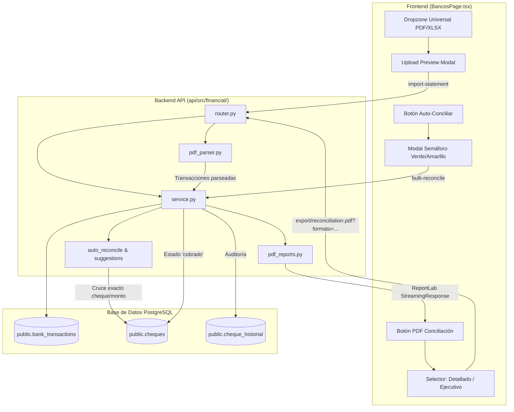

# Conciliación Bancaria Integral, Ingesta de Extractos PDF y Reportes Duales Implementation Plan

> **For agentic workers:** REQUIRED SUB-SKILL: Use superpowers:subagent-driven-development to implement this plan task-by-task. Steps use checkbox (`- [ ]`) syntax for tracking.

**Goal:** Implementar la ingesta universal de extractos bancarios en PDF/Excel (Banco Continental y Banco Interfisa), el asistente inteligente de auto-conciliación con semáforo de confianza en UI, y la generación dual de reportes PDF de conciliación bancaria (A4 Landscape Detallado con saldo progresivo y A4 Portrait Resumido Ejecutivo).

**Architecture:** Se crea un motor de parsing bancario (`pdf_parser.py`) basado en `pdfplumber` que procesa extractos de Continental e Interfisa extrayendo transacciones y referencias de cheques; se amplía el servicio financiero (`service.py` y `router.py`) para soportar carga multipart PDF/XLSX y emparejamiento inteligente de cheques diferidos; se refactoriza `pdf_reports.py` para generar reportes en orientación Landscape y Portrait; y se actualiza la interfaz React (`BancosPage.tsx`) con dropzone unificado y selector de formato PDF.

**Architecture Diagram:**



**Tech Stack:** Python 3.12+, FastAPI, SQLAlchemy (asyncpg), ReportLab, pdfplumber, React, Vite, TypeScript, Tailwind CSS.

**Spec:** [docs/superpowers/specs/2026-10-17-conciliacion-bancaria-integral-design.md](file:///Users/gustaquevedo/Library/CloudStorage/OneDrive-Personal/Dev/Intelimarket/docs/superpowers/specs/2026-10-17-conciliacion-bancaria-integral-design.md)

## Global Constraints

- **Zona Horaria:** `America/Asuncion` (UTC-4 / UTC-3). Ningún timestamp en crudo UTC en los PDFs.
- **Formato Moneda:** Canónico Guaraníes (PYG) enteros sin decimales, con punto separador de miles (ej: `Gs. 28.663.060`).
- **Seguridad en BD:** No tocar POS ni Electron (`GEMINI.md`). Todas las conciliaciones deben ser transaccionales con registro en `public.cheque_historial`.
- **Despliegues:** Despliegue con scripts canónicos (`deploy-api.sh` y `deploy-ui.sh`).

---

### Task 1: Parser de Extractos Bancarios en PDF (Continental e Interfisa)

**Files:**
- Create: `api/src/financial/pdf_parser.py`
- Test: `api/tests/test_bank_pdf_parser.py`

**Interfaces:**
- Produces:
  ```python
  def parse_bank_statement_pdf(content: bytes) -> dict:
      """Retorna:
      {
          'banco': 'CONTINENTAL' | 'INTERFISA',
          'tipo_cuenta': 'corriente' | 'ahorro',
          'numero_cuenta': str,
          'periodo_desde': date,
          'periodo_hasta': date,
          'saldo_anterior': Decimal,
          'saldo_cierre': Decimal,
          'transacciones': list[dict] # {fecha, hora, descripcion, referencia, tipo, monto, saldo_progresivo, nro_cheque}
      }
      """
  ```

- [ ] **Step 1: Write the failing unit test**
  Crear `api/tests/test_bank_pdf_parser.py` utilizando los archivos reales de muestra en `Datos/` (`CONTINENTAL CTE SEPTIEMBRE 2026.pdf` e `INTERFISA CTE AGOSTO 2026.pdf`).

- [ ] **Step 2: Run test to verify it fails**
  Run: `pytest api/tests/test_bank_pdf_parser.py -v`
  Expected: FAIL con `ModuleNotFoundError: No module named 'api.src.financial.pdf_parser'`

- [ ] **Step 3: Implement minimal parser in `pdf_parser.py`**
  Implementar la extracción de tablas para Continental y líneas estructuradas para Interfisa con extracción de N° de cheques mediante regex `r'(?:CHEQUE DEP\.?\s*N/B|CHEQUE PAGADO|CHQ)\s*(\d+)'`.

- [ ] **Step 4: Run test to verify it passes**
  Run: `pytest api/tests/test_bank_pdf_parser.py -v`
  Expected: PASS

- [ ] **Step 5: Commit**
  ```bash
  git add api/src/financial/pdf_parser.py api/tests/test_bank_pdf_parser.py
  git commit -m "feat(financial): parser de extractos bancarios PDF para Continental e Interfisa"
  ```

---

### Task 2: Endpoint Unificado de Ingesta de Extractos (PDF & Excel) en API

**Files:**
- Modify: `api/src/financial/service.py:1490-1550`
- Modify: `api/src/financial/router.py:475-515`
- Test: `api/tests/test_bank_statement_endpoint.py`

**Interfaces:**
- Produces:
  - `POST /api/financial/banks/{account_id}/import-statement/preview`
  - `POST /api/financial/banks/{account_id}/import-statement` (recibe archivo `.pdf`, `.xlsx` o `.xls`).

- [ ] **Step 1: Write the failing integration test**
  Verificar que `POST /api/financial/banks/{account_id}/import-statement/preview` acepte PDF y devuelva la estructura de vista previa.

- [ ] **Step 2: Run test to verify it fails**
  Run: `pytest api/tests/test_bank_statement_endpoint.py -v`
  Expected: FAIL (404 Not Found o endpoint no existente)

- [ ] **Step 3: Implement backend integration**
  Integrar `parse_bank_statement_pdf` en `service.py` y exponer las rutas universales en `router.py`.

- [ ] **Step 4: Run test to verify it passes**
  Run: `pytest api/tests/test_bank_statement_endpoint.py -v`
  Expected: PASS

- [ ] **Step 5: Commit**
  ```bash
  git add api/src/financial/service.py api/src/financial/router.py api/tests/test_bank_statement_endpoint.py
  git commit -m "feat(financial): endpoint unificado de importacion de extractos PDF y Excel"
  ```

---

### Task 3: Motor Inteligente de Auto-Conciliación (Emparejamiento de Cheques y Semáforo)

**Files:**
- Modify: `api/src/financial/service.py:1610-1700`
- Modify: `api/src/financial/router.py:430-475`
- Test: `api/tests/test_auto_reconcile_smart.py`

**Interfaces:**
- Produces:
  - `GET /api/financial/banks/{account_id}/reconciliation-suggestions`: Retorna movimientos bancarios con coincidencias clasificadas en `verde` (número y monto exacto de cheque o referencia) y `amarillo` (monto exacto en ventana temporal).
  - Efecto colateral: Al conciliar un cheque por número exacto, pasa a `cobrado` y actualiza `cheque_historial`.

- [ ] **Step 1: Write unit test for matching logic**
  Validar que un débito bancario que contenga en su texto `353711` empareje con el cheque diferido entregado `353711` con confianza `alta` (`verde`).

- [ ] **Step 2: Run test to verify it fails**
  Run: `pytest api/tests/test_auto_reconcile_smart.py -v`
  Expected: FAIL

- [ ] **Step 3: Implement enhanced matching algorithm**
  Modificar `get_reconciliation_suggestions` en `service.py` para buscar cheques entregados/pendientes por número de cheque y monto.

- [ ] **Step 4: Run test to verify it passes**
  Run: `pytest api/tests/test_auto_reconcile_smart.py -v`
  Expected: PASS

- [ ] **Step 5: Commit**
  ```bash
  git add api/src/financial/service.py api/src/financial/router.py api/tests/test_auto_reconcile_smart.py
  git commit -m "feat(financial): motor de auto-conciliacion con matching de cheques y semaforo de certeza"
  ```

---

### Task 4: Generador Dual de PDF de Conciliación (Landscape Detallado & Portrait Resumido)

**Files:**
- Modify: `api/src/financial/pdf_reports.py:85-135`
- Modify: `api/src/financial/service.py:1890-1925`
- Modify: `api/src/financial/router.py:277-293`
- Test: `api/tests/test_reconciliation_pdf_dual.py`

**Interfaces:**
- Consumes: `get_reconciliation_report(db, company_id, account_id, desde, hasta)`
- Produces:
  ```python
  def generate_reconciliation_pdf(
      company: dict, account, reporte: dict,
      fecha_desde: Optional[date], fecha_hasta: Optional[date],
      formato: str = "landscape", # 'landscape' o 'portrait'
      generated_by: str = ""
  ) -> bytes:
  ```

- [ ] **Step 1: Write test for PDF byte generation in both formats**
  Test que invoque la función con `formato="landscape"` y `formato="portrait"`, comprobando que devuelva un PDF válido que comience con `%PDF-` y sin desbordes.

- [ ] **Step 2: Run test to verify it fails**
  Run: `pytest api/tests/test_reconciliation_pdf_dual.py -v`
  Expected: FAIL (argumento `formato` no soportado)

- [ ] **Step 3: Implement dual PDF generation**
  - Implementar cuadro de conciliación contable superior: Saldo Extracto + Depósitos en Tránsito - Cheques en Tránsito = Saldo en Libros.
  - Formato `landscape`: Grilla completa de movimientos con saldo progresivo.
  - Formato `portrait`: Resumen ejecutivo de 1 página con solo partidas pendientes de conciliación.
  - Parámetro `formato` en query de `router.py`.

- [ ] **Step 4: Run test to verify it passes**
  Run: `pytest api/tests/test_reconciliation_pdf_dual.py -v`
  Expected: PASS

- [ ] **Step 5: Commit**
  ```bash
  git add api/src/financial/pdf_reports.py api/src/financial/service.py api/src/financial/router.py api/tests/test_reconciliation_pdf_dual.py
  git commit -m "feat(financial): generador dual de PDF de conciliacion (landscape detallado y portrait ejecutivo)"
  ```

---

### Task 5: Interfaz Web en React (Dropzone Universal, Asistente Semáforo y Menú PDF)

**Files:**
- Modify: `ui-web/src/pages/bancos/BancosPage.tsx:1320-1860`
- Modify: `ui-web/src/services/financial.service.ts`

- [ ] **Step 1: Add frontend service methods**
  Agregar `importStatementPreview(accountId, file)` e `importStatement(accountId, file)` con soporte de `formato` en `downloadReconciliationPdf`.

- [ ] **Step 2: Implement Dropzone Universal en `BancosPage.tsx`**
  Permitir arrastrar archivos `.pdf` o `.xlsx` con modal de vista previa antes de confirmar la carga de movimientos.

- [ ] **Step 3: Implement Modal de Auto-Conciliación con Semáforo**
  Separar en dos pestañas/bloques: "Coincidencias Seguras (Verde)" seleccionadas por defecto con botón "Conciliar Lote", y "Sugerencias Dudosas (Amarillo)" con botones individuales.

- [ ] **Step 4: Implement Selector de PDF (Detallado Landscape vs Resumido Portrait)**
  Menú desplegable en el botón *"PDF Conciliación"* que permita descargar inmediatamente la versión requerida.

- [ ] **Step 5: Build y verificación de UI**
  Ejecutar `npm run build` en `ui-web/` para asegurar cero errores de tipado o empaquetado.

- [ ] **Step 6: Commit**
  ```bash
  git add ui-web/src/pages/bancos/BancosPage.tsx ui-web/src/services/financial.service.ts
  git commit -m "feat(ui): dropzone universal de extractos, asistente semaforo y selector dual de pdf de conciliacion"
  ```

---

### Task 6: Despliegue Zero-Downtime y Verificación en Producción

**Files:**
- Run: `bash deploy-api.sh`
- Run: `bash deploy-ui.sh`

- [ ] **Step 1: Desplegar Backend**
  Ejecutar `bash deploy-api.sh` en la VM de producción.
- [ ] **Step 2: Desplegar Frontend**
  Ejecutar `bash deploy-ui.sh` en la VM de producción.
- [ ] **Step 3: Prueba E2E en Producción**
  Subir el extracto `CONTINENTAL CTE SEPTIEMBRE 2026.pdf`, validar las coincidencias sugeridas, auto-conciliar un lote y descargar ambos PDFs (Landscape y Portrait) para corroborar la calidad visual.
- [ ] **Step 4: Commit y consolidación**
  Registrar evidencia y sincronizar con `origin/vertical/supermercado`.
