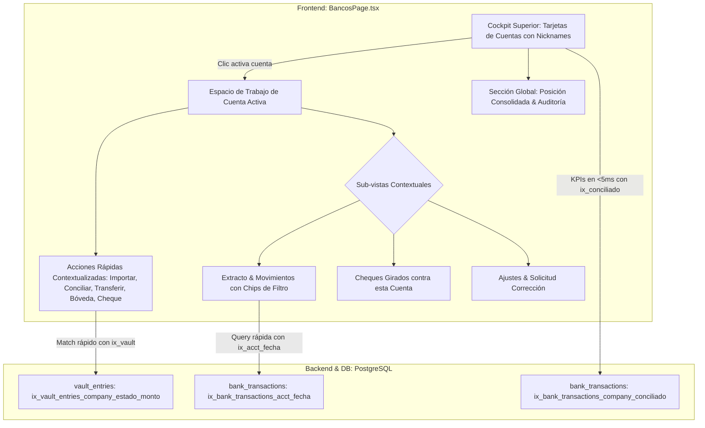

# Plan de Implementación: Módulo de Cuentas Bancarias — Workspace Unificado y Optimización de Índices

> **For agentic workers:** REQUIRED SUB-SKILL: Use superpowers:subagent-driven-development to implement this plan task-by-task. Steps use checkbox (`- [ ]`) syntax for tracking.

**Goal:** Unificar la experiencia del módulo de Cuentas Bancarias en un workspace maestro-detalle sin navegación fragmentada, destacando los nicknames de las cuentas e indexando las tablas de transacciones bancarias y bóveda en PostgreSQL.

**Architecture:** Se implementa una migración de Alembic con índices compuestos especializados sobre `bank_transactions` y `vault_entries`. En el frontend ([BancosPage.tsx](file:///Users/gustaquevedo/Library/CloudStorage/OneDrive-Personal/Dev/Intelimarket/ui-web/src/pages/bancos/BancosPage.tsx)), se reorganiza el layout en un selector de cuentas superior tipo cockpit con alias/nicknames destacados, y un espacio de trabajo continuo contextualizado a la cuenta bancaria activa con acciones directas (importar extracto, auto-conciliar, transferir, depositar y emitir cheque sin selector redundante) y filtros integrados.

**Architecture Diagram:**



**Tech Stack:** React 18, TypeScript, TailwindCSS, Lucide Icons, FastAPI, SQLAlchemy 2.0 async, PostgreSQL 15, Alembic.

**Spec:** [docs/superpowers/specs/2026-10-19-modulo-bancos-workspace-unificado-y-optimizacion-indices.md](file:///Users/gustaquevedo/Library/CloudStorage/OneDrive-Personal/Dev/Intelimarket/docs/superpowers/specs/2026-10-19-modulo-bancos-workspace-unificado-y-optimizacion-indices.md)

## Global Constraints
- Rama de trabajo: `vertical/supermercado`.
- No tocar POS (`ui-web/src/pages/pos/`) ni Electron (`electron/`).
- Zona horaria obligatoria: `America/Asuncion` (UTC-4 / UTC-3).
- Formato canónico de montos: [formatPYG](file:///Users/gustaquevedo/Library/CloudStorage/OneDrive-Personal/Dev/Intelimarket/ui-web/src/utils/format.ts), sin decimales en guaraníes, sin prefijo `Gs.` en encabezados.
- Despliegue zero-downtime: exclusivamente `bash deploy-ui.sh && bash deploy-api.sh`.

---

### Task 1: Migración Alembic para Índices de Rendimiento en PostgreSQL

**Files:**
- Create: `api/alembic/versions/20261019154500_add_bank_transactions_and_vault_indexes.py`

**Interfaces:**
- Consumes: `bank_transactions` y `vault_entries` en esquemas `public` y `sandbox`.
- Produces: Índices compuestos `ix_bank_transactions_acct_fecha`, `ix_bank_transactions_company_conciliado`, `ix_bank_transactions_cheque_id`, `ix_bank_transactions_invoice_id`, y `ix_vault_entries_company_estado_monto`.

- [ ] **Step 1: Crear archivo de migración Alembic**

Escribir `api/alembic/versions/20261019154500_add_bank_transactions_and_vault_indexes.py`:
```python
"""add bank transactions and vault indexes

Revision ID: 20261019154500
Revises: 20261019140000
Create Date: 2026-10-19 15:45:00
"""
from alembic import op

revision = "20261019154500"
down_revision = "20261019140000"
branch_labels = None
depends_on = None

def upgrade():
    op.execute("""
        CREATE INDEX IF NOT EXISTS ix_bank_transactions_acct_fecha 
        ON bank_transactions (bank_account_id, fecha DESC);
    """)
    op.execute("""
        CREATE INDEX IF NOT EXISTS ix_bank_transactions_company_conciliado 
        ON bank_transactions (company_id, conciliado);
    """)
    op.execute("""
        CREATE INDEX IF NOT EXISTS ix_bank_transactions_cheque_id 
        ON bank_transactions (cheque_id) WHERE cheque_id IS NOT NULL;
    """)
    op.execute("""
        CREATE INDEX IF NOT EXISTS ix_bank_transactions_invoice_id 
        ON bank_transactions (invoice_id) WHERE invoice_id IS NOT NULL;
    """)
    op.execute("""
        CREATE INDEX IF NOT EXISTS ix_vault_entries_company_estado_monto 
        ON vault_entries (company_id, estado, monto_pyg);
    """)

def downgrade():
    op.execute("DROP INDEX IF EXISTS ix_bank_transactions_acct_fecha;")
    op.execute("DROP INDEX IF EXISTS ix_bank_transactions_company_conciliado;")
    op.execute("DROP INDEX IF EXISTS ix_bank_transactions_cheque_id;")
    op.execute("DROP INDEX IF EXISTS ix_bank_transactions_invoice_id;")
    op.execute("DROP INDEX IF EXISTS ix_vault_entries_company_estado_monto;")
```

- [ ] **Step 2: Probar migración con Alembic localmente**

Run: `cd api && uv run alembic upgrade head`
Expected: Migración aplicada exitosamente.

- [ ] **Step 3: Commit**

```bash
git add api/alembic/versions/20261019154500_add_bank_transactions_and_vault_indexes.py
git commit -m "perf(db): agregar indices especializados para bank_transactions y vault_entries"
```

---

### Task 2: Rediseño del Cockpit Superior y Espacio de Trabajo en BancosPage.tsx

**Files:**
- Modify: `ui-web/src/pages/bancos/BancosPage.tsx`

**Interfaces:**
- Consumes: `banks`, `bankDashboard`, `bankTxns`, `cheques`, `selectedBank`.
- Produces: Layout unificado maestro-detalle donde la selección de cuenta activa de inmediato su espacio de trabajo con acciones rápidas, filtros por chip e integración total sin idas y vueltas.

- [ ] **Step 1: Implementar Cockpit de Cuentas con Nicknames Prominentes**
En `BancosPage.tsx`, rediseñar las tarjetas superiores:
- Mostrar el **Nickname/Alias** (`b.alias || b.banco`) en tamaño destacado y con badge de estilo distintivo.
- Mostrar debajo el banco oficial, tipo de cuenta y número de cuenta.
- Mostrar el saldo actual formateado con `formatGs`.
- Badge indicador de movimientos pendientes de conciliar (`acctStats?.pendientes`).
- Al hacer clic, fijar `selectedBank = b.id` y cargar sus transacciones.

- [ ] **Step 2: Implementar el Espacio de Trabajo de la Cuenta Activa**
Directamente debajo del cockpit:
- Cabecera de la cuenta activa con sus datos y barra de **Acciones Rápidas Contextualizadas**:
  * Botón `📥 Importar Extracto` (abre `showImportBank` ya vinculado a `selectedBank`).
  * Botón `⚡ Auto-Conciliar Inteligente` (ejecuta `openAutoReconcile` directo).
  * Botón `💸 Transferencia / Comisión` (abre `showTxModal` con origen en `selectedBank`).
  * Botón `🏦 Depositar Bóveda` (abre `showDepositModal` con destino en `selectedBank`).
  * Botón `✍️ Emitir Cheque` (abre `showChequeModal` con cuenta emisora en `selectedBank`).
- Pestañas internas de la cuenta:
  1. `📑 Extracto & Movimientos`:
     - Chips de filtro rápido: `Todos`, `Pendientes (X)`, `Conciliados (Y)`, `Cheques`.
     - Buscador por texto (descripción, referencia, monto).
     - Tabla con badges interactivos y botón directo de `Buscar Coincidencia` o `Desvincular`.
  2. `🧾 Cheques de esta Cuenta`:
     - Lista filtrada de `cheques` donde `bank_account_id === selectedBank`.
     - Indicador de saldo bancario real vs. saldo proyectado descontando cheques en tránsito.
  3. `⚙️ Configuración & Ajustes`:
     - Edición del alias/nickname, umbral de saldo mínimo y solicitud de corrección.

- [ ] **Step 3: Pestaña Global de Posición Consolidada & Auditoría**
Mantener como segunda vista accesible desde una solapa superior:
- Gráfico de Posición de Caja en el tiempo (`AreaChart`).
- Bandeja de solicitudes de corrección de saldo para aprobación gerencial.
- Cartera general consolidada de todos los cheques de la empresa.

- [ ] **Step 4: Verificar compilación en frontend**

Run: `cd ui-web && npm run build`
Expected: Build exitoso sin errores de TypeScript ni empaquetado Vite.

- [ ] **Step 5: Commit**

```bash
git add ui-web/src/pages/bancos/BancosPage.tsx
git commit -m "feat(ui): unificar modulo de bancos en workspace maestro-detalle con nicknames destacados"
```

---

### Task 3: Despliegue Zero-Downtime a Producción y Validación de Rendimiento

**Files:**
- Run: `deploy-ui.sh` y `deploy-api.sh` en el servidor de producción.

- [ ] **Step 1: Git push a origin/vertical/supermercado**

```bash
git push origin vertical/supermercado
```

- [ ] **Step 2: Despliegue en servidor de producción**

```bash
ssh intellihouse@100.83.91.76 "cd /home/intellihouse/intelimarket && git pull origin vertical/supermercado && bash deploy-ui.sh && bash deploy-api.sh"
```
Expected: Migración 20261019154500 aplicada, build atómico conmutado y rolling restart exitoso sin cortes.

- [ ] **Step 3: Verificación de índices y tiempos de respuesta en producción**

Comprobar vía consulta SQL en la base de datos de producción que los índices están activos y que las consultas de extracto y conteo de pendientes devuelven en milisegundos.
