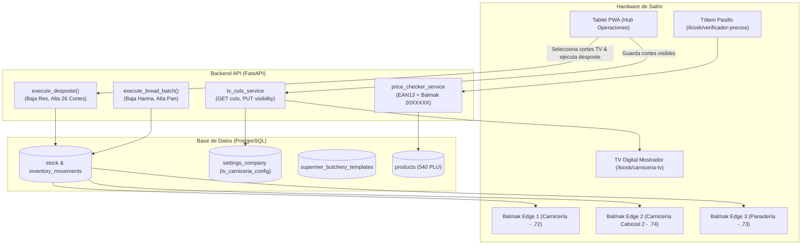

# Plan de Implementación: Bloque Operaciones de Salón y TV Digital Carnicería (Extra Supermercado)

> **For agentic workers:** REQUIRED SUB-SKILL: Use superpowers:subagent-driven-development to implement this plan task-by-task. Steps use checkbox (`- [ ]`) syntax for tracking.

**Goal:** Transformar y poner en producción los 8 módulos de Operaciones de Salón para Extra Supermercado, conectando la TV Digital Carnicería 1080p en formato lista de precios con selección desde tablet y destaque de promos, el desposte de res con alimentación real a stock y balanzas Balmak Edge, horneadas de panadería en 1 tap, verificador de precios kiosco y el Hub PWA ergonómico en tablet.

**Architecture:** Se dota al backend de endpoints dedicados para TV Digital (`tv-cuts`) guardando la visibilidad en `settings_company`, se refactoriza `execute_desposte` para que impacte formalmente en `Stock` e `InventoryMovement` deduciendo la res y acreditando los 26 cortes con su costo ponderado, y en el frontend se rediseña la TV Digital (`/kiosk/carniceria-tv`) como pizarra negra 1080p con columnas y auto-destaque de ofertas, junto con el selector en tablet y los paneles táctiles de piso.

**Architecture Diagram:**

**Tech Stack:** FastAPI (Python 3.11, SQLAlchemy asyncpg), React 18 / TypeScript, Tailwind CSS, Vite, PostgreSQL 15.

**Spec:** [`docs/superpowers/specs/2026-10-20-salon-operations-architecture.md`](file:///Users/gustaquevedo/Library/CloudStorage/OneDrive-Personal/Dev/Intelimarket/docs/superpowers/specs/2026-10-20-salon-operations-architecture.md)

## Global Constraints
- Prohibido tocar POS (`ui-web/src/pages/pos/`) o Electron.
- Zona horaria obligatoria `America/Asuncion` (UTC-4 / UTC-3).
- Moneda paraguaya PYG sin decimales ni sufijos redundantes; inputs obligatorios con `<CurrencyInput />`.
- Modales con arquitectura canónica: `max-h-[90vh] flex flex-col`, header `shrink-0`, body `flex-1 overflow-y-auto`, footer `shrink-0`.
- Despliegue con scripts oficiales: `bash deploy-api.sh` y `bash deploy-ui.sh`.

---

### Task 1: Backend — Alimentación Real de Stock en Desposte y Endpoints de TV Digital

**Files:**
- Modify: `api/src/supermer/service.py`
- Modify: `api/src/supermer/router.py`
- Modify: `api/src/supermer/schemas.py`
- Test: `tests/test_butchery_and_tv.py`

**Interfaces:**
- `GET /api/v1/supermer/butchery/tv-cuts`: Devuelve lista de cortes cárnicos con precio normal, precio promo, `en_promo` y `visible_en_tv`.
- `PUT /api/v1/supermer/butchery/tv-cuts/visibility`: Recibe `visible_product_ids: list[str]` y guarda en `settings_company` (clave `tv_carniceria_config`).
- `POST /api/v1/supermer/butchery/desposte`: Actualizado para descontar materia prima (`RES ENTERA BOVINA`) e incrementar stock de los 26 cortes en `stock` con `InventoryMovement`.

- [ ] **Step 1: Escribir prueba unitaria para `tv-cuts` y stock feed de desposte**
- [ ] **Step 2: Ejecutar test y verificar fallo esperado**
- [ ] **Step 3: Implementar métodos en `service.py`, schemas en `schemas.py` y endpoints en `router.py`**
- [ ] **Step 4: Ejecutar test y verificar pase**
- [ ] **Step 5: Commit:** `git commit -m "feat(supermer): endpoints tv-cuts y alimentacion real de stock en execute_desposte"`

---

### Task 2: Frontend — TV Digital Carnicería 1080p en Formato Lista con Destaque Automático

**Files:**
- Modify: `ui-web/src/pages/kiosk/CarniceriaTvDigitalPage.tsx`
- Modify: `ui-web/src/api/index.ts`

**Interfaces:**
- Consumes: `api.supermer.butchery.tvCuts()` (`GET /api/v1/supermer/butchery/tv-cuts`)
- Produces: Pantalla completa 1920x1080, tema oscuro profundo, formato lista de precios (pizarra digital) organizada en 2-3 columnas fijas sin scroll vertical, destaque automático en dorado con badge `OFERTA` y precio anterior tachado para cortes en promoción, auto-refresco cada 25 segundos.

- [ ] **Step 1: Actualizar cliente API en `ui-web/src/api/index.ts` con métodos `getTvCuts()` y `updateTvCutsVisibility()`**
- [ ] **Step 2: Rediseñar `CarniceriaTvDigitalPage.tsx` eliminando datos mock y configurando layout lista 1080p oscura**
- [ ] **Step 3: Agregar lógica de polling suave y renderizado de badges de promo automáticos**
- [ ] **Step 4: Verificar compilación con `npm run build`**
- [ ] **Step 5: Commit:** `git commit -m "feat(tv-kiosk): pizarra digital carniceria 1080p en tema oscuro con lista de precios y auto-destaque de ofertas"`

---

### Task 3: Frontend — Control de Pizarra TV y Desposte Táctil desde Tablet

**Files:**
- Modify: `ui-web/src/pages/operations/CarniceriaDespostePage.tsx`

**Interfaces:**
- Consumes: `api.supermer.butchery.templates.list()`, `api.supermer.butchery.desposte()`, `api.supermer.butchery.getTvCuts()`, `api.supermer.butchery.updateTvCutsVisibility()`
- Produces:
  1. Nueva pestaña o modal: *"Gestor de Pizarra TV"*, permitiendo activar/desactivar qué cortes se muestran en la TV con 1 tap.
  2. Rediseño ergonómico del desposte táctil: ingreso de kilos de res, cálculo inmediato de la fórmula con los 26 cortes, confirmación táctil que alimenta el stock vendible.

- [ ] **Step 1: Agregar subpanel "Pizarra TV Carnicería" en `CarniceriaDespostePage.tsx` con switches de visibilidad**
- [ ] **Step 2: Integrar guardado automático de visibilidad contra el endpoint backend**
- [ ] **Step 3: Rediseñar la sección de ejecución de desposte adaptada a pantalla táctil de tablet (botones grandes, CurrencyInput para costo)**
- [ ] **Step 4: Verificar compilación con `npm run build`**
- [ ] **Step 5: Commit:** `git commit -m "feat(carniceria): gestor de cortes para pizarra tv y desposte tactil conectado a stock"`

---

### Task 4: Backend & Frontend — Panadería & Rotisería con Horneadas Batch en 1 Tap

**Files:**
- Modify: `api/src/supermer/service.py`
- Modify: `api/src/supermer/router.py`
- Modify: `ui-web/src/pages/operations/PanaderiaRotiseriaPage.tsx`

**Interfaces:**
- Backend: `POST /api/v1/supermer/bakery/quick-batch`: Recibe `{tipo_pan, bolsas_harina, kilos_obtenidos, fecha_vencimiento}`. Descuenta insumos proporcionalmente y suma los kilos a `PAN FRANCES KG` (PLU 98) o `PAN FELIPE` (PLU 100).
- Frontend: `PanaderiaRotiseriaPage.tsx` con tarjetas táctiles de horneada rápida en 1 tap para la tablet de panadería.

- [ ] **Step 1: Implementar servicio y endpoint `quick-batch` en backend**
- [ ] **Step 2: Probar endpoint con test unitario**
- [ ] **Step 3: Rediseñar `PanaderiaRotiseriaPage.tsx` con tarjetas táctiles para horneada y rotisería**
- [ ] **Step 4: Verificar compilación con `npm run build`**
- [ ] **Step 5: Commit:** `git commit -m "feat(panaderia): horneadas batch en 1 tap para alimentacion de stock vendible"`

---

### Task 5: Frontend — Verificador de Precios Kiosco con Soporte Dual de Códigos

**Files:**
- Modify: `ui-web/src/pages/kiosk/PriceCheckerKioskPage.tsx`

**Interfaces:**
- Lectura EAN-13 Comercial: Muestra precio normal y precio mayorista (a partir de 3/6 unidades).
- Lectura EAN-13 Balmak Edge (prefijo `20`): Parsea PLU, identifica producto pesable, muestra kilos y monto a pagar.
- Temporizador regresivo de 7 segundos para auto-reset a la pantalla de bienvenida.

- [ ] **Step 1: Implementar parser de códigos de balanza (prefijo 20) y cálculo mayorista en `PriceCheckerKioskPage.tsx`**
- [ ] **Step 2: Ajustar diseño de alta legibilidad táctil para tótem con auto-reset**
- [ ] **Step 3: Verificar compilación con `npm run build`**
- [ ] **Step 4: Commit:** `git commit -m "feat(kiosk): verificador de precios con soporte mayorista y balanzas balmak edge"`

---

### Task 6: Frontend — Hub Operaciones Tablet PWA (Reposición, Merma y Flejes)

**Files:**
- Modify: `ui-web/src/pages/operations/SalonOperacionesPwaPage.tsx`

**Interfaces:**
- Módulo Quiebres & Reposición: Muestra stock salón vs. stock depósito central con botón táctil "Solicitar Reposición".
- Módulo Merma Express: 4 botones directos para asentar merma de góndola en 2 segundos.
- Módulo Auditoría Flejes: Comparación de precio de fleje vs. precio sistema.
- Accesos rápidos táctiles a Desposte, Horneada, Temperaturas y TV.

- [ ] **Step 1: Refactorizar `SalonOperacionesPwaPage.tsx` modularizando los paneles táctiles de tablet**
- [ ] **Step 2: Vincular las acciones de merma rápida y reposición con los endpoints existentes**
- [ ] **Step 3: Verificar compilación con `npm run build`**
- [ ] **Step 4: Commit:** `git commit -m "feat(hub-pwa): interfaz ergonomica de tablet para reposicion mermas y auditoria"`

---

### Task 7: Frontend & Backend — Verdulería, HACCP y Mantenimiento de Equipos

**Files:**
- Modify: `ui-web/src/pages/operations/VerduleriaFrescosPage.tsx`
- Modify: `ui-web/src/pages/operations/HaccpPage.tsx`
- Modify: `ui-web/src/pages/operations/EquipmentPage.tsx`

**Interfaces:**
- `VerduleriaFrescosPage.tsx`: Registro diario de pesaje de merma de cajones y markdown express.
- `HaccpPage.tsx`: Registro táctil de 3 temperaturas de frío (-2°C a 2°C) con semáforo y alerta roja inmediata.
- `EquipmentPage.tsx`: Fichas de equipos (Balmak Edge, sierras, horno, picadora) con botón de reporte de falla en 2 toques.

- [ ] **Step 1: Simplificar `VerduleriaFrescosPage.tsx` a pesaje de merma diaria y markdown**
- [ ] **Step 2: Simplificar `HaccpPage.tsx` a control de temperaturas con semáforo preventivo**
- [ ] **Step 3: Simplificar `EquipmentPage.tsx` con fichas de máquinas y reporte de avería rápido**
- [ ] **Step 4: Verificar compilación con `npm run build`**
- [ ] **Step 5: Commit:** `git commit -m "feat(operaciones): simplificacion de frescos haccp y mantenimiento de equipos"`

---

### Task 8: Verificación Global, Build y Despliegue Zero-Downtime

**Files:**
- Verify: Todas las páginas de `ui-web/src/pages/operations/` y `ui-web/src/pages/kiosk/`
- Deploy: `deploy-api.sh` y `deploy-ui.sh`

- [ ] **Step 1: Ejecutar verificación de tipos y build de producción en UI (`npm run build`)**
- [ ] **Step 2: Ejecutar suite de pruebas de backend con `pytest`**
- [ ] **Step 3: Desplegar backend con `bash deploy-api.sh` (reinicio secuencial zero-downtime)**
- [ ] **Step 4: Desplegar frontend con `bash deploy-ui.sh` (enlace atómico)**
- [ ] **Step 5: Validar en vivo la TV Digital en `http://100.83.91.76:5173/kiosk/carniceria-tv` y el Hub en tablet**
