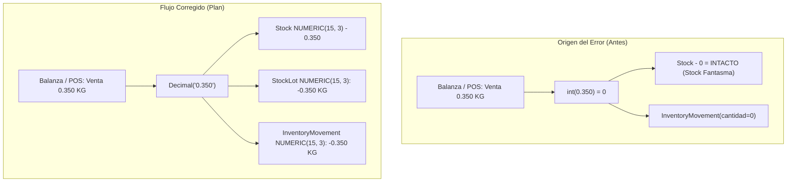

# Plan de Remediación Integral: Soporte de Stock Decimal y Sinceramiento de Pesables (Kokue Poty y Supermercado)

> **Para ejecutores y subagentes:** HABILIDAD REQUERIDA: `superpowers:subagent-driven-development` para implementar este plan tarea por tarea. Cada tarea contiene pasos TDD atómicos (`- [ ]`).

**Meta:** Eliminar el truncamiento entero (`int()`) en el cálculo de stock para productos pesables/fraccionarios, migrar el esquema de base de datos a `NUMERIC(15, 3)` y recalcular el stock real de Extra Supermercado eliminando el stock fantasma acumulado.

**Arquitectura:**
1. **Base de Datos (Alembic):** Migrar `stock.cantidad`, `stock.cantidad_reservada`, `stock_lots.cantidad`, `stock_lots.cantidad_disponible` e `inventory_movements.cantidad` de `INTEGER` a `NUMERIC(15, 3)`.
2. **Backend (FastAPI / SQLAlchemy):** Eliminar todos los casts destructivos `int(...)` y `round(...)` en `api/src/sales/service.py`, `api/src/purchases/service.py` e `api/src/inventory/service.py`, reemplazándolos por `Decimal(str(...))` exacto.
3. **Remediación y Sinceramiento Histórico:** Script transaccional con auditoría que calcule la fracción decimal no descontada en los 196.401 ítems vendidos históricamente y ajuste el saldo real de cada SKU afectado.

**Diagrama de Arquitectura y Flujo de Datos:**

**Tech Stack:** FastAPI, SQLAlchemy 2.0 Async, PostgreSQL 16 (Alembic), Pydantic v2.

---

## Restricciones Globales
- **Regla 7 (Zero-Downtime):** Todo despliegue en producción debe utilizar `bash deploy-api.sh` sin reiniciar a ciegas.
- **Regla 10 (Formatos y Decimales):** Cantidades de pesables deben preservar 3 decimales (`NUMERIC(15, 3)`), mientras que importes de dinero en Guaraníes siguen siendo enteros sin decimales.
- **Regla 12 (Aislamiento Transaccional):** Toda corrección de stock histórico debe ejecutarse dentro de transacciones aisladas con log de auditoría (`InventoryMovement` de ajuste con trazabilidad).

---

## Tareas de Implementación

### Tarea 1: Migración DDL de Alembic a NUMERIC(15, 3)

**Archivos:**
- Crear: `api/alembic/versions/20261028095000_migrate_stock_columns_to_numeric.py`
- Modificar: `api/src/inventory/models.py:69-106`
- Test: `api/tests/test_decimal_stock_ddl.py`

**Interfaces:**
- `Stock.cantidad`: `Numeric(15, 3)`
- `Stock.cantidad_reservada`: `Numeric(15, 3)`
- `StockLot.cantidad`: `Numeric(15, 3)`
- `StockLot.cantidad_disponible`: `Numeric(15, 3)`
- `InventoryMovement.cantidad`: `Numeric(15, 3)`

- [ ] **Paso 1: Escribir migración de Alembic**
- [ ] **Paso 2: Actualizar modelos SQLAlchemy en `api/src/inventory/models.py`**
- [ ] **Paso 3: Ejecutar migración en VM y verificar DDL**

---

### Tarea 2: Eliminar casts destructivos `int()` en Ventas y Recepciones

**Archivos:**
- Modificar: `api/src/sales/service.py:820-920`
- Modificar: `api/src/purchases/service.py:780-860`
- Test: `api/tests/test_pesable_sales_deduction.py`

- [ ] **Paso 1: Escribir test automatizado de deducción decimal en venta**
- [ ] **Paso 2: Corregir `_deduct_stock_for_sale` en `api/src/sales/service.py`**
- [ ] **Paso 3: Corregir recepción de compras en `api/src/purchases/service.py`**
- [ ] **Paso 4: Ejecutar test y verificar PASS**

---

### Tarea 3: Script de Sinceramiento y Remediación de Stock Histórico

**Archivos:**
- Crear: `scripts/sincerar_stock_pesables_historico.py`

- [ ] **Paso 1: Dry-run del script calculando desfases exactos por producto**
- [ ] **Paso 2: Generar movimiento compensatorio oficial en Kardex**
- [ ] **Paso 3: Ejecutar en producción y verificar que Kokue Poty refleje el stock real**
- SKU 126617: de 36 a 14.515 KG
- SKU 126618: de 34 a 17.559 KG
- SKU 126549: de 55 a 31.921 KG

---

### Tarea 4: Despliegue Zero-Downtime y Verificación Final

- [ ] **Paso 1: Ejecutar `bash deploy-api.sh`**
- [ ] **Paso 2: Ejecutar venta de prueba de 0.250 KG en POS Sandbox y verificar descuento en vivo**
