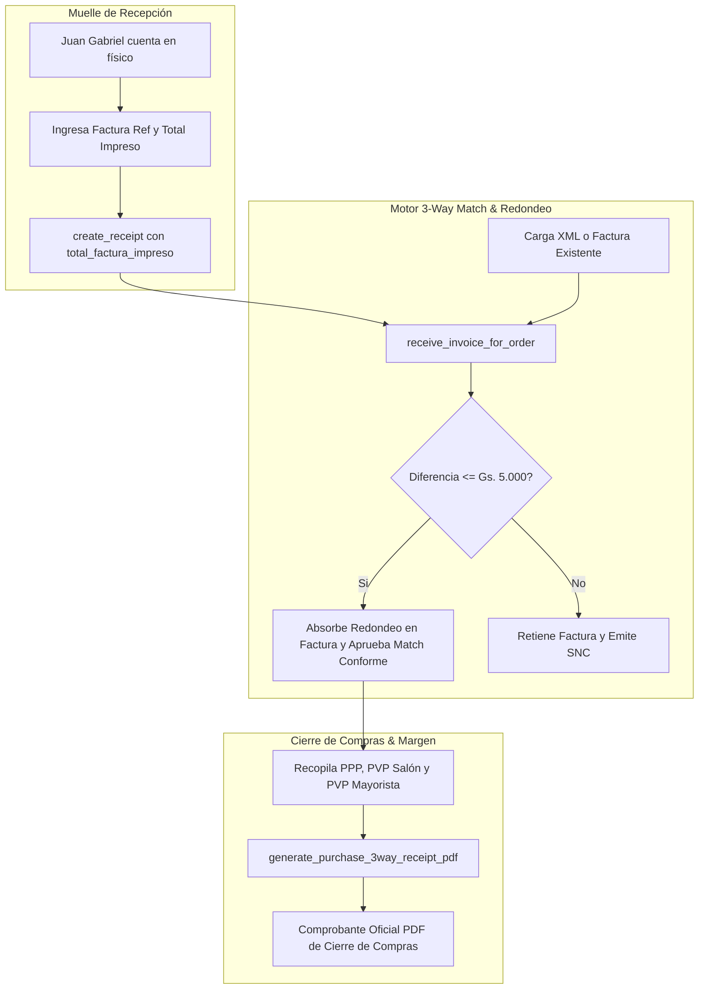

# Acta de Recepción, Cotejo 3-Way Match y Cierre de Compras con Márgenes Comerciales - Implementation Plan

> **For agentic workers:** REQUIRED SUB-SKILL: Use superpowers:subagent-driven-development to implement this plan task-by-task. Steps use checkbox (`- [ ]`) syntax for tracking.

**Goal:** Implementar el comprobante oficial "Acta de Recepción y Cierre de Compras (Auditoría 3-Way Match & Margen Comercial)" con las columnas de Costo Promedio (PPP), Precios de Salón y Mayorista con sus márgenes calculados sobre PPP, junto con el campo de ajuste de monto por redondeo decimal en la asignación de factura y recepción física.

**Architecture:** Se incorpora el generador ReportLab `generate_purchase_3way_receipt_pdf` en el backend, soportado por un endpoint que compila la tríada (Orden de Compra, Recepción en Muelle, Factura Fiscal) y los datos de fijación de precios de los productos. En el frontend, se integran los campos de monto físico impreso con `<CurrencyInput />` y los botones de descarga/impresión directa tanto en muelle (`DepositoRecepcionPage.tsx`) como en auditoría (`PurchasesPage.tsx`).

**Architecture Diagram:**

**Tech Stack:** Python 3.11, FastAPI, SQLAlchemy 2.0 Async, ReportLab, React, TypeScript, Tailwind CSS, Playwright.

**Spec:** [docs/superpowers/specs/2026-10-29-recepcion-3way-match-comprobante-cierre-compras-design.md](file:///Users/gustaquevedo/Library/CloudStorage/OneDrive-Personal/Dev/Intelimarket/docs/superpowers/specs/2026-10-29-recepcion-3way-match-comprobante-cierre-compras-design.md)

---

## Global Constraints

- **NO TOCAR POS NI ELECTRON:** Prohibido modificar archivos en `ui-web/src/pages/pos/` ni `electron/`.
- **REGLA DE MONEDA:** Moneda PYG tácita; terminantemente prohibido imprimir `Gs.` en reportes o encabezados.
- **ZONA HORARIA:** Todas las fechas y horas deben formatearse en `America/Asuncion`.
- **INPUTS DE MONEDA:** Usar obligatoriamente `<CurrencyInput />` para importes monetarios.
- **MODALES:** Seguir la arquitectura canónica `max-h-[90vh] flex flex-col overflow-hidden rounded-2xl shadow-xl`.

---

## Tasks

- [ ] **Task 1: Generador ReportLab del Comprobante PDF de Cierre 3-Way y Márgenes**
  - [ ] Implementar `generate_purchase_3way_receipt_pdf` en `api/src/purchases/pdf_reports.py` con orientación horizontal o vertical optimizada para las 11 columnas.
  - [ ] Incluir cálculo de márgenes sobre Costo Promedio (PPP): `((PVP - PPP) / PVP) * 100`.
  - [ ] Incluir semáforo 3-way, datos de muelle, factura, orden y firmas tripartitas.
  - [ ] Escribir script de prueba unitaria en `scripts/test_pdf_3way_receipt.py` para verificar que el PDF se genera correctamente sin errores de tipografía o desbordes.

- [ ] **Task 2: Lógica de Negocio y Endpoint Backend para Compilar Datos y Servir el PDF**
  - [ ] Crear función de servicio `get_3way_receipt_data` en `api/src/purchases/service.py` que vincule `PurchaseOrder`, `PurchaseReceipt`, `SupplierInvoice`, ítems y los datos de `Product` (`costo_promedio`, `precio_venta`, `precio_mayorista`).
  - [ ] Crear endpoint `GET /v1/purchase-orders/{order_id}/3way-receipt-pdf` y `GET /v1/purchases/invoices/{invoice_id}/3way-receipt-pdf` en `api/src/purchases/router.py`.
  - [ ] Actualizar `receive_invoice_for_order` para admitir `total_factura_impreso` como parámetro opcional, ajustando el saldo/total de la factura ante diferencias de redondeo válidas ($\le ₲ 5.000$).

- [ ] **Task 3: Actualización del Cliente API y Frontend en Muelle de Recepción (`DepositoRecepcionPage.tsx`)**
  - [ ] Registrar en `ui-web/src/api/index.ts` el método `download3WayReceiptPdf(orderId: string, invoiceId?: string)`.
  - [ ] En `ui-web/src/pages/operations/DepositoRecepcionPage.tsx`:
    - Agregar estado `totalFacturaImpreso` y campo numérico con `<CurrencyInput />` en la sección de datos del comprobante.
    - Enviar `total_factura_impreso` en `createReceipt`.
    - En la vista de éxito (`viewState === 'success'`), añadir botón principal "Descargar / Imprimir Acta de Cierre 3-Way & Márgenes".

- [ ] **Task 4: Actualización en Módulo de Compras & Auditoría 3-Way (`PurchasesPage.tsx`)**
  - [ ] En el modal de asignación de factura (`setShowReceiveInvoiceModal`):
    - Añadir campo de ajuste con `<CurrencyInput />` para el total impreso de la factura física.
    - Enviar `total_factura_impreso` a `receiveInvoiceForOrder`.
  - [ ] En el modal de auditoría 3-Way Match (`showMatchModal`):
    - Añadir botón de acción "Imprimir Acta de Recepción y Cierre 3-Way (PDF)".
  - [ ] En la tabla principal de Órdenes de Compra:
    - Agregar acción en el menú contextual / fila para descargar el acta de recepción cuando la orden ya cuente con recepción o factura.

- [ ] **Task 5: Verificación End-to-End con Playwright & Validación Final**
  - [ ] Crear test automatizado en `tests-pos/test-3way-receipt-pdf.spec.js` para validar la navegación, presencia de los campos de redondeo y descarga del PDF.
  - [ ] Ejecutar el test localmente con Playwright y capturar evidencia.
  - [ ] Verificar que no existan regresiones en el flujo P2P.
