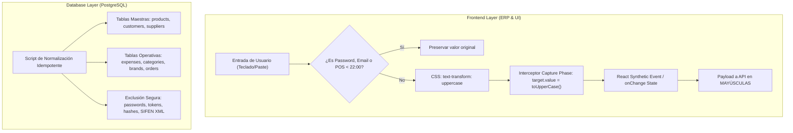

# Plan de Implementación: Política Canónica de Textos en MAYÚSCULAS y Normalización de Datos

> **For agentic workers:** REQUIRED SUB-SKILL: Use superpowers:subagent-driven-development to implement this plan task-by-task. Steps use checkbox (`- [ ]`) syntax for tracking.

**Goal:** Implementar de forma canónica y universal la política de textos en MAYÚSCULAS en todas las entradas de texto del ERP (excluyendo contraseñas y correos), normalizar el histórico de datos existente en la base de datos PostgreSQL, y dejar programada la activación para las terminales POS a las 22:00 hs.

**Architecture:**
Aplicación de una estrategia en tres capas siguiendo la filosofía Ponytail (*mínimo cambio que resuelve el 100% del requerimiento*):
1. **Capa Visual:** CSS global en `index.css` con `text-transform: uppercase` excluyendo passwords, emails y campos técnicos.
2. **Capa React/DOM:** Interceptor en fase de captura (`capture: true`) en `App.tsx` que actualiza el valor nativo del elemento con el descriptor de prototipo antes de la propagación a React.
3. **Capa de Persistencia:** Script de normalización SQL idempotente en backend para tablas maestras y operativas de negocio.

**Architecture Diagram:**



**Tech Stack:** React 18, TypeScript, Tailwind CSS, PostgreSQL, Python 3.12 (SQLAlchemy Async), Playwright.

**Spec:** [`docs/superpowers/specs/2026-10-31-politica-canonica-mayusculas-y-normalizacion-datos-design.md`](file:///Users/gustaquevedo/Library/CloudStorage/OneDrive-Personal/Dev/Intelimarket/docs/superpowers/specs/2026-10-31-politica-canonica-mayusculas-y-normalizacion-datos-design.md)

## Global Constraints

- Prohibido modificar archivos dentro de `ui-web/src/pages/pos/` o `electron/` directamente en horario diurno (Regla 1 de GEMINI.md).
- Formato de moneda, timezone `America/Asuncion` y campos de contraseñas (`type="password"`) estrictamente inmutables.
- Despliegue en producción sin corte mediante `deploy-ui.sh`.

---

### Task 1: Capa Visual CSS Global de Textos en Mayúsculas

**Files:**
- Modify: `ui-web/src/index.css`

**Interfaces:**
- Consumes: Tailwind base/components layers
- Produces: Regla CSS global para `input` y `textarea`

- [ ] **Step 1: Inspeccionar y editar `ui-web/src/index.css`**
Agregar la regla canónica de `text-transform: uppercase` con exclusiones para contraseñas, emails, controles de formulario no textuales y clase `.keep-case`.

```css
/* Política Canónica: Textos en Mayúsculas (Excluye contraseñas y correos) */
input:not([type="password"]):not([type="email"]):not([type="file"]):not([type="checkbox"]):not([type="radio"]):not([type="range"]):not([type="color"]):not(.keep-case),
textarea:not(.keep-case) {
  text-transform: uppercase;
}
```

- [ ] **Step 2: Verificar sintaxis CSS y build local**
Run: `npm --prefix ui-web run build`
Expected: Build exitoso sin advertencias de CSS.

- [ ] **Step 3: Commit**
```bash
git add ui-web/src/index.css
git commit -m "feat(ui): regla css universal para textos en mayusculas excluyendo password y email"
```

---

### Task 2: Interceptor Universal DOM en Fase de Captura con Sincronización React

**Files:**
- Modify: `ui-web/src/App.tsx`
- Test: `tests-pos/test-canonical-uppercase.spec.js`

**Interfaces:**
- Consumes: Eventos `input` nativos del navegador
- Produces: Sincronización transparente de `value` en mayúsculas en el estado de React

- [ ] **Step 1: Crear prueba Playwright para verificar la transformación a mayúsculas**
Escribir `tests-pos/test-canonical-uppercase.spec.js` validando que:
1. Al tipear en un input de texto común, el valor se transforme a MAYÚSCULAS en el DOM y en React.
2. Al tipear en un input de contraseña, el valor preserve exactamente mayúsculas y minúsculas.
3. Al tipear en un input de email, el valor conserve minúsculas.

- [ ] **Step 2: Ejecutar test para verificar que falla antes de implementar el interceptor**
Run: `cd tests-pos && npx playwright test test-canonical-uppercase.spec.js`
Expected: FAIL (el texto se conserva en minúsculas en el valor de React).

- [ ] **Step 3: Implementar interceptor global en `ui-web/src/App.tsx`**
Agregar `useEffect` en `App.tsx` con el listener en fase de captura (`capture: true`):

```tsx
useEffect(() => {
  const handleGlobalInput = (e: Event) => {
    const target = e.target as HTMLInputElement | HTMLTextAreaElement;
    if (!target || !(target instanceof HTMLInputElement || target instanceof HTMLTextAreaElement)) return;

    // Blindaje de POS antes de las 22:00 hs (hora Paraguay)
    const isPosRoute = window.location.pathname.startsWith("/pos");
    const now = new Date();
    const pyHour = parseInt(now.toLocaleTimeString("en-US", { timeZone: "America/Asuncion", hour12: false, hour: "2-digit" }), 10);
    if (isPosRoute && pyHour < 22) return;

    if (
      target.type === "password" ||
      target.type === "email" ||
      target.type === "file" ||
      target.type === "checkbox" ||
      target.type === "radio" ||
      target.type === "range" ||
      target.type === "color" ||
      target.classList.contains("keep-case")
    ) {
      return;
    }

    const val = target.value;
    if (typeof val !== "string") return;
    const upper = val.toUpperCase();
    if (val !== upper) {
      const start = target.selectionStart;
      const end = target.selectionEnd;

      const proto = target instanceof HTMLInputElement ? window.HTMLInputElement.prototype : window.HTMLTextAreaElement.prototype;
      const setter = Object.getOwnPropertyDescriptor(proto, "value")?.set;
      if (setter) {
        setter.call(target, upper);
      } else {
        target.value = upper;
      }
      if (start !== null && end !== null) {
        target.setSelectionRange(start, end);
      }
    }
  };

  window.addEventListener("input", handleGlobalInput, true);
  return () => window.removeEventListener("input", handleGlobalInput, true);
}, []);
```

- [ ] **Step 4: Ejecutar test para verificar que pasa**
Run: `cd tests-pos && npx playwright test test-canonical-uppercase.spec.js`
Expected: PASS.

- [ ] **Step 5: Commit**
```bash
git add ui-web/src/App.tsx tests-pos/test-canonical-uppercase.spec.js
git commit -m "feat(ui): interceptor dom en fase de captura para sincronizar inputs en mayusculas"
```

---

### Task 3: Normalización de Datos Históricos en PostgreSQL

**Files:**
- Create: `scripts/normalizar_datos_mayusculas.py`

**Interfaces:**
- Consumes: Conexión asíncrona a PostgreSQL en VM (`async_session_factory`)
- Produces: Datos normalizados a mayúsculas en tablas maestras y operativas

- [ ] **Step 1: Escribir script de normalización idempotente `scripts/normalizar_datos_mayusculas.py`**
Script con transacciones atómicas seguras y conteo de registros actualizados en:
- `products`: `nombre`, `descripcion`, `marca`, `categoria`, `unidad_medida`
- `customers`: `razon_social`, `nombre_fantasia`, `direccion`, `contacto`, `ciudad`, `departamento`
- `suppliers`: `razon_social`, `nombre_fantasia`, `contacto`, `direccion`, `ciudad`, `rubro`
- `expenses`: `descripcion`, `proveedor`, `notas`, `employee_nombre`
- `product_categories`: `nombre`, `descripcion`
- `product_brands`: `nombre`
- `purchase_orders`: `observaciones`
- `purchase_order_items`: `descripcion`
- `purchase_receipt_items`: `descripcion`

- [ ] **Step 2: Probar el script en modo dry-run y ejecutar en la VM**
Run: `ssh intellihouse@100.83.91.76 "cd ~/intelimarket && PYTHONPATH=. .venv/bin/python scripts/normalizar_datos_mayusculas.py"`
Expected: Conteo de filas actualizadas sin errores de integridad.

- [ ] **Step 3: Commit**
```bash
git add scripts/normalizar_datos_mayusculas.py
git commit -m "feat(db): script idempotente para normalizacion de tablas maestras a mayusculas"
```

---

### Task 4: Despliegue en Producción y Verificación Final

**Files:**
- Execute: `deploy-ui.sh`

- [ ] **Step 1: Compilar frontend y desplegar sin corte**
Run: `bash deploy-ui.sh`
Expected: Build atómico y switch de symlink exitoso en `/var/www/intelimarket-ui/current`.

- [ ] **Step 2: Ejecutar suite de pruebas completa en Playwright**
Run: `cd tests-pos && npx playwright test test-canonical-uppercase.spec.js test-3way-receipt-pdf.spec.js`
Expected: Todos los tests en verde.

- [ ] **Step 3: Sincronizar repositorio git**
Run: `git push origin vertical/supermercado`
Expected: `HEAD` alineado con `origin/vertical/supermercado`.
