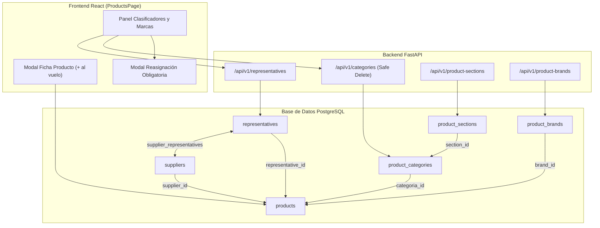

# Plan de Implementación: Representantes y Taxonomía de Productos

> **For agentic workers:** REQUIRED SUB-SKILL: Use superpowers:subagent-driven-development to implement this plan task-by-task. Steps use checkbox (`- [ ]`) syntax for tracking.

**Goal:** Implementar en InteliMarket la entidad Representante (matriz/fabricante/importador oficial), su vinculación N:M con Proveedores, la taxonomía de supermercado (Sección, Línea, Marca, Tipo), y el panel de gestión con borrado seguro y reasignación obligatoria de productos.

**Architecture:** Se crean las tablas relacionales en PostgreSQL mediante Alembic (`representatives`, `supplier_representatives`, `product_sections`, `product_brands`), se extienden `product_categories` y `products`, se exponen endpoints FastAPI con validación transaccional de reasignación en borrado, y se integran en el frontend React tanto en la ficha de producto (con botones `+` al vuelo) como en una pestaña de administración de clasificadores.

**Architecture Diagram:**



**Tech Stack:** FastAPI, SQLAlchemy 2.0 Async, Alembic, PostgreSQL 15, React 18, TypeScript, TailwindCSS, Playwright.

**Spec:** [`docs/superpowers/specs/2026-10-31-representantes-y-taxonomia-productos-design.md`](file:///Users/gustaquevedo/Library/CloudStorage/OneDrive-Personal/Dev/Intelimarket/docs/superpowers/specs/2026-10-31-representantes-y-taxonomia-productos-design.md)

## Global Constraints
- Vertical: Exclusivamente Extra Supermercado (Retail & Supermercado).
- No tocar POS (`ui-web/src/pages/pos/`) ni Electron (`electron/`).
- Despliegues: Backend con `bash deploy-api.sh` y Frontend con `bash deploy-ui.sh`.
- Zona Horaria: `America/Asuncion` para marcas de tiempo.
- Cero productos huérfanos: toda categoría eliminada con productos exige reasignación atómica en BD.

---

### Task 1: Migración Alembic y Estructura DDL en Base de Datos

**Files:**
- Create: `api/alembic/versions/20261031170000_add_representatives_and_taxonomy.py`
- Test: `scripts/test_migration_taxonomy.py`

**Interfaces:**
- Consumes: PostgreSQL schema `public`, tablas `products`, `suppliers`, `product_categories`.
- Produces: Tablas `representatives`, `supplier_representatives`, `product_sections`, `product_brands`; columnas `section_id` en `product_categories` y `representative_id`, `brand_id`, `tipo_variante` en `products`.

- [ ] **Step 1: Escribir la migración Alembic**

Crear `api/alembic/versions/20261031170000_add_representatives_and_taxonomy.py`:
- Crear tabla `representatives`: `id` UUID PK, `company_id` UUID, `nombre` VARCHAR(150), `contacto` VARCHAR(200), `telefono` VARCHAR(50), `activo` BOOLEAN default true, `created_at` TIMESTAMPTZ.
- Crear tabla `supplier_representatives`: `supplier_id` UUID FK `suppliers.id` ON DELETE CASCADE, `representative_id` UUID FK `representatives.id` ON DELETE CASCADE, `es_principal` BOOLEAN default false, `created_at` TIMESTAMPTZ, PK compuesta `(supplier_id, representative_id)`.
- Crear tabla `product_sections`: `id` UUID PK, `company_id` UUID, `nombre` VARCHAR(100), `orden` INT default 0, `activo` BOOLEAN default true.
- Crear tabla `product_brands`: `id` UUID PK, `company_id` UUID, `nombre` VARCHAR(120), `representative_id` UUID FK `representatives.id` ON DELETE SET NULL, `activo` BOOLEAN default true.
- Agregar columna `section_id` UUID FK `product_sections.id` en `product_categories`.
- Agregar columnas `representative_id` UUID FK `representatives.id`, `brand_id` UUID FK `product_brands.id`, `tipo_variante` VARCHAR(100) en `products`.
- Sembrar datos iniciales de secciones (`Bebidas`, `Almacén / Despensa`, `Lácteos y Quesería`, `Carnicería`, `Verdulería y Frutería`, `Panadería y Confitería`, `Limpieza y Lavandería`, `Perfumería y Cuidado Personal`, `Bazar y Hogar`, `Mascotas`) y representantes clave (`PARESA`, `CERVEPAR`, `UNILEVER`, `BEBIDAS DEL PARAGUAY`, `VIERCI`, `CHORTITZER (TREBOL)`, `LACTOLANDA`, `TROVATO`, `IRIS`, `REAL SUL`).

- [ ] **Step 2: Probar la migración en local/sandbox**

Ejecutar:
```bash
.venv/bin/python -m py_compile api/alembic/versions/20261031170000_add_representatives_and_taxonomy.py
```
Expected: PASS sin errores de sintaxis.

- [ ] **Step 3: Commit**

```bash
git add api/alembic/versions/20261031170000_add_representatives_and_taxonomy.py
git commit -m "feat(db): migracion alembic para representantes, marcas y secciones"
```

---

### Task 2: Modelos SQLAlchemy y Schemas Pydantic

**Files:**
- Modify: `api/src/products/models.py`
- Modify: `api/src/products/schemas.py`
- Modify: `api/src/purchases/models.py`
- Test: `tests/test_taxonomy_models.py`

**Interfaces:**
- Consumes: DDL de Task 1.
- Produces: Clases SQLAlchemy `Representative`, `SupplierRepresentative`, `ProductSection`, `ProductBrand`, relaciones en `Product`, `ProductCategory` y `Supplier`. Schemas Pydantic `RepresentativeCreate`, `RepresentativeResponse`, `BrandCreate`, `BrandResponse`, `SectionCreate`, `SectionResponse`.

- [ ] **Step 1: Escribir prueba de validación de modelos**

Crear script de prueba `tests/test_taxonomy_models.py` que importe los modelos y schemas y valide la instanciación de un `Product` con `representative_id`, `brand_id` y `tipo_variante`.

- [ ] **Step 2: Ejecutar test para verificar que falla**

```bash
.venv/bin/python tests/test_taxonomy_models.py
```
Expected: FAIL con `ImportError` o `AttributeError`.

- [ ] **Step 3: Implementar modelos en `api/src/products/models.py` y `api/src/purchases/models.py`**

Agregar las clases `Representative`, `SupplierRepresentative`, `ProductSection`, `ProductBrand` con sus `ForeignKey` e índices correspondientes. Extender `Product` y `ProductCategory`.

- [ ] **Step 4: Implementar schemas en `api/src/products/schemas.py`**

Crear schemas Pydantic v2:
- `RepresentativeCreate`, `RepresentativeUpdate`, `RepresentativeResponse`.
- `ProductBrandCreate`, `ProductBrandUpdate`, `ProductBrandResponse`.
- `ProductSectionCreate`, `ProductSectionUpdate`, `ProductSectionResponse`.
- Extender `ProductCreate`, `ProductUpdate`, `ProductResponse` con los nuevos campos.

- [ ] **Step 5: Ejecutar test para verificar que pasa**

```bash
.venv/bin/python tests/test_taxonomy_models.py
```
Expected: PASS.

- [ ] **Step 6: Commit**

```bash
git add api/src/products/models.py api/src/products/schemas.py api/src/purchases/models.py tests/test_taxonomy_models.py
git commit -m "feat(models): modelos y schemas para representantes y clasificacion comercial"
```

---

### Task 3: Backend Services y Endpoints (Representantes, Secciones, Marcas)

**Files:**
- Modify: `api/src/products/service.py`
- Modify: `api/src/products/router.py`
- Test: `tests/test_taxonomy_endpoints.py`

**Interfaces:**
- Consumes: Modelos y schemas de Task 2.
- Produces: Rutas HTTP REST para `/api/v1/representatives`, `/api/v1/product-sections`, `/api/v1/product-brands`, `/api/v1/suppliers/{id}/representatives`.

- [ ] **Step 1: Escribir test de integración de endpoints**

Crear `tests/test_taxonomy_endpoints.py` testeando creación y listado de representantes y asignación a proveedor.

- [ ] **Step 2: Implementar funciones en `api/src/products/service.py`**
- `list_representatives(db, company_id, search, limit, offset)`
- `create_representative(db, body)`
- `update_representative(db, id, body)`
- `delete_representative(db, id)`
- `list_supplier_representatives(db, supplier_id)`
- `set_supplier_representatives(db, supplier_id, representative_ids)`
- `list_product_sections(db, company_id)`
- `create_product_section(db, body)`
- `list_product_brands(db, company_id, search, limit, offset)`
- `create_product_brand(db, body)`

- [ ] **Step 3: Exponer rutas en `api/src/products/router.py`**
- `@router.get("/representatives")`
- `@router.post("/representatives")`
- `@router.patch("/representatives/{id}")`
- `@router.delete("/representatives/{id}")`
- `@router.get("/suppliers/{supplier_id}/representatives")`
- `@router.put("/suppliers/{supplier_id}/representatives")`
- `@router.get("/product-sections")`
- `@router.post("/product-sections")`
- `@router.get("/product-brands")`
- `@router.post("/product-brands")`

- [ ] **Step 4: Ejecutar test y verificar que pasa**

```bash
.venv/bin/python tests/test_taxonomy_endpoints.py
```
Expected: PASS.

- [ ] **Step 5: Commit**

```bash
git add api/src/products/service.py api/src/products/router.py tests/test_taxonomy_endpoints.py
git commit -m "feat(api): endpoints de representantes, marcas y secciones"
```

---

### Task 4: Borrado Seguro de Categorías con Reasignación Obligatoria

**Files:**
- Modify: `api/src/products/service.py`
- Modify: `api/src/products/router.py`
- Test: `tests/test_safe_category_delete.py`

**Interfaces:**
- Consumes: `ProductCategory`, `Product`.
- Produces: `DELETE /api/v1/categories/{id}?reassign_to_id={destino_id}` garantizando que ningún producto quede con `categoria_id` nulo o huérfano.

- [ ] **Step 1: Escribir test de borrado seguro**

Crear `tests/test_safe_category_delete.py`:
- Test A: Borrar categoría con 0 productos -> éxito directo.
- Test B: Borrar categoría con N productos sin `reassign_to_id` -> HTTP 409 Conflict con mensaje descriptivo.
- Test C: Borrar categoría con N productos enviando `reassign_to_id` -> productos transferidos y categoría eliminada atómicamente.

- [ ] **Step 2: Ejecutar test para verificar fallo**

```bash
.venv/bin/python tests/test_safe_category_delete.py
```
Expected: FAIL.

- [ ] **Step 3: Implementar `delete_category_safe` en `api/src/products/service.py`**

```python
async def delete_category_safe(db: AsyncSession, category_id: UUID, reassign_to_id: Optional[UUID] = None) -> dict:
    # 1. Contar productos
    q_count = await db.execute(select(func.count(Product.id)).where(Product.categoria_id == category_id))
    prod_count = q_count.scalar() or 0

    if prod_count > 0:
        if not reassign_to_id:
            raise HTTPException(
                status_code=409,
                detail=f"La categoría tiene {prod_count} productos asignados. Seleccione una categoría de destino para reasignarlos antes de eliminar."
            )
        # Verificar destino existente
        dest = await db.get(ProductCategory, reassign_to_id)
        if not dest:
            raise HTTPException(status_code=404, detail="La categoría de destino para reasignación no existe.")
        
        # Reasignación atómica
        await db.execute(
            update(Product)
            .where(Product.categoria_id == category_id)
            .values(categoria_id=reassign_to_id, updated_at=func.now())
        )

    cat = await db.get(ProductCategory, category_id)
    if not cat:
        raise HTTPException(status_code=404, detail="Categoría no encontrada.")
    await db.delete(cat)
    await db.commit()
    return {"status": "ok", "deleted_id": str(category_id), "reassigned_products": prod_count}
```

- [ ] **Step 4: Exponer endpoint en `api/src/products/router.py`**

Modificar `@router.delete("/categories/{id}")` para recibir `reassign_to_id: Optional[UUID] = Query(None)`.

- [ ] **Step 5: Ejecutar test para verificar que pasa**

```bash
.venv/bin/python tests/test_safe_category_delete.py
```
Expected: PASS.

- [ ] **Step 6: Commit**

```bash
git add api/src/products/service.py api/src/products/router.py tests/test_safe_category_delete.py
git commit -m "feat(categories): endpoint de borrado seguro con reasignacion obligatoria de productos"
```

---

### Task 5: Frontend - Ficha del Producto (Modal `/products`)

**Files:**
- Modify: `ui-web/src/api/index.ts`
- Modify: `ui-web/src/pages/products/ProductsPage.tsx`
- Test: `tests-pos/test-product-modal-taxonomy.spec.js`

**Interfaces:**
- Consumes: Endpoints de Task 3 y 4.
- Produces: Formulario enriquecido en el modal de productos con botones rápidos `+` para crear Representante, Sección, Línea y Marca al vuelo sin perder el foco.

- [ ] **Step 1: Agregar métodos cliente en `ui-web/src/api/index.ts`**
- `api.representatives.list()`, `api.representatives.create()`
- `api.sections.list()`, `api.sections.create()`
- `api.brands.list()`, `api.brands.create()`
- `api.categories.deleteSafe(id, reassignToId)`

- [ ] **Step 2: Modificar modal de edición/creación en `ui-web/src/pages/products/ProductsPage.tsx`**
- Agregar estado para `representatives`, `sections`, `brands`.
- Cargar listas al montar.
- En la ficha de producto:
  * Campo **Representante**: `<select>` con botón `+`. Al pulsar `+`, abre mini-diálogo o prompt para nombre y lo agrega instantáneamente al selector dejándolo seleccionado.
  * Campo **Sección**: `<select>` con botón `+`.
  * Campo **Línea / Categoría**: `<select>` con botón `+`, filtrando líneas si hay sección seleccionada.
  * Campo **Marca**: `<select>` con botón `+`.
  * Campo **Tipo / Variante**: `<input>` de texto libre sugerido.

- [ ] **Step 3: Verificar compilación del frontend**

Ejecutar:
```bash
cd ui-web && npm run build
```
Expected: Build exitoso sin errores de tipos TypeScript.

- [ ] **Step 4: Commit**

```bash
git add ui-web/src/api/index.ts ui-web/src/pages/products/ProductsPage.tsx
git commit -m "feat(ui): integracion de representantes, marcas y secciones con creacion al vuelo en modal de productos"
```

---

### Task 6: Frontend - Panel "Clasificadores y Marcas" y Modal de Reasignación

**Files:**
- Create: `ui-web/src/pages/products/TaxonomyManagementModal.tsx`
- Modify: `ui-web/src/pages/products/ProductsPage.tsx`
- Test: `tests-pos/test-category-reassign-ui.spec.js`

**Interfaces:**
- Consumes: `api.categories`, `api.representatives`, `api.sections`, `api.brands`.
- Produces: Panel de administración en `/products` y modal de confirmación con reasignación obligatoria.

- [ ] **Step 1: Crear `TaxonomyManagementModal.tsx`**
- Pestañas: Representantes, Categorías/Líneas, Secciones, Marcas.
- En cada pestaña: tabla interactiva con búsqueda, conteo de productos, botones de Editar y Eliminar.
- Al hacer clic en eliminar categoría:
  * Si `productos_count > 0`: despliega diálogo modal requiriendo seleccionar la categoría destino.
  * Llama a `api.categories.deleteSafe(catId, targetId)`.
  * Notifica éxito y refresca la lista.

- [ ] **Step 2: Integrar en `ProductsPage.tsx`**
- Agregar botón en la barra superior de Productos: `🏷️ Clasificadores & Marcas`.
- Al hacer clic, abre `TaxonomyManagementModal`.

- [ ] **Step 3: Compilar build de UI**

```bash
cd ui-web && npm run build
```
Expected: PASS.

- [ ] **Step 4: Commit**

```bash
git add ui-web/src/pages/products/TaxonomyManagementModal.tsx ui-web/src/pages/products/ProductsPage.tsx
git commit -m "feat(ui): panel de clasificacion comercial y modal de reasignacion obligatoria de categorias"
```

---

### Task 7: Despliegue en Producción y Validación End-to-End

**Files:**
- Test: `tests-pos/test-e2e-taxonomy.spec.js`

**Interfaces:**
- Consumes: Todo el stack.
- Produces: Despliegue en vivo en producción y verificación automatizada en Playwright.

- [ ] **Step 1: Desplegar Backend con `deploy-api.sh`**

```bash
git push origin vertical/supermercado
ssh intellihouse@100.83.91.76 "cd /home/intellihouse/intelimarket && git pull origin vertical/supermercado && bash deploy-api.sh"
```
Expected: Migración aplicada y cluster dual reiniciado con HTTP 200.

- [ ] **Step 2: Desplegar Frontend con `deploy-ui.sh`**

```bash
ssh intellihouse@100.83.91.76 "cd /home/intellihouse/intelimarket && bash deploy-ui.sh"
```
Expected: Build atómico y switch de symlink sin downtime.

- [ ] **Step 3: Ejecutar prueba E2E en Playwright**

Crear y correr `tests-pos/test-e2e-taxonomy.spec.js`:
- Iniciar sesión en `/products`.
- Abrir modal de nuevo producto, crear representante "PARESA TEST" al vuelo mediante el botón `+`.
- Seleccionar sección, línea y marca.
- Guardar producto.
- Abrir panel de clasificadores, intentar borrar una categoría con productos asignados sin destino -> verificar alerta de bloqueo.
- Seleccionar categoría destino -> ejecutar reasignación y verificar que los productos se transfirieron sin errores.

- [ ] **Step 4: Commit de pruebas y verificación final**

```bash
git add tests-pos/test-e2e-taxonomy.spec.js
git commit -m "test: verificacion automatizada end-to-end de representantes y borrado seguro de categorias"
```
