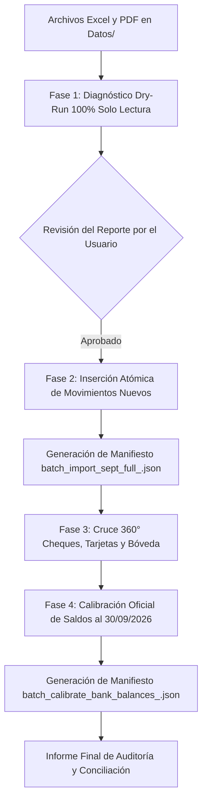

# Especificación de Diseño: Auditoría y Conciliación Bancaria Integral — Septiembre 2026

## 1. Contexto y Objetivos

Extra Supermercado Mayorista (Grupo Santa Teresa E.A.S.) dispone de los extractos bancarios consolidados al 30 de septiembre de 2026 en formato Excel y PDF en el directorio `Datos/`:
- **Banco Continental:** `CONTINENTAL MES DE SEPTIEMBRE 2026.xlsx` (Hojas `CTE`, `AHORRO`, `AHORRO PIX`) y extractos en PDF.
- **Banco Interfisa:** `INTERFISA MES DE SEPTIEMBRE 2026.xlsx` (Hojas `CTE`, `AHORRO` con más de 2.000 operaciones) y extractos en PDF.
- **Libro Maestro de Cheques:** `CHEQUES A PLAZO EXTRA PARAGUAY.xlsx` (Hoja `26`).

### Metas Principales:
1. **Detección e Incorporación Quirúrgica ("Sin Pisar Datos"):** Identificar e incorporar únicamente los movimientos del 24 al 30 de septiembre que no están en la base de datos, garantizando cero duplicación o sobreescritura de los movimientos ya auditados previamente.
2. **Cruce 360° de Operaciones:**
   - Conciliar débitos bancarios contra cheques emitidos en el libro maestro de tesorería y la tabla `cheques` de la BD, marcándolos como `COBRADO` / `COMPENSADO`.
   - Conciliar depósitos de ventanilla contra cierres de bóveda y retiros (drops) de caja salón.
   - Conciliar acreditaciones automáticas en Interfisa Ahorro contra lotes de tarjeta POS (Bancard, Dinelco, QR).
3. **Calibración Oficial de Saldos al 30/09/2026:** Ajustar los saldos maestros (`saldo_actual` en `bank_accounts`) a los balances exactos certificados por los extractos oficiales al 30/09/2026.
4. **Trazabilidad Atómica y Reversibilidad al 100%:** Cada modificación generará manifiestos JSON con UUID único y scripts de rollback dedicados (`--commit`), permitiendo revertir cualquier etapa en segundos.
5. **Informe Definitivo de Auditoría:** Actualizar [INFORME_AUDITORIA_Y_CONCILIACION_SETIEMBRE_2026.md](file:///Users/gustaquevedo/Library/CloudStorage/OneDrive-Personal/Dev/Intelimarket/Datos/INFORME_AUDITORIA_Y_CONCILIACION_SETIEMBRE_2026.md) con el balance global reconciliado del mes completo.

---

## 2. Arquitectura de Cuentas y Mapeo

El sistema gestiona 5 cuentas bancarias activas vinculadas a la empresa:

| Entidad Bancaria | Tipo Normalizado | Número de Cuenta | Banco en BD | Hoja Excel Origen |
| :--- | :--- | :--- | :--- | :--- |
| **Banco Continental** | Cta. Corriente | `382364779308` | `BANCO CONTINENTAL-CTE` | `CTE` |
| **Banco Continental** | Caja de Ahorro | `38250039706001` | `BANCO CONTINENTAL-DINELCO` | `AHORRO` |
| **Banco Continental** | Ahorro PIX | `38250039706208` | `BANCO CONTINENTAL-PLUGPAY` | `AHORRO PIX` |
| **Banco Interfisa** | Cta. Corriente | `259058910` | `BANCO INTERFISA-CTE` | `CTE` |
| **Banco Interfisa** | Caja de Ahorro | `259026699` | `BANCO INTERFISA-AHORRO` | `AHORRO` |

*Nota sobre Interfisa:* Se mantiene la regla canónica del parser `statement_import.py`: las columnas de débito y crédito del archivo de Interfisa vienen invertidas de origen respecto a la convención habitual, por lo que se invierten adecuadamente al interpretar depósitos y extracciones.

---

## 3. Pipeline de Ejecución en 4 Etapas

### Fase 1: Diagnóstico Dry-Run (Solo Lectura)
- **Script:** `api/audit_datos_septiembre_full_dryrun.py`
- Lee los archivos locales de Continental e Interfisa.
- Aplica la firma unívoca:
  `firma = (bank_account_id, fecha, tipo, monto, referencia, hash(descripcion))`
- Compara contra los registros actuales en `bank_transactions` en la BD.
- Detecta:
  - Movimientos ya existentes (duplicados ignorados).
  - Movimientos nuevos del 24 al 30 de septiembre a incorporar.
  - Cheques debitados en banco vs. libro maestro de cheques `CHEQUES A PLAZO EXTRA PARAGUAY.xlsx`.
  - Saldos de cierre actuales en BD vs. saldos esperados al 30/09.
- No ejecuta ningún `INSERT`, `UPDATE` ni `DELETE`.

### Fase 2: Inserción Quirúrgica de Movimientos Nuevos
- **Script:** `api/import_septiembre_full.py`
- Inserta exclusivamente los registros clasificados como nuevos.
- Inserta con `conciliado = False` por defecto (hasta la Fase 3).
- Genera el manifiesto atómico:
  `Datos/audit_logs/batch_import_sept_full_<UUID>.json` conteniendo los IDs de transacciones creadas.
- Script de reversión:
  `python api/revert_import_septiembre.py <MANIFIESTO.json> --commit`

### Fase 3: Conciliación Cruzada 360°
- **Script:** `api/reconcile_septiembre_full_step_c.py`
- **Cheques Emitidos:**
  - Identifica débitos bancarios correspondientes a cheques pagados.
  - Empareja con la tabla `cheques` y libro `CHEQUES A PLAZO EXTRA PARAGUAY.xlsx` por número, banco y monto.
  - Actualiza el cheque a `estado = 'COBRADO'` con fecha de débito real y vincula `bank_transaction.cheque_id`.
- **Acreditaciones y Salón:**
  - Concilia créditos de Interfisa Ahorro (`259026699`) con lotes de tarjetas POS.
  - Concilia créditos de depósitos en efectivo en Continental Cte (`382364779308`) con retiros/drops de tesorería.
- Genera manifiesto atómico de conciliación con rollback.

### Fase 4: Calibración Oficial de Saldos al 30/09/2026
- **Script:** `api/calibrate_bank_balances_sept_full.py`
- Extrae el balance oficial final al 30/09 de cada extracto bancario oficial.
- Actualiza `bank_accounts.saldo_actual` y registra la fecha de verificación `saldo_verificado_at = '2026-09-30 23:59:59'`.
- Genera manifiesto atómico:
  `Datos/audit_logs/batch_calibrate_bank_balances_<UUID>.json`.
- Script de reversión:
  `python api/revert_calibrate_bank_balances.py <MANIFIESTO.json> --commit`.
- Actualiza y emite el [INFORME_AUDITORIA_Y_CONCILIACION_SETIEMBRE_2026.md](file:///Users/gustaquevedo/Library/CloudStorage/OneDrive-Personal/Dev/Intelimarket/Datos/INFORME_AUDITORIA_Y_CONCILIACION_SETIEMBRE_2026.md).

---

## 4. Estrategia de Seguridad y Rollback

1. **Sin Riesgo de Regresión:** Cada fase es idempotente y reversible de forma independiente.
2. **Cero Caídas en Cajas de Salón:** No se tocan procesos ni tablas de ventas activas del POS, ni se realizan reinicios bruscos. Se opera de acuerdo a las reglas de `GEMINI.md`.
3. **Auditoría Forense:** Cada archivo JSON en `Datos/audit_logs/` preserva el estado previo y posterior con marca temporal en hora paraguaya (`America/Asuncion`).
