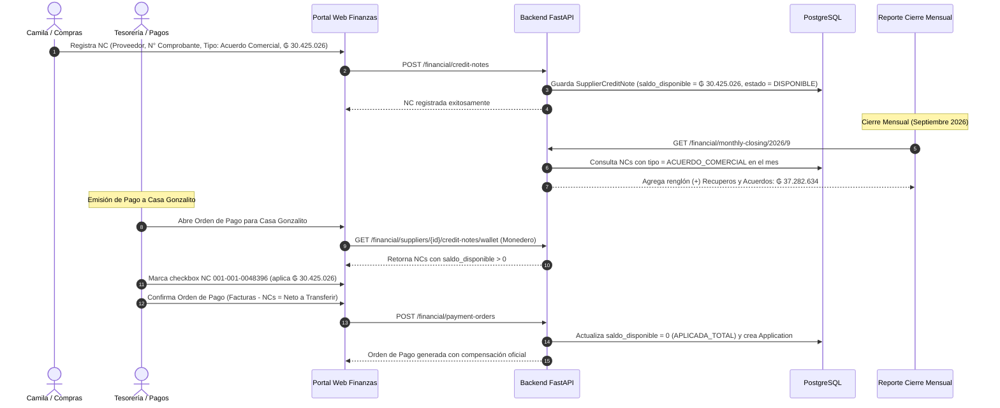

# Especificación de Diseño: Gestión de Notas de Crédito de Proveedores, Monedero de Deudas y Back Margin Comercial

**Fecha:** 2026-10-15  
**Autor:** Antigravity Agent & Equipo de Finanzas  
**Módulos Afectados:** `api/src/financial/`, `ui-web/src/pages/financial/`, `ui-web/src/components/financial/`  
**Estado:** Propuesta de Diseño Aprobada — Listo para Planificación  

---

## 1. Contexto de Negocio y Justificación

En las operaciones de retail supermercadista (*Extra Supermercado Mayorista*), las Notas de Crédito (NC) emitidas por proveedores tienen dos naturalezas completamente distintas:

1. **Notas de Crédito Operativas (Ajustes de Mercadería):**
   * *Origen:* Devoluciones físicas por rotura o vencimiento, faltantes en recepción de mercadería respecto a la factura emitida o errores en la facturación física.
   * *Impacto Contable:* **Neutro en el P&L.** Se vinculan directamente a la factura de compra de origen y restan inventario/kardex o cancelan mercadería que nunca ingresó al patrimonio.

2. **Notas de Crédito por Acuerdos Comerciales y Rebates (Back Margin):**
   * *Origen:* Retribuciones económicas pactadas por volumen de compra/venta (ej: Acuerdos con **Paresa / Coca-Cola** por ₲ 30.425.026, **Trociuk** por ₲ 5.006.250), trade marketing, descuentos especiales del 50% y aportes comerciales.
   * *Impacto Contable:* **Impacto positivo directo en la rentabilidad del mes.** Las mercaderías ya se compraron a costo regular y ya se vendieron al público. La NC constituye una ganancia comercial pura y líquida para el supermercado. En el mes de Septiembre 2026, estas percepciones suman **₲ 37.282.634 (+3.02% de margen adicional)** sobre las ventas netas de ₲ 1.234.596.102.

### Objetivo del Sistema
* Proveer un flujo de registro asistido en Finanzas para que Camila González / Compras recepcione y archive las NCs con su timbrado oficial y comprobante adjunto.
* Depositar el saldo a favor en un **"Monedero de NCs de Proveedor"** en Cuentas por Pagar (AP), disponible para ser compensado mediante casillas de verificación al emitir Órdenes de Pago (OP).
* Reflejar automáticamente las NCs de acuerdos comerciales devengadas en el **Reporte Mensual de Resultados (P&L)** como un renglón visible: `(+) Recuperos y Acuerdos Comerciales de Proveedores`, junto con una pestaña de auditoría dedicada.

---

## 2. Arquitectura de Datos y Estados

### 2.1 Modelo `SupplierCreditNote` (Mejora de Esquema)
En `api/src/financial/models.py`, se formalizan los campos requeridos para la segregación y el monedero:

* `id`: UUID (Primary Key).
* `company_id`: UUID (Multi-tenant).
* `supplier_id`: UUID (ForeignKey a Proveedor).
* `tipo_nota_credito`: Enum / Varchar(30):
  * `ACUERDO_COMERCIAL`: Rebate por volumen, sell-out, bonificación corporativa (afecta P&L).
  * `OPERATIVA`: Devolución física, rotura, faltante, error de factura (neutro en P&L, exige factura origen).
* `motivo`: Varchar(150) (ej: *"Acuerdo Comercial Paresa"*, *"Acuerdo Trociuk"*, *"Descuento 50%"*).
* `numero`: Varchar(30) (N° de comprobante legal, ej: `001-001-0048396`).
* `timbrado`: Varchar(30) (Timbrado de la SET/DNIT).
* `fecha`: Date (Fecha de emisión del comprobante).
* `fecha_recepcion`: Date (Fecha en que Camila/Compras recepcionó la NC; rige para el mes contable devengado).
* `monto`: Numeric(15, 0) (Monto total nominal de la NC).
* `saldo_disponible`: Numeric(15, 0) (Monto remanente pendiente de aplicar en pagos; inicializado en `monto`).
* `estado`: Enum / Varchar(25):
  * `DISPONIBLE`: `saldo_disponible == monto`.
  * `PARCIALMENTE_APLICADA`: `0 < saldo_disponible < monto`.
  * `APLICADA_TOTAL`: `saldo_disponible == 0`.
  * `ANULADA`: Rechazada formalmente.
* `numero_factura_origen`: Varchar(50), nullable (Obligatorio únicamente si `tipo_nota_credito == OPERATIVA`).
* `archivo_adjunto_path`: Varchar(500), nullable (PDF o imagen de respaldo).
* `observaciones`: Text.

### 2.2 Modelo `SupplierCreditNoteApplication` (Compensaciones)
Registra cada evento de descuento de saldo en una Orden de Pago:
* `id`: UUID.
* `credit_note_id`: UUID (ForeignKey a `supplier_credit_notes.id`).
* `invoice_id`: UUID (ForeignKey a `supplier_invoices.id`).
* `payment_order_id`: UUID, nullable (ForeignKey a la Orden de Pago).
* `monto_aplicado`: Numeric(15, 0).
* `fecha`: DateTime(timezone=True).
* `observaciones`: Text.

---

## 3. Flujo Funcional y Casos de Uso

---

## 4. Diseño del Reporte Mensual de Resultados (P&L)

### 4.1 Estructura del P&L Contribuido
En `monthly_closing_service.py` y `MonthlyClosingPage.tsx`:

$$\begin{aligned}
\text{Ventas Netas Operativas} &\quad \text{₲ 1.234.596.102} \\
\text{(-) Costo de Mercaderías Vendidas (CMV Facturado)} &\quad -\text{₲ 1.035.380.216} \\
\hline
\mathbf{\text{(=) Margen Bruto Frontal (Front Margin)}} &\quad \mathbf{\text{₲ 199.215.886 (16.14\%)}}\\[6pt]
\mathbf{\text{(+) Recuperos y Acuerdos Comerciales (Back Margin)}} &\quad +\mathbf{\text{₲ 37.282.634 (+3.02\%)}}\\[6pt]
\hline
\mathbf{\text{(=) Margen Comercial Total Contribuido}} &\quad \mathbf{\text{₲ 236.498.520 (19.16\%)}}\\[6pt]
\text{(-) Nómina Salarial Devengada (SueldOK)} &\quad -\text{₲ 148.214.133} \\
\text{(-) OPEX Operativo Real (Alquiler, Energía, Logística)} &\quad -\text{₲ 19.785.867} \\
\hline
\mathbf{\text{(=) EBITDA Operativo}} &\quad \mathbf{\text{₲ 68.498.520 (5.55\%)}}
\end{aligned}$$

### 4.2 Pestaña Detalle: "Acuerdos Comerciales" (`acuerdos_comerciales`)
Al hacer clic en el renglón de Recuperos y Acuerdos Comerciales, el drawer/pestaña despliega:
1. **Tarjetas KPI:**
   * Total Percepciones Devengadas: ₲ 37.282.634.
   * Aporte porcentual sobre Ventas: +3.02%.
   * Cantidad de Comprobantes: 9 NCs registradas.
   * Proveedores Benefactores: Casa Gonzalito (Paresa & Trociuk), Super Mix, Gosi, Santa María, Panama Repr., Aquidaban.
2. **Tabla Detallada de Auditoría:**
   * Columnas: Fecha, Proveedor, Razón Comercial, N° NC, Timbrado, Moneda, Monto en Gs., Estado en Monedero (Disponible / Aplicada).

---

## 5. Diseño de Componentes Frontend (UI-Web)

### 5.1 Pantalla de Gestión de Notas de Crédito (`/financial/credit-notes`)
* **Listado de NCs:** Filtros por proveedor, rango de fechas, estado del monedero (Disponible, Parcial, Aplicada) y naturaleza (`ACUERDO_COMERCIAL` vs `OPERATIVA`).
* **Modal / Formulario de Alta:**
  * Selector intuitivo de tipo (con tooltips explicativos).
  * Campos validados con máscara de timbrado y comprobante (`001-001-XXXXXXX`).
  * Botón para adjuntar comprobante PDF o foto.
* **Tarjeta de Resumen:** Indicador del saldo total disponible en cartera para compensar deudas.

### 5.2 Selector de Monedero en la Orden de Pago
* Al seleccionar un proveedor, una tabla interactiva lista las NCs disponibles.
* Checkboxes con cálculo en tiempo real:
  * Suma de Facturas Seleccionadas: ₲ A.
  * Menos NCs Compensadas: ₲ B.
  * **Neto a Transferir / Pagar:** ₲ (A - B).

---

## 6. Plan de Pruebas y Validación (TDD)

1. **Test Unitario - Creación de NCs y Clasificación:**
   * Verificar que una NC de tipo `ACUERDO_COMERCIAL` se guarde con `saldo_disponible == monto` y no exija `numero_factura_origen`.
   * Verificar que una NC de tipo `OPERATIVA` rechace el guardado si no se provee `numero_factura_origen`.
2. **Test de Compensación (Monedero):**
   * Crear una NC de ₲ 10.000.000.
   * Aplicar ₲ 6.000.000 en una factura.
   * Verificar que `saldo_disponible` se actualice a ₲ 4.000.000 y estado pase a `PARCIALMENTE_APLICADA`.
   * Aplicar los ₲ 4.000.000 restantes y verificar cambio a `APLICADA_TOTAL`.
3. **Test de Cálculo de Cierre Mensual (P&L):**
   * Correr cálculo de Septiembre 2026 y validar que el renglón `recuperos_acuerdos_comerciales` totalice exactamente ₲ 37.282.634.
   * Validar que el `margen_comercial_total` sea de ₲ 236.498.520 (19.16%).

---

## 7. Auto-Revisión de la Especificación

* **Scan de Placeholders:** Sin TBDs ni valores pendientes. Cifras y modelos contrastados con la imagen oficial de Septiembre 2026.
* **Consistencia Interna:** Los modelos `SupplierCreditNote` y `SupplierCreditNoteApplication` armonizan con la Orden de Pago y el Cierre Mensual.
* **Alcance:** Bien delimitado a la recepción de NCs, su monedero de compensación y su reflejo en el P&L.
