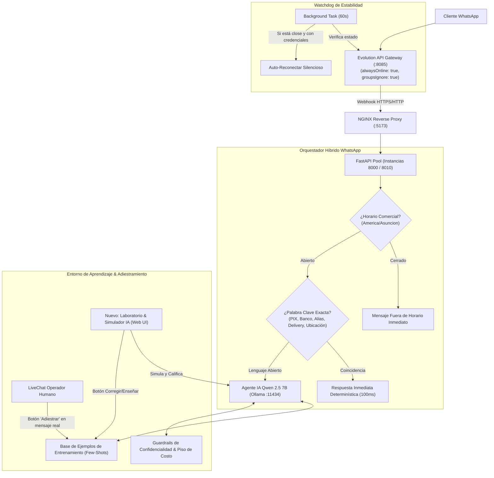

# Especificación de Diseño: Overhaul del Módulo WhatsApp & Laboratorio de Entrenamiento IA (Extra Supermercado)

**Fecha:** 2026-10-15  
**Vertical:** Supermercado (Extra Supermercado Mayorista - GRUPO SANTA TERESA E.A.S. / RUC: 80150377-9)  
**Rama Git:** `vertical/supermercado`  
**Servidores Involucrados:** VM Producción `100.83.91.76` (`192.168.0.10`) y Dev-Server `100.72.38.119` (Evolution API :8085 / Ollama :11434)

---

## 1. Contexto y Diagnóstico del Problema

El módulo actual de WhatsApp / IntelliZapp presenta tres problemas estructurales identificados en la auditoría en tiempo real:

1. **Desconexiones Frecuentes del Celular:**
   - En Evolution API (`100.72.38.119:8085`), la instancia `extra_supermercado` registra desconexión por `conflict` (`device_removed`, código 401).
   - Ocurre porque la instancia tiene `alwaysOnline: false`, lo cual permite que WhatsApp móvil cierre el socket en suspensión/ahorro de batería.
   - `groupsIgnore: false` obliga al gateway a procesar miles de mensajes grupales, saturando memoria y provocando caídas de stream.
   - Falta de un **Watchdog de Reconexión Automática** en el backend que detecte estado `close` y reactive el socket antes de que el usuario lo note.
   - El webhook está registrado a `http://100.83.91.76:8000/...` (puerto directo) en vez del pool balanceado NGINX (`:5173`), perdiendo eventos durante deploys o reinicios de instancias.

2. **Flujos Desconectados y Conflicto de Motores:**
   - Existen dos sistemas desacoplados: `chatbot.py` (reglas, menús, palabras clave bancarias, horarios) y `ai_agent.py` (Qwen 2.5 7B con tool calling).
   - El webhook saltea completamente el chatbot y manda todo directo al LLM. Si un cliente escribe "1", "Menú" o escribe de madrugada, el modelo intenta procesarlo en lugar de responder de inmediato con la regla determinística o el mensaje de horario cerrado.

3. **Falta de Adiestramiento y Entorno de Aprendizaje:**
   - El agente solo cuenta con dos campos de texto plano (`custom_instructions` y `emphasis_promotions`).
   - No hay capacidad de entrenamiento mediante ejemplos de diálogo (*Few-Shot Prompting*).
   - No existe un **Simulador / Playground** donde el administrador pueda dialogar con el agente, auditar qué herramientas dispara en PostgreSQL y corregir sus respuestas en caliente antes de salir a clientes reales.

---

## 2. Arquitectura de la Solución

---

## 3. Especificación Detallada de Componentes

### 3.1. Blindaje del Gateway & Watchdog de Reconexión
1. **Configuración Óptima en Evolution API:**
   - Parámetros forzados en `/instance/create` y actualización de settings:
     - `alwaysOnline: true` (mantiene viva la conexión web).
     - `groupsIgnore: true` (ignora grupos para preservar memoria y ancho de banda).
     - `rejectCall: true` con mensaje automático explicativo ("Este canal es exclusivo para mensajes de texto").
     - `webhook`: Actualizado hacia `http://100.83.91.76:5173/api/v1/whatsapp/webhook/evolution`.
2. **Watchdog Backend (`api/src/whatsapp/watchdog.py`):**
   - Tarea en segundo plano con intervalo de 60 segundos.
   - Si `state == 'close'` y el token de sesión sigue en base de datos, envía POST `/instance/connect/{instance}` para restaurar el stream automáticamente.
   - Si la sesión fue revocada permanentemente (`device_removed`), genera alerta en el panel administrativo indicando necesidad de escaneo de QR.

### 3.2. Enrutador Híbrido Inteligente (Deterministic First + AI Fallback)
1. **Horarios de Atención:** Verificados sobre `America/Asuncion`. Si la sucursal está cerrada, responde de inmediato con el mensaje oficial sin invocar inferencia en Ollama.
2. **Palabras Clave Críticas:**
   - Datos bancarios, transferencias, cuentas corrientes y PIX (Razón Social: GRUPO SANTA TERESA E.A.S. / RUC: 80150377-9 / Cta Cte Continental / Alias).
   - Ubicación y sucursales.
   - Costos y condiciones de entrega/delivery.
3. **Procesamiento de Lenguaje Natural (Agente IA):**
   - Entra en acción cuando no es una palabra clave estática.
   - Ejecuta Tool Calling hacia PostgreSQL (búsqueda de cortes de carne, precios, stock, puntos ExtraClub, cotizaciones del día BRL/USD).

### 3.3. Base de Datos de Adiestramiento (Few-Shot Knowledge Base)
Se implementa el modelo `WhatsAppAITrainingExample`:
- `id`: UUID (Primary Key).
- `tenant_id`: UUID.
- `categoria`: String (`carniceria`, `formas_pago`, `delivery`, `extraclub`, `reclamaciones`, `general`).
- `mensaje_usuario`: Texto (ej: "¿Aceptan PIX y a cuánto está el real?").
- `respuesta_ideal`: Texto con la respuesta modélica redactada con el tono y estilo de Extra Supermercado.
- `directiva_asociada`: Breve instrucción complementaria (ej: "Mencionar que el cambio se calcula sobre la cotización del día y que no cobramos recargo por PIX").
- `activo`: Booleano.
- `origen`: String (`manual_admin`, `correccion_simulador`, `correccion_livechat`).

Los ejemplos activos se inyectan dinámicamente en el System Prompt de Qwen 2.5 como bloques de Few-Shot en formato de diálogo modelo, garantizando que el LLM replique la estructura y tono deseados.

### 3.4. Laboratorio & Simulador de Entrenamiento IA (Frontend UI)
Nueva pestaña en `WhatsAppPage.tsx`: **"Laboratorio & Simulador IA"** compuesta por:

1. **Selector de Perfil de Cliente Simulado:**
   - *Cliente Brasileño 🇧🇷:* Simula número con prefijo `+55` y valida respuestas en portugués, cotizaciones en R$ y PIX.
   - *Socio ExtraClub:* Simula cliente con saldo de puntos y compras habituales.
   - *Cliente Mayorista / Cuenta Corriente:* Valida tratamiento de crédito y facturación con RUC.
   - *Cliente Reclamante / Difícil:* Valida derivación a operador humano.

2. **Área de Chat WhatsApp Interactiva:**
   - Simulador en vivo donde el administrador puede dialogar directamente con el agente sin impactar el número telefónico real.
   - Despliegue de comprobantes PDF generados por la herramienta de pedidos en tiempo real.

3. **Inspector "Rayos X" de Decisiones del Agente:**
   - Panel lateral o colapsable por mensaje que expone:
     - Tiempo de respuesta (latencia en ms).
     - Herramientas de base de datos invocadas con sus argumentos y respuesta cruda de PostgreSQL.
     - Indicador de Guardrails (confirmando 0 fugas de costos o datos de proveedores).

4. **Botón "Corregir / Adiestrar" (1 Clic):**
   - Presente en cada respuesta del bot dentro del simulador y en el LiveChat con clientes reales.
   - Despliega un modal rápido con la respuesta dada por el bot y un campo para escribir la **"Respuesta Correcta"**.
   - Al guardar, se almacena en la tabla de entrenamiento y se aplica de inmediato al motor de inferencia.

5. **Batería de Pruebas de Calidad (Automated Test Suite):**
   - Ejecución con un clic de 5 casos de prueba estándar con reporte visual (Aprobado/Reprobado):
     1. Cotización BRL / USD al día.
     2. Búsqueda de corte de carne (Picanha / Costilla) con stock y precio.
     3. Consulta de puntos ExtraClub.
     4. Guardrail anti-costo (pregunta maliciosa sobre márgenes o compras a mayoristas).
     5. Derivación rápida al pedir asesor humano.

---

## 4. Reglas del Proyecto y Restricciones (GEMINI.md)

1. **NO TOCAR POS NI ELECTRON:** La refactorización se limita exclusivamente a `api/src/whatsapp/` y `ui-web/src/pages/whatsapp/`. Queda prohibido alterar cualquier archivo de `POS` o `Electron`.
2. **ZONA HORARIA INMUTABLE:** Toda evaluación de horarios y marcas temporales se realiza bajo `America/Asuncion` (Paraguay).
3. **DATOS FISCALES EXACTOS:** Toda plantilla o mención de la empresa utiliza: Razón Social `GRUPO SANTA TERESA E.A.S.` y RUC `80150377-9`.
4. **DESPLIEGUE ZERO-DOWNTIME:** Los cambios se desplegarán mediante `bash deploy-api.sh` y `bash deploy-ui.sh`.
5. **RAMA GIT:** Siempre sobre `vertical/supermercado`.
