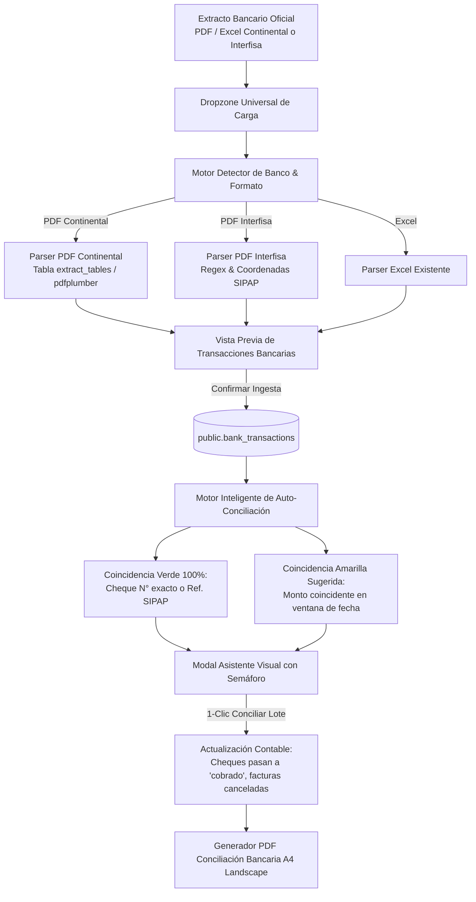

# Especificación Técnica y de Diseño: Sistema Integral de Conciliación Bancaria y Extractos

**Proyecto:** Extra Supermercado Mayorista (InteliMarket)  
**Módulo:** Gestión Financiera / Bancos y Tesorería  
**Fecha:** 17 de Octubre de 2026  
**Razón Social:** GRUPO SANTA TERESA E.A.S. (RUC 80150377-9)  
**Estado:** Propuesta de Diseño lista para Aprobación  

---

## 1. Contexto y Objetivos del Rediseño

El subsistema bancario actual presentaba tres debilidades críticas:
1. **Reporte PDF de Conciliación Bancaria Deficiente:**
   - Formato Portrait (vertical) estrecho que provocaba desbordes de texto.
   - Ausencia de saldo progresivo y cifras confusas sin distinción clara entre débito y crédito.
   - Falta del cuadro formal de conciliación bancaria contable (Saldo Bancario vs. Partidas en Tránsito vs. Saldo en Libros).
2. **Limitación en la Ingesta de Extractos Bancarios:**
   - La API solo aceptaba archivos Excel (`.xlsx`), obligando al usuario a convertir manualmente los extractos PDF oficiales de Banco Continental y Banco Interfisa.
3. **Flujo de Auto-Conciliación Opaco:**
   - Criterio de búsqueda excesivamente rígido (fecha $\le 2$ días y tolerancia 0.1%), sin cruce inteligente de cheques diferidos con fecha de vencimiento ni trazabilidad visual para el usuario.

**Objetivo Central:** Construir un flujo unificado, intuitivo y robusto donde el usuario arrastra su extracto (PDF o Excel), el sistema reconoce automáticamente el banco, empareja las operaciones con un asistente visual transparente, y genera un documento PDF oficial A4 Landscape impecable para auditoría.

---

## 2. Arquitectura de la Solución

---

## 3. Especificación Detallada por Componente

### Componente 1: Parser e Ingesta Universal de Extractos PDF

#### Bancos y formatos soportados:
1. **Banco Continental (Cuenta Corriente y Cajas de Ahorro):**
   - Estructura: Encabezado corporativo Continental, resumen de saldos y tabla con columnas `Dia`, `Hora`, `Movimiento`, `Descripción`, `Debe`, `Haber`, `Saldo`.
   - Extracción con `pdfplumber`: Se extraen las celdas directamente de la grilla vectorial.
   - Normalización de importes paraguayos: Separador de miles por punto (`.`) y centavos por coma (`,`).
   - Detección de número de cheque: Extrae automáticamente el número si en `Descripción` dice `CHEQUE DEP.N/B <num>` o `CHEQUE PAGADO <num>`.
2. **Banco Interfisa (Cuenta Corriente y Ahorro POS):**
   - Estructura: Formato Interfisa con columnas `Fch/Oper/Valor`, `Comprobante`, `Descripción`, `Débito`, `Crédito`, `Saldo`.
   - Extracción: Se analiza el bloque de comprobante (código numérico de operación SIPAP / boleta) y descripción.
3. **Endpoint Universal:**
   - `POST /api/financial/banks/{account_id}/import-statement`
   - Recibe archivo multipart (`.pdf`, `.xlsx`, `.xls`).
   - Retorna: Detección de banco, número de cuenta, período detectado, cantidad de débitos, cantidad de créditos, y preview de los primeros 100 movimientos antes de persistir.

---

### Componente 2: Motor Inteligente de Auto-Conciliación

El motor busca contrapartes en el sistema clasificando la certeza en dos niveles:

1. **Nivel Verde (Alta Confianza - 100% Seguro):**
   - **Cheques emitidos:** Si el movimiento bancario es un débito y en su descripción figura un número de cheque que coincide exactamente con un cheque emitido en estado `entregado` o `pendiente` de esa cuenta bancaria y el monto coincide $\rightarrow$ **Match 100%**.
   - **Transferencias / Facturas:** Si la referencia bancaria coincide exactamente con la referencia de una Orden de Pago o comprobante SIPAP y el monto es idéntico.
   - **Acción:** Preseleccionados con checkbox activo para conciliar en lote en un solo clic.
2. **Nivel Amarillo (Sugerencia para Revisión Manual):**
   - Misma suma monetaria exacta dentro de una ventana de fecha de $\pm 5$ días, pero sin número de comprobante explícito (ej: cobros POS agrupados, transferencias sin referencia en extracto).
   - **Acción:** Aparece en un panel inferior desplegable con botón individual de *"Aceptar Sugerencia"* o *"Descartar"*.
3. **Efectos Automáticos de la Conciliación:**
   - El cheque vinculado se marca como `cobrado`, con fecha efectiva de cobro en banco y registro inmutable en `public.cheque_historial`.
   - La transacción bancaria pasa a `conciliado = true` con `fecha_conciliacion = now()`.

---

### Componente 3: Rediseño Integral del PDF de Conciliación Bancaria

- **Hoja y Orientación:** A4 Horizontal (Landscape — $297 \times 210\,\text{mm}$), garantizando $275\,\text{mm}$ de área imprimible útil.
- **Tipografía y Estilos:** Fuentes estándar ReportLab (`Helvetica` y `Helvetica-Bold`), con tamaño base 7.5pt y leading 9pt para evitar desbordes y cortes de texto.
- **Moneda:** Formato canónico Paraguay (PYG enteros con separadores de miles con punto, ej. `Gs. 28.663.060`).

#### Secciones del Reporte:
1. **Encabezado Institucional:**
   - Logo y Membrete: `GRUPO SANTA TERESA E.A.S.` | RUC: `80150377-9` | Extra Supermercado Mayorista.
   - Título: **INFORME OFICIAL DE CONCILIACIÓN BANCARIA Y ESTADO DE CUENTA**.
   - Datos de la Cuenta: Banco, Número de Cuenta, Alias, Moneda y Período (`dd/mm/aaaa` al `dd/mm/aaaa`).
2. **Cuadro Ejecutivo de Cuadre Contable (KPI Cards):**
   - **(+) Saldo al Cierre según Extracto Bancario:** $S_{\text{banco}}$.
   - **(+) Depósitos y Recaudaciones en Tránsito:** $D_{\text{tránsito}}$.
   - **(-) Cheques Emitidos en Tránsito:** $C_{\text{tránsito}}$ (cheques diferidos entregados aún no debitados).
   - **(=) Saldo Conciliado en Libros:** $S_{\text{libros}}$.
   - **Badge de Cuadre:** *"CUADRADO"* (Verde) si la diferencia es 0, o *"DISCREPANCIA"* (Rojo) con el monto exacto de descuadre.
3. **Sección 1: Movimientos del Extracto Bancario Conciliados en el Período:**
   - Columnas: `Fecha`, `Hora/Operación`, `Concepto Bancario`, `Referencia / Cheque`, `Contraparte Contable`, `Débito (Gs.)`, `Crédito (Gs.)`, `Saldo Progresivo (Gs.)`.
4. **Sección 2: Detalle de Partidas en Tránsito (Cheques y Valores Diferidos):**
   - Listado de los cheques diferidos que la empresa ya entregó pero que al corte del extracto siguen pendientes de cobro por el proveedor (con N° de cheque, proveedor, fecha de vencimiento y monto).
5. **Sección 3: Partidas Pendientes de Acreditación / Identificación:**
   - Movimientos del extracto que aún no fueron asociados a ningún comprobante contable.
6. **Pie de Firma y Auditoría:**
   - Nombre de usuario, fecha y hora de emisión en zona horaria `America/Asuncion`, paginación *"Página X de Y"* y campos para firmas de Tesorería y Contabilidad.

---

## 4. Plan de Archivos a Modificar / Crear

| Archivo | Acción | Descripción |
|---|---|---|
| `api/src/financial/pdf_parser.py` | Crear | Motor de parsing y extracción estructurada para extractos PDF de Continental e Interfisa con `pdfplumber`. |
| `api/src/financial/pdf_reports.py` | Modificar | Reestructuración de `generate_reconciliation_pdf()` a Landscape A4 con cuadro contable y saldo progresivo. |
| `api/src/financial/service.py` | Modificar | Enriquecer `get_reconciliation_report()` para computar saldo progresivo, saldo en libros y cheques diferidos en tránsito; actualizar motor de auto-conciliación con tolerancia inteligente para cheques diferidos. |
| `api/src/financial/router.py` | Modificar | Nuevo endpoint unificado `POST /banks/{account_id}/import-statement` (soporte PDF y XLSX). |
| `ui-web/src/pages/bancos/BancosPage.tsx` | Modificar | Dropzone universal para subir PDF/Excel, nuevo modal con semáforo Verde/Amarillo de auto-conciliación y botón de descarga del PDF renovado. |

---

## 5. Criterios de Aceptación y Verificación

1. **Prueba de Ingesta PDF:** Se procesarán los archivos reales en `Datos/` (`CONTINENTAL CTE SEPTIEMBRE 2026.pdf` e `INTERFISA CTE AGOSTO 2026.pdf`) verificando que se extraigan el 100% de las filas, débitos, créditos y números de cheque sin pérdida de datos.
2. **Prueba de Auto-Conciliación:** Se verificará que los débitos bancarios que contengan números de cheques de la cartera coincidente pasen automáticamente a la categoría Verde y actualicen el cheque a `cobrado`.
3. **Prueba Visual del PDF:** Generación del PDF de conciliación bancaria verificando cero desbordes, números formateados en Guaraníes con punto de miles y la presencia del cuadro de conciliación formal.
