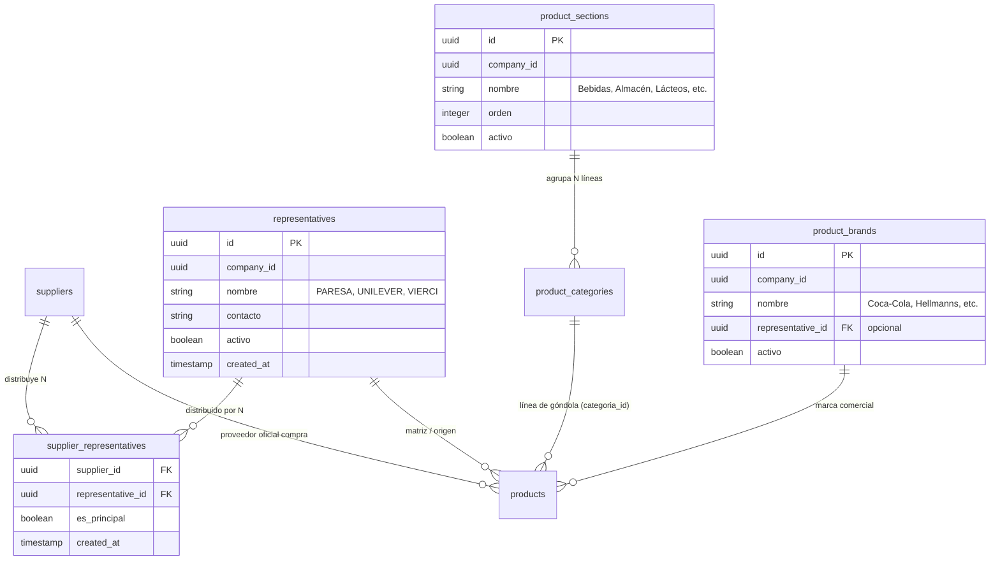

# Especificación de Diseño: Representantes y Taxonomía de Productos

**Fecha:** 2026-10-31  
**Vertical:** Extra Supermercado (Retail & Supermercado)  
**Estado:** Aprobado para Planificación  

---

## 1. Contexto y Justificación del Negocio

En el sistema legado (Visual Store / Nemuha MySQL), el campo libre `categoria` se utilizó históricamente para registrar conceptos heterogéneos sin distinción formal:
- **Distribuidores y Matrices Oficiales:** `PARESA` (128 productos), `SUR COMERCIAL`, etc.
- **Marcas comerciales y cooperativas:** `TREBOL` (126 productos).
- **Categorizaciones informales:** `VENENOS` (55 productos).

Para profesionalizar el maestro de artículos de Extra Supermercado, se define una separación estricta entre el **Canal de Abastecimiento** (quién lo fabrica y quién lo distribuye) y la **Taxonomía Comercial de Góndola** (cómo se exhibe y clasifica el producto).

---

## 2. Arquitectura de Datos y Modelos

### 2.1. Entidades Principales



### 2.2. Definición DDL / Modelos SQLAlchemy

1. **`representatives` (Tabla de Representantes / Matrices):**
   * `id`: UUID (Primary Key, server default `gen_random_uuid()`)
   * `company_id`: UUID (Not Null, Index)
   * `nombre`: VARCHAR(150) (Not Null)
   * `contacto`: VARCHAR(200) (Nullable)
   * `telefono`: VARCHAR(50) (Nullable)
   * `activo`: BOOLEAN (Default True)
   * `created_at`: TIMESTAMP WITH TIME ZONE (Default `now()`)

2. **`supplier_representatives` (Tabla de Distribución Comercial N:M):**
   * `supplier_id`: UUID (Foreign Key `suppliers.id`, Primary Key compuesta, ON DELETE CASCADE)
   * `representative_id`: UUID (Foreign Key `representatives.id`, Primary Key compuesta, ON DELETE CASCADE)
   * `es_principal`: BOOLEAN (Default False)
   * `created_at`: TIMESTAMP WITH TIME ZONE (Default `now()`)

3. **`product_sections` (Secciones / Departamentos Macro):**
   * `id`: UUID (Primary Key, server default `gen_random_uuid()`)
   * `company_id`: UUID (Not Null, Index)
   * `nombre`: VARCHAR(100) (Not Null)
   * `orden`: INTEGER (Default 0)
   * `activo`: BOOLEAN (Default True)

4. **`product_brands` (Maestro de Marcas):**
   * `id`: UUID (Primary Key, server default `gen_random_uuid()`)
   * `company_id`: UUID (Not Null, Index)
   * `nombre`: VARCHAR(120) (Not Null)
   * `representative_id`: UUID (Nullable, Foreign Key `representatives.id`, ON DELETE SET NULL)
   * `activo`: BOOLEAN (Default True)

5. **Modificaciones en `product_categories`:**
   * Se agrega la columna `section_id`: UUID (Nullable, Foreign Key `product_sections.id`, ON DELETE SET NULL).
   * Mantiene compatibilidad total con la columna histórica `categoria_id` de `products`.

6. **Modificaciones en `products`:**
   * `representative_id`: UUID (Nullable, Foreign Key `representatives.id`, ON DELETE SET NULL, Index).
   * `brand_id`: UUID (Nullable, Foreign Key `product_brands.id`, ON DELETE SET NULL, Index).
   * `tipo_variante`: VARCHAR(100) (Nullable, texto libre / sugerido ej. "Zero", "Entera", "Descremada", "Lata 269ml").

---

## 3. Endpoints Backend (FastAPI)

### 3.1. Gestión de Representantes (`/api/v1/representatives`)
* `GET /api/v1/representatives`: Listado con filtro de búsqueda y conteo de productos asociados.
* `POST /api/v1/representatives`: Creación de representante.
* `PATCH /api/v1/representatives/{id}`: Edición de nombre y datos de contacto.
* `DELETE /api/v1/representatives/{id}`: Baja lógica o física si no tiene dependencias.
* `GET /api/v1/suppliers/{supplier_id}/representatives`: Obtener representantes asignados al proveedor.
* `PUT /api/v1/suppliers/{supplier_id}/representatives`: Guardar lote de representantes distribuidos por el proveedor.

### 3.2. Gestión de Secciones y Marcas
* `GET /api/v1/product-sections`: Listado de secciones.
* `POST /api/v1/product-sections`: Crear sección.
* `PATCH /api/v1/product-sections/{id}`: Modificar sección.
* `GET /api/v1/product-brands`: Listado de marcas con paginación/búsqueda.
* `POST /api/v1/product-brands`: Crear marca.
* `PATCH /api/v1/product-brands/{id}`: Modificar marca.

### 3.3. Endpoint Canónico de Borrado Seguro de Categorías (`DELETE /api/v1/categories/{id}`)
* **Query param:** `reassign_to_id: UUID | None = None`.
* **Lógica del servicio:**
  1. Consulta `SELECT COUNT(*) FROM products WHERE categoria_id = :cat_id`.
  2. Si `count == 0`:
     * Ejecuta `DELETE FROM product_categories WHERE id = :cat_id`.
     * Retorna `{ "status": "ok", "deleted_id": cat_id, "reassigned_products": 0 }`.
  3. Si `count > 0` y `reassign_to_id is None`:
     * Lanza `HTTPException(status_code=409, detail="La categoría tiene productos asociados y requiere una categoría de destino para reasignar.")`.
  4. Si `count > 0` y `reassign_to_id` es válido:
     * En una sola transacción:
       ```sql
       UPDATE products 
       SET categoria_id = :reassign_to_id, updated_at = NOW() 
       WHERE categoria_id = :cat_id;

       DELETE FROM product_categories 
       WHERE id = :cat_id;
       ```
     * Retorna `{ "status": "ok", "deleted_id": cat_id, "reassigned_products": count }`.

---

## 4. Diseño de la Interfaz de Usuario (Frontend)

### 4.1. Ficha del Producto (Modal en `/products`)
* **Bloque Canal & Origen:**
  * `Proveedor Oficial`: Selector existente (`suppliers`).
  * `Representante`: Selector con búsqueda y botón `+` para crear nuevo al vuelo. Si el proveedor tiene representantes configurados, se destacan en el menú desplegable.
* **Bloque Taxonomía de Góndola:**
  * `Sección`: Selector con botón `+`.
  * `Línea / Categoría`: Selector con botón `+`. Si se selecciona una Sección, filtra las líneas pertenecientes a esa sección.
  * `Marca`: Selector con botón `+`.
  * `Tipo / Variante`: Input de texto asistido con sugerencias.

### 4.2. Panel "Clasificadores y Marcas" en `/products`
Se añade una pestaña secundaria o vista de gestión en la pantalla de Productos con 4 pestañas:
1. **Representantes:** Listado de matrices con buscador, cantidad de productos y multi-selector de qué proveedores lo comercializan.
2. **Categorías / Líneas:** Tabla con nombre, sección a la que pertenece, cantidad de productos y botones de Editar / Eliminar.
3. **Secciones:** Catálogo ordenable de departamentos de tienda.
4. **Marcas:** Buscador y lista alfabética de marcas con opción de vincularlas a su Representante.

### 4.3. Modal de Reasignación al Borrar Categoría
Cuando el usuario pulsa el cesto de basura en una categoría con productos asociados:
* Se bloquea la eliminación directa.
* Se despliega un diálogo emergente:
  > **⚠️ Reasignación obligatoria de productos**  
  > *La categoría `[Nombre]` tiene `N` productos asignados.*  
  > *Seleccione la categoría de destino para transferir estos productos antes de eliminar:*  
  > `[ Selector de Categoría Destino ]`  
  > `[ Cancelar ]`  `[ Reasignar y Eliminar ]`
* Al confirmar, se invoca `DELETE /api/v1/categories/{id}?reassign_to_id={destino_id}` y se actualiza la grilla reactivamente.

---

## 5. Estrategia de Migración y Datos Semilla

1. **Migración Alembic:**
   * Crea las tablas `representatives`, `supplier_representatives`, `product_sections`, `product_brands`.
   * Añade columnas `section_id` en `product_categories` y `representative_id`, `brand_id`, `tipo_variante` en `products`.
2. **Secciones Semilla Iniciales:**
   * Bebidas, Almacén / Despensa, Lácteos y Quesería, Carnicería, Verdulería y Frutería, Panadería y Confitería, Limpieza y Lavandería, Perfumería y Cuidado Personal, Bazar y Hogar, Mascotas.
3. **Representantes Semilla Detectados del Histórico:**
   * `PARESA`, `CERVEPAR`, `UNILEVER`, `BEBIDAS DEL PARAGUAY`, `VIERCI`, `CHORTITZER (TREBOL)`, `LACTOLANDA`, `TROVATO`, `IRIS`, `REAL SUL`.
4. **Reclasificación Segura:**
   * Los 128 productos de la categoría `PARESA` se reasignan a la categoría de línea `Gaseosas / Bebidas` y su `representative_id` se vincula a `PARESA`.

---

## 6. Verificación y Pruebas
1. **Pruebas de Integridad Referencial:** Comprobar que el borrado de una categoría sin `reassign_to_id` sea rechazado si tiene productos.
2. **Prueba Transaccional:** Validar que la reasignación mueva los productos a la nueva categoría y elimine la vieja sin dejar huérfanos.
3. **Prueba End-to-End con Playwright:** Validar en UI la creación rápida al vuelo con el botón `+`, el guardado de la ficha de producto y la visualización en la grilla.
